<p align="center">
  
</p>

<h1 align="center">Nhà hàng Ba Anh Em</h1>

<p align="center">Website đặt bàn, chọn món trước và quản lý vận hành nhà hàng món Việt.</p>

<p align="center">
  
  
  
  
  
</p>

<p align="center">
  <a href="#giao-dien">Xem giao diện</a> ·
  <a href="#cai-dat">Chạy local</a> ·
  <a href="#kien-truc">Xem kiến trúc</a> ·
  <a href="#api">Tài liệu API</a>
</p>

---

## Tổng quan

Khách có thể kiểm tra khung giờ còn chỗ, đặt bàn và gửi món muốn dùng trước khi đến. Nhân sự dùng khu vực vận hành để theo dõi lượt đặt, bố trí bàn theo ca, xem món cần chuẩn bị và đối chiếu cọc.

| Thành phần       | Phạm vi hiện tại                                                                                                                                                                            |
| ---------------- | ------------------------------------------------------------------------------------------------------------------------------------------------------------------------------------------- |
| **Web demo**     | Giao diện khách và vận hành chạy với dữ liệu mẫu trong bộ nhớ trình duyệt. Tải lại trang sẽ khôi phục trạng thái ban đầu. Trợ lý chat dùng quy tắc cục bộ và QR chỉ phục vụ minh họa.       |
| **API nền tảng** | NestJS cung cấp health check, OpenAPI, phiên khách và đăng nhập nhân sự qua OIDC. PostgreSQL 17 lưu dữ liệu nền và phiên khi được cấu hình. Giao diện nghiệp vụ đang dùng dịch vụ mô phỏng. |

Bản demo trong README được chạy ở local. Xem [bộ ảnh giao diện](#giao-dien) để khám phá sản phẩm hoặc [chạy bản demo](#cai-dat) để tương tác trực tiếp.

## Mục lục

- [Tính năng và vai trò](#tinh-nang)
- [Bộ ảnh giao diện](#giao-dien)
- [Công nghệ và kiến trúc](#kien-truc)
- [Luồng đặt bàn](#luong-dat-ban)
- [Cấu trúc thư mục](#cau-truc)
- [Cài đặt và khởi chạy](#cai-dat)
- [Biến môi trường](#bien-moi-truong)
- [API](#api)
- [Hướng dẫn dùng demo](#su-dung)
- [Kiểm thử và triển khai](#kiem-thu)
- [Định hướng, tác giả và giấy phép](#dinh-huong)

<a name="tinh-nang"></a>

## ✦ Tính năng và vai trò

| Vai trò demo      | Có thể trải nghiệm                                                                                                                                                                                                                                                                 |
| ----------------- | ---------------------------------------------------------------------------------------------------------------------------------------------------------------------------------------------------------------------------------------------------------------------------------- |
| **Khách hàng**    | Xem và tìm món theo tên hoặc nhóm, xem chi tiết, lên hóa đơn tạm tính. Kiểm tra chỗ, đặt bàn, lưu món, thử luồng cọc và xem trạng thái. Tra cứu lượt đặt, gửi yêu cầu đổi/hủy, gửi yêu cầu tiệc và đánh giá lượt đã dùng bữa. Chat hỗ trợ gợi ý món và thu thập thông tin đặt bàn. |
| **Nhân viên**     | Tìm lượt đặt theo mã hoặc lọc theo ca và tình trạng, ghi kết quả phục vụ, xem sơ đồ và phân bàn, theo dõi món bếp cần chuẩn bị, xử lý đối chiếu cọc mẫu.                                                                                                                           |
| **Quản trị viên** | Dùng các màn hình của nhân viên, xem báo cáo theo kỳ, quản trị món và trạng thái công bố, xử lý yêu cầu đổi/hủy, trả lời yêu cầu tiệc và duyệt đánh giá.                                                                                                                           |

<a name="giao-dien"></a>

## ◈ Bộ ảnh giao diện

Ảnh chụp bằng Playwright trên Chromium từ ứng dụng local. Viewport desktop là **1440 × 960** và mobile là **390 × 844**. Ảnh toàn trang có chiều cao theo nội dung. Số điện thoại mẫu được che ở những màn hình có hiển thị. Nhấp vào ảnh để xem kích thước đầy đủ.

### Trang chủ

Trang giới thiệu nhà hàng, có lối vào thực đơn, đặt bàn và các món nổi bật.

[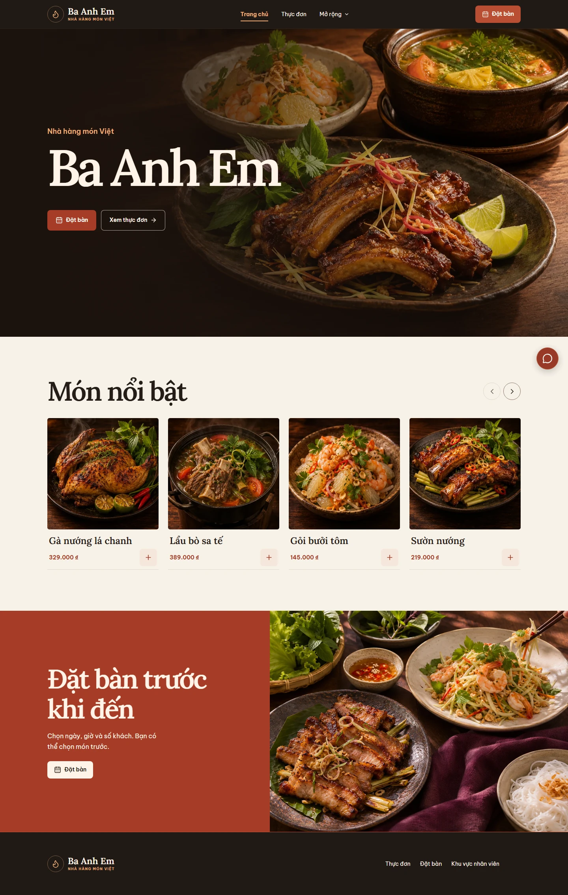](docs/assets/screenshots/desktop/trang-chu.webp)

<details>
<summary><strong>Khách hàng · Thực đơn, trợ lý và đặt bàn</strong></summary>

#### Thực đơn

Tìm món theo tên, chuyển nhóm và xem giá, trạng thái món. Ảnh hiển thị kết quả tìm kiếm món lẩu.

[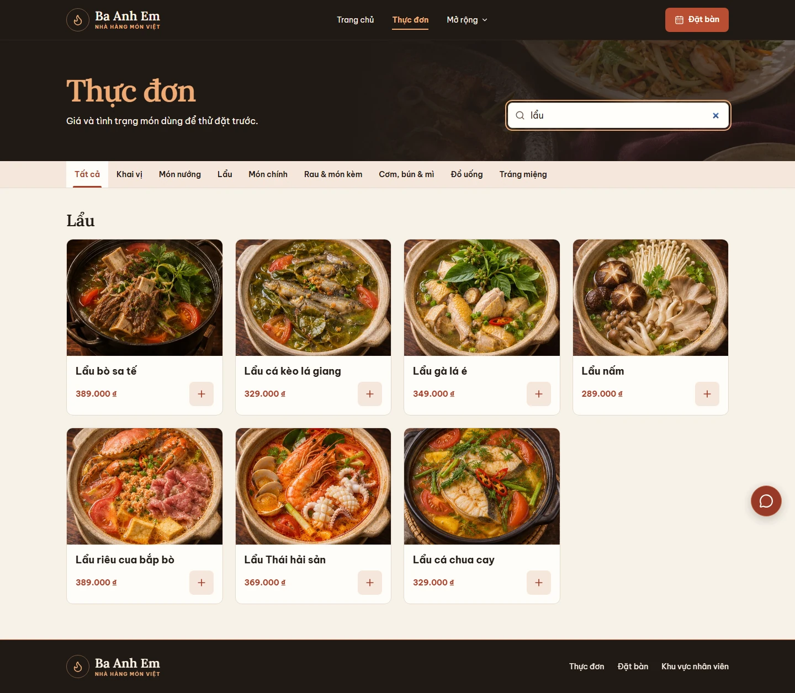](docs/assets/screenshots/desktop/thuc-don.webp)

#### Chi tiết món

Hộp thoại hiển thị ảnh, mô tả, giá và lối vào đặt bàn cho món còn phục vụ.

[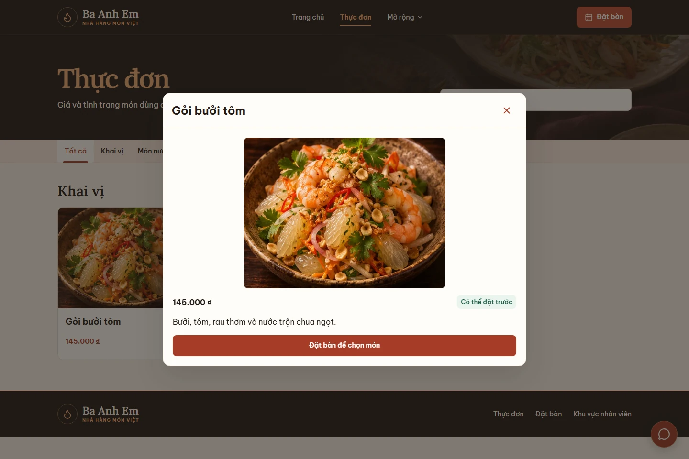](docs/assets/screenshots/desktop/chi-tiet-mon.webp)

#### Hóa đơn tạm tính

Điều chỉnh số lượng, xem tổng tiền món và chuyển danh sách sang luồng đặt bàn.

[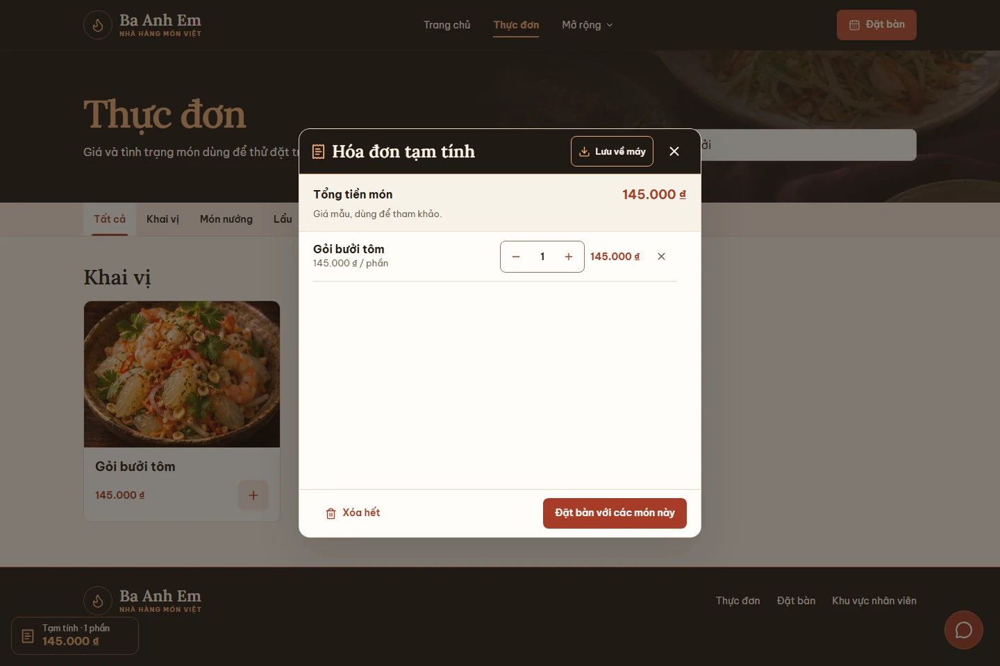](docs/assets/screenshots/desktop/bill-tam-tinh.webp)

#### Trợ lý Ba Anh Em

Cửa sổ chat đang gợi ý món cho nhóm bốn người từ thực đơn mẫu.

[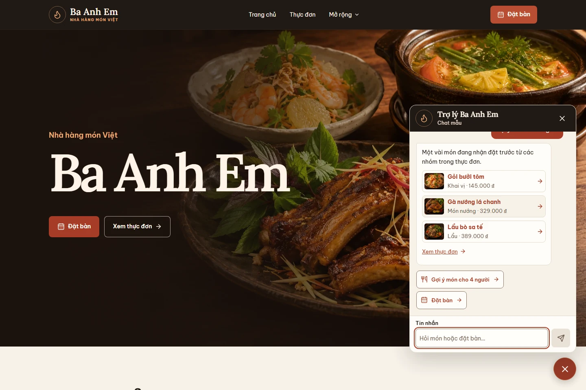](docs/assets/screenshots/desktop/tro-ly.webp)

#### Đặt bàn

Bước đầu kiểm tra giờ còn chỗ theo ngày và số khách. Hai ảnh tiếp theo ghi lại bước [nhập liên hệ](docs/assets/demo/dat-ban-lien-he.webp) và [kiểm tra yêu cầu](docs/assets/demo/dat-ban-kiem-tra.webp) trước khi gửi.

[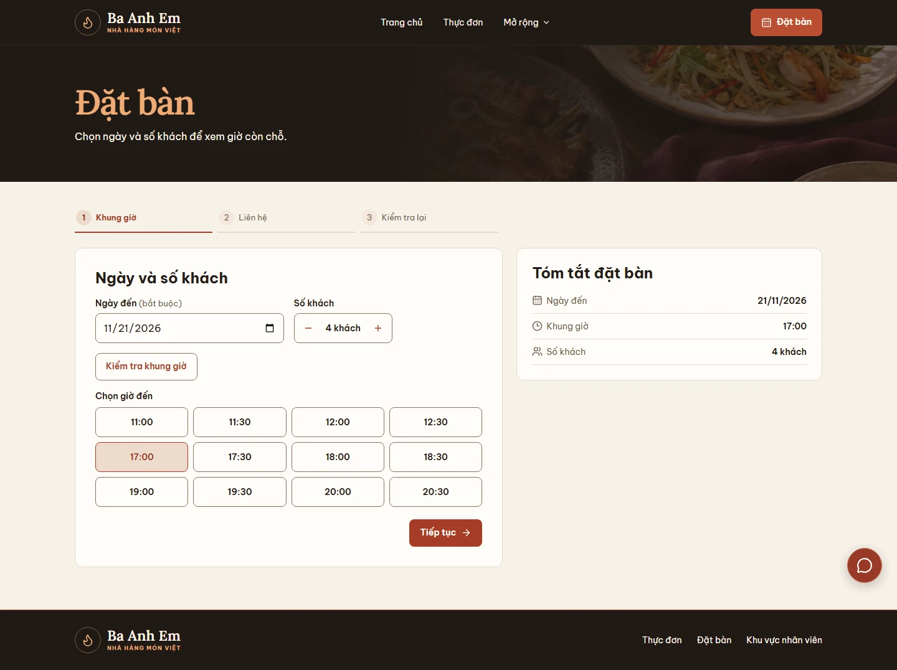](docs/assets/screenshots/desktop/dat-ban.webp)

#### Chọn món trước

Danh sách món và phần tổng hợp khi khách lưu món cho lượt đặt đã tạo. Ảnh tập trung vào phần thao tác và tóm tắt đang hiển thị.

[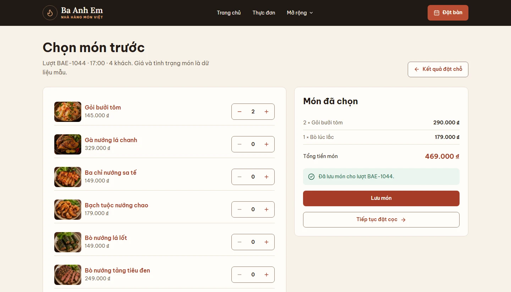](docs/assets/screenshots/desktop/chon-mon-truoc.webp)

#### Đặt cọc mẫu

Xem mã QR minh họa và mã tham chiếu, sau đó báo đã chuyển để kiểm tra trạng thái mẫu.

[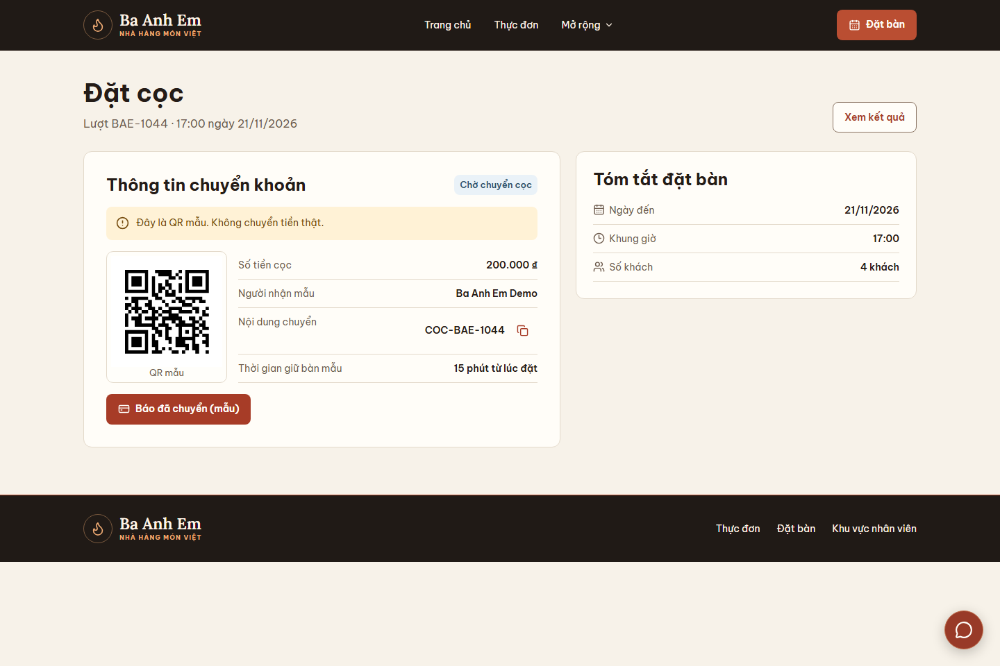](docs/assets/screenshots/desktop/dat-coc.webp)

#### Kết quả đặt bàn

Hiển thị mã lượt, bàn được phân, món đã lưu và tình trạng cọc sau khi xác minh mẫu.

[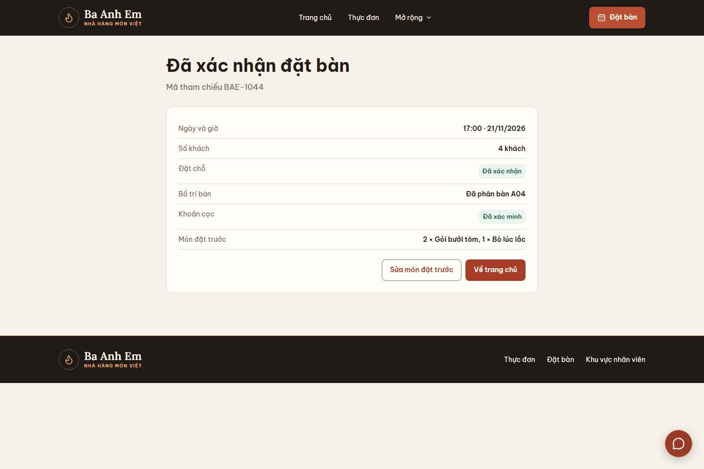](docs/assets/screenshots/desktop/ket-qua-dat-ban.webp)

</details>

<details>
<summary><strong>Khách hàng · Tra cứu, đổi/hủy, tiệc và đánh giá</strong></summary>

#### Tra cứu đặt chỗ

Dùng mã lượt và số điện thoại mẫu để tìm lượt đặt. Nút thông tin mẫu điền sẵn dữ liệu thử.

[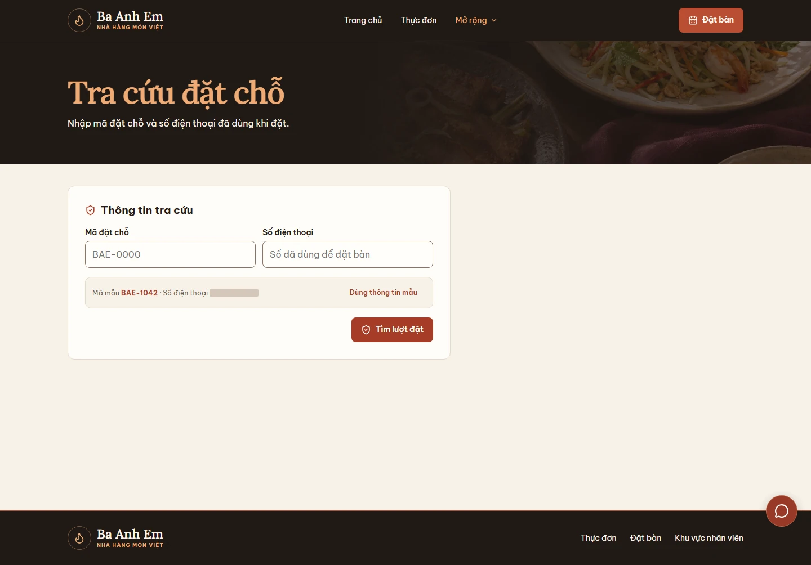](docs/assets/screenshots/desktop/tra-cuu-dat-cho.webp)

#### Yêu cầu đổi hoặc hủy

Sau khi tra cứu thành công, khách xem tình trạng và gửi lý do đổi/hủy để quản trị viên xử lý.

[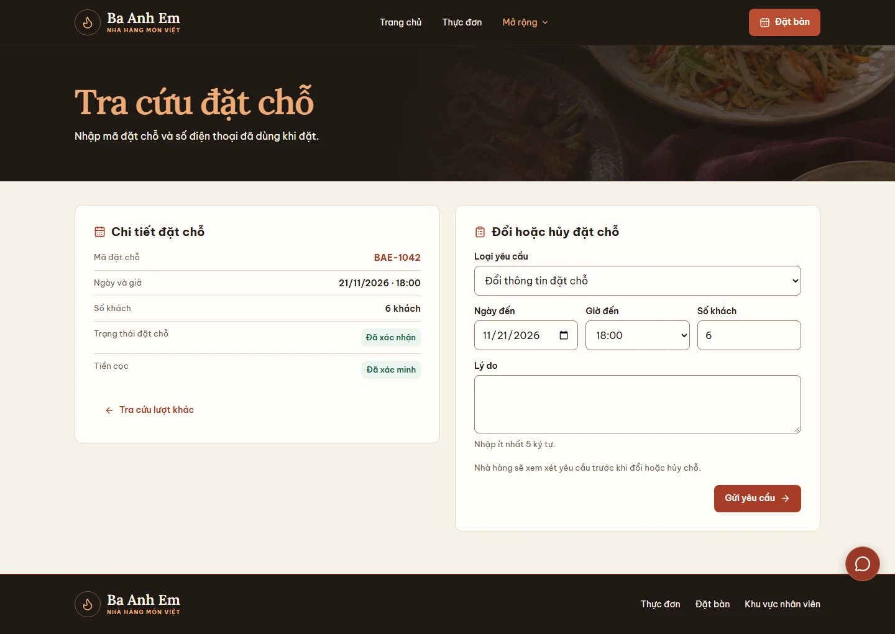](docs/assets/screenshots/desktop/yeu-cau-doi-huy.webp)

#### Đặt tiệc

Gửi ngày, giờ, số người, dịp tổ chức và nhu cầu để nhà hàng xem xét. [Kết quả gửi yêu cầu](docs/assets/demo/ket-qua-dat-tiec.webp) hiển thị mã và trạng thái tiếp nhận.

[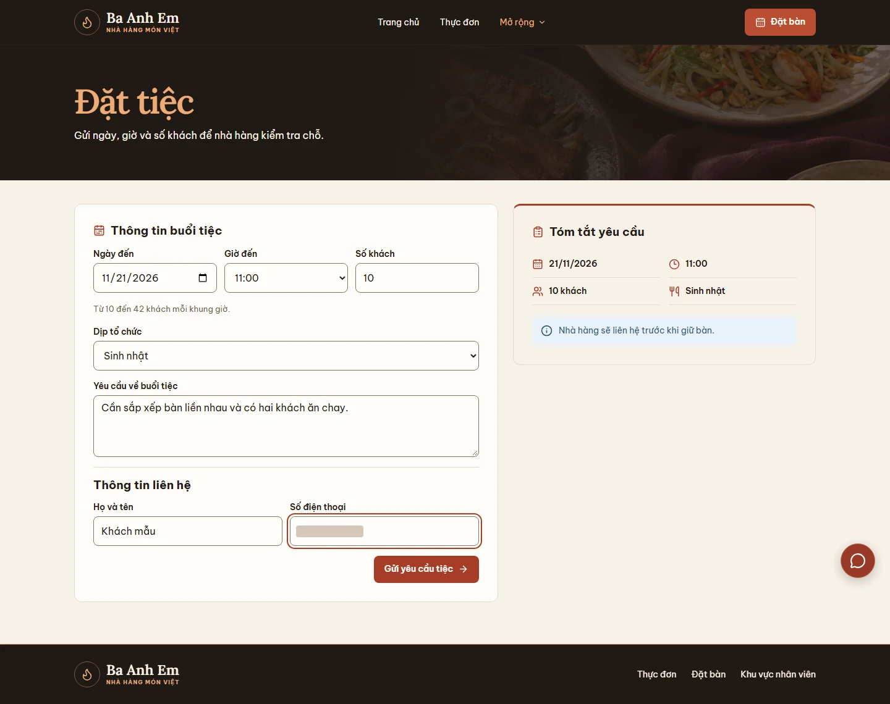](docs/assets/screenshots/desktop/dat-tiec.webp)

#### Đánh giá nhà hàng

Chọn số sao và viết nhận xét sau khi xác minh lượt đã dùng bữa. Trang cũng hiển thị đánh giá đã công bố. [Kết quả gửi đánh giá](docs/assets/demo/ket-qua-danh-gia.webp) ghi nhận nội dung đang chờ duyệt.

[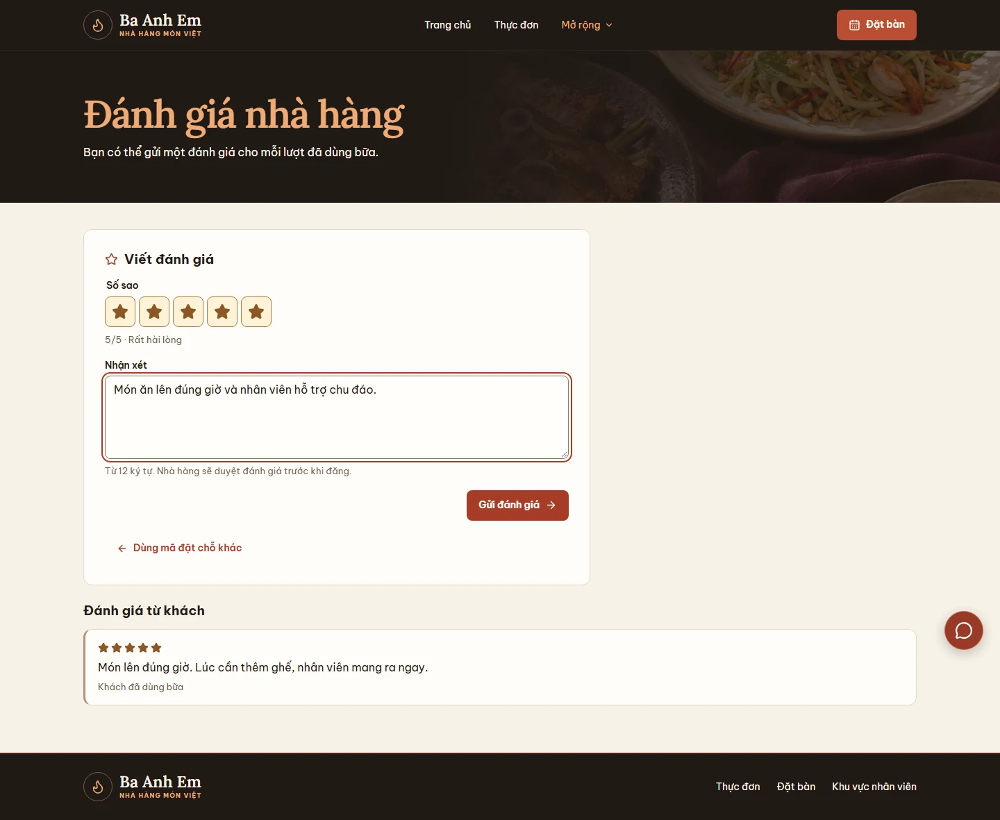](docs/assets/screenshots/desktop/danh-gia.webp)

</details>

<details>
<summary><strong>Nhân viên · Tiếp nhận, bàn, bếp và cọc</strong></summary>

#### Đăng nhập vận hành

Chọn vai trò nhân viên hoặc quản trị viên để vào bản demo.

[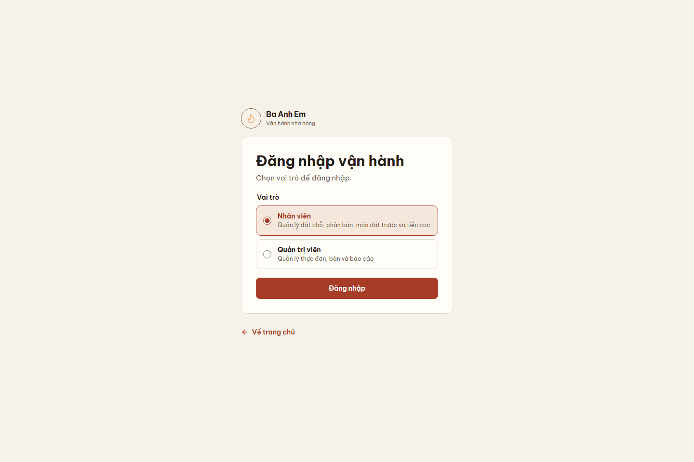](docs/assets/screenshots/desktop/van-hanh-dang-nhap.webp)

#### Danh sách đặt chỗ

Tìm theo mã hoặc lọc theo ngày, giờ và trạng thái. Mỗi dòng có liên kết vào chi tiết.

[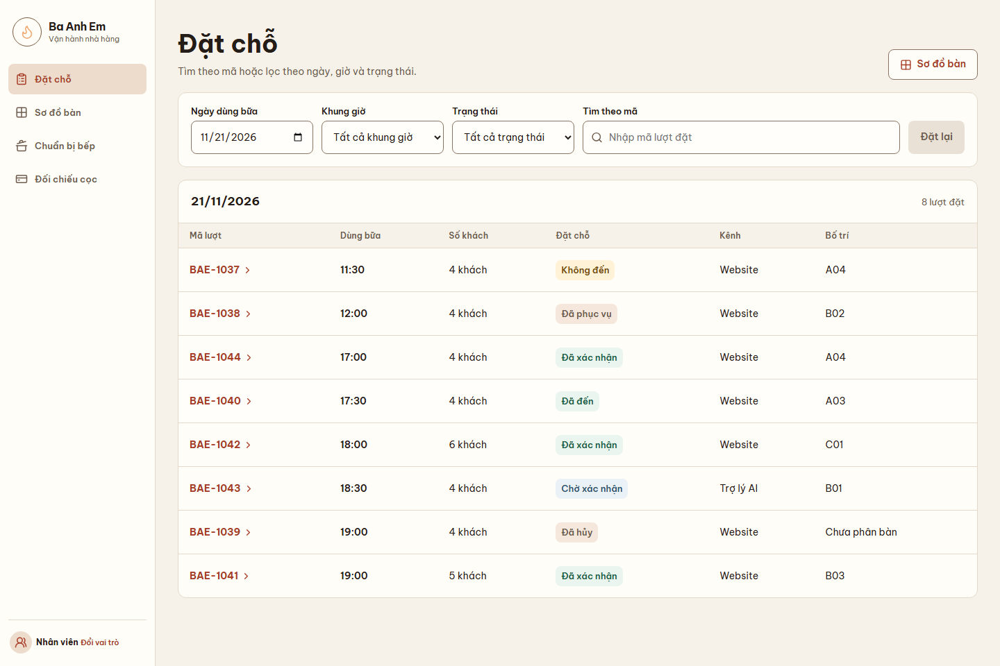](docs/assets/screenshots/desktop/van-hanh-dat-cho.webp)

#### Chi tiết lượt đặt

Theo dõi kết quả phục vụ, bố trí bàn, cọc và món đặt trước ở cùng một nơi.

[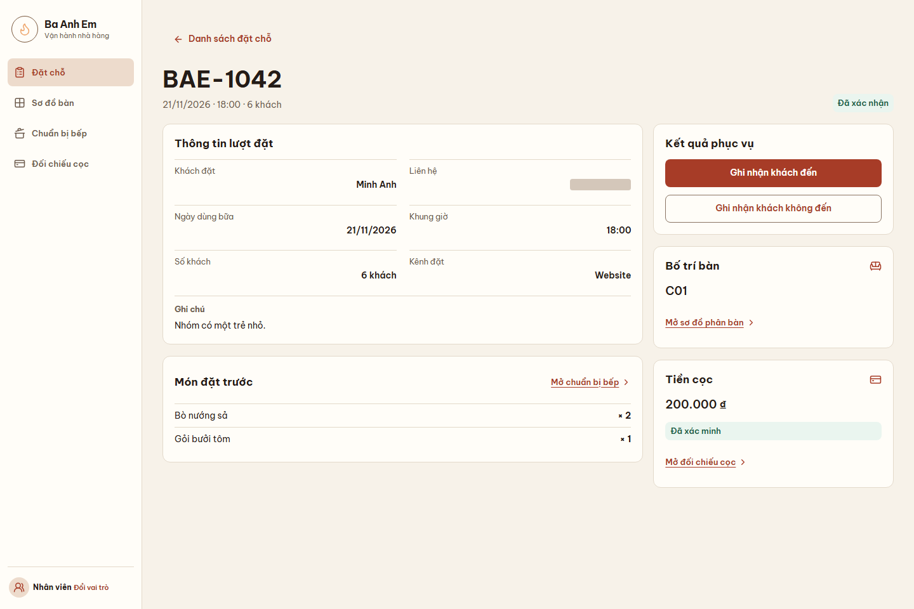](docs/assets/screenshots/desktop/van-hanh-chi-tiet-dat-cho.webp)

#### Sơ đồ và phân bàn

Xem tình trạng bàn theo giờ và khu vực, chọn bàn phù hợp cho một lượt đặt.

[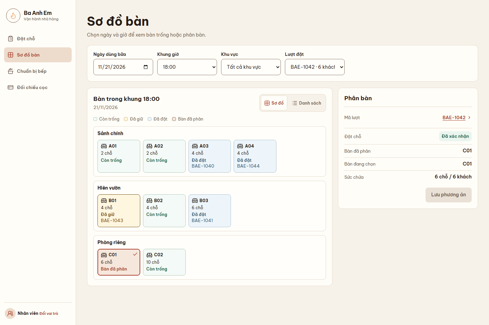](docs/assets/screenshots/desktop/van-hanh-so-do-ban.webp)

#### Chuẩn bị bếp

Nhóm món cần chuẩn bị theo khung giờ và hiển thị lượt có cập nhật món.

[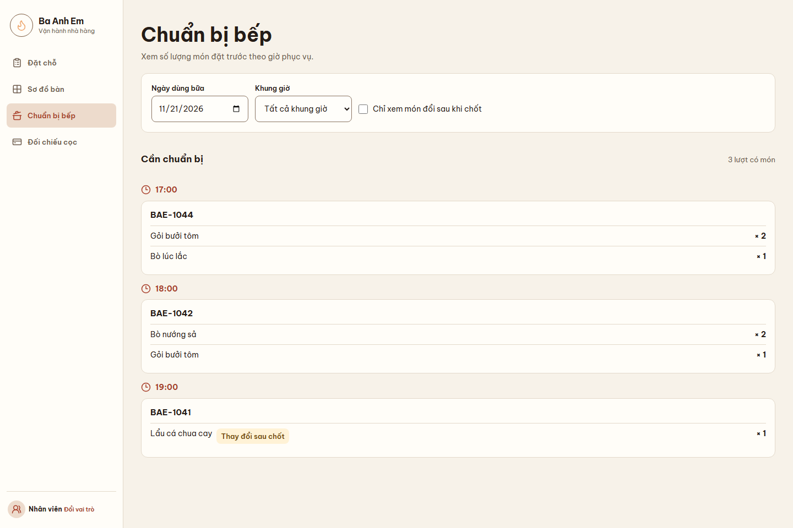](docs/assets/screenshots/desktop/van-hanh-chuan-bi-bep.webp)

#### Đối chiếu cọc

Theo dõi các khoản cọc theo trạng thái và mở [chi tiết giao dịch](docs/assets/screenshots/desktop/van-hanh-giao-dich-coc.webp) để đối chiếu.

[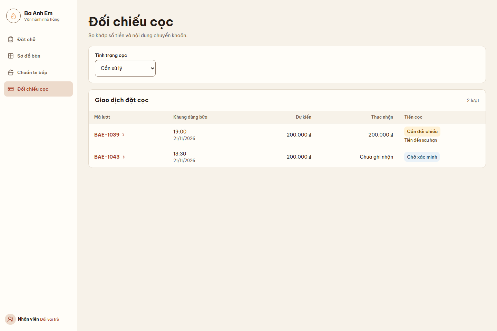](docs/assets/screenshots/desktop/van-hanh-doi-chieu-coc.webp)

</details>

<details>
<summary><strong>Quản trị viên · Báo cáo, thực đơn, tiệc và đánh giá</strong></summary>

#### Báo cáo

Tổng hợp lượt đặt, khách dự kiến, lượt không đến và số cọc đã xác minh theo ngày dùng bữa.

[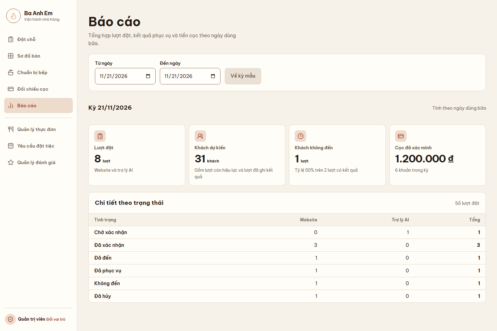](docs/assets/screenshots/desktop/van-hanh-bao-cao.webp)

#### Quản trị thực đơn

Tìm, thêm và sửa món, quản lý tình trạng phục vụ và trạng thái công bố. [Hộp thoại sửa món](docs/assets/screenshots/desktop/van-hanh-chinh-sua-mon.webp) hiển thị các trường chỉnh sửa.

[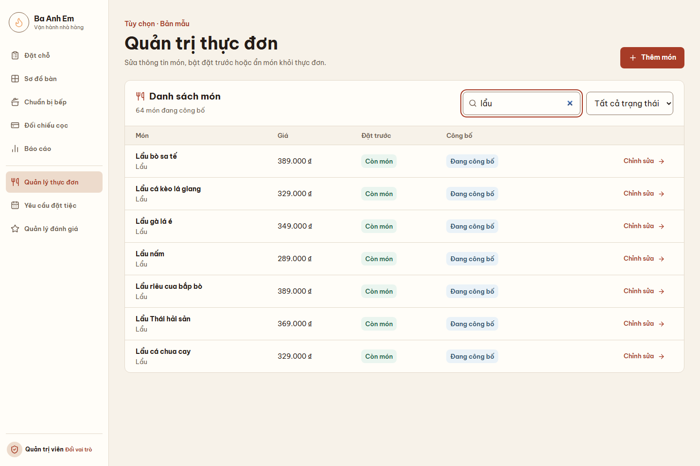](docs/assets/screenshots/desktop/van-hanh-quan-tri-thuc-don.webp)

#### Duyệt yêu cầu đổi hoặc hủy

Xem lý do, thông tin lượt và các điều kiện liên quan trước khi quyết định.

[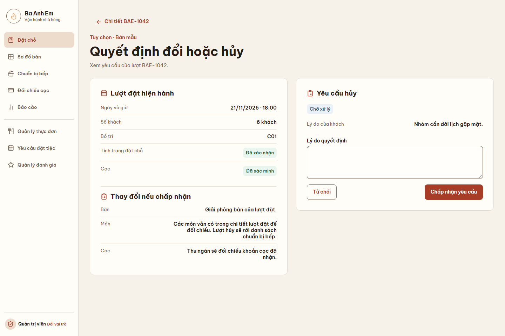](docs/assets/screenshots/desktop/van-hanh-duyet-doi-huy.webp)

#### Xử lý yêu cầu tiệc

Xem số khách, nhu cầu và khả năng bố trí trước khi phản hồi.

[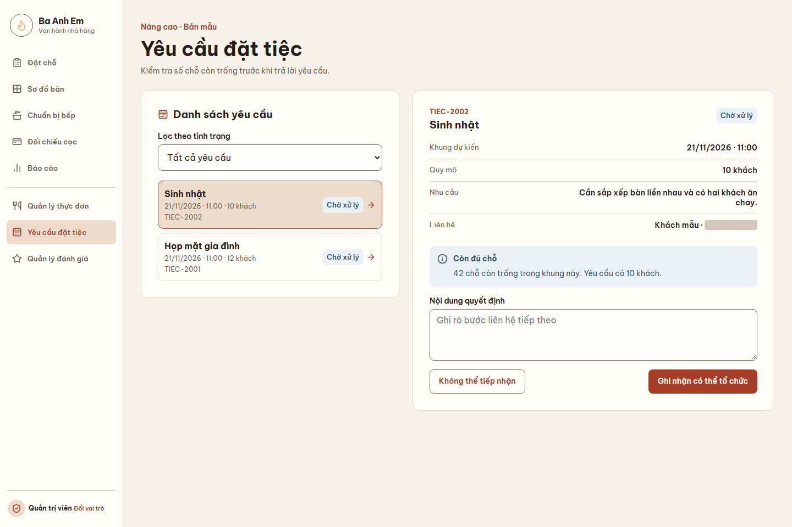](docs/assets/screenshots/desktop/van-hanh-yeu-cau-dat-tiec.webp)

#### Duyệt đánh giá

Xem nhận xét và điểm sao trong hàng đợi, rồi công bố hoặc từ chối.

[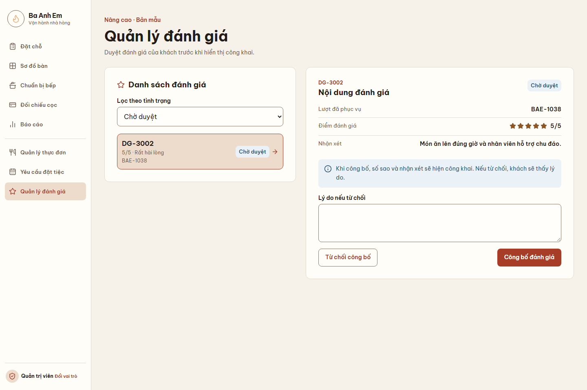](docs/assets/screenshots/desktop/van-hanh-duyet-danh-gia.webp)

</details>

<details>
<summary><strong>Mobile · Giao diện trên màn hình hẹp</strong></summary>

#### Trang chủ · Thực đơn · Đặt bàn

Trang chủ đưa khách vào luồng đặt bàn, thực đơn xếp món theo chiều dọc và bộ chọn giờ đáp ứng thao tác chạm.

<p>
  <a href="docs/assets/screenshots/mobile/trang-chu.webp">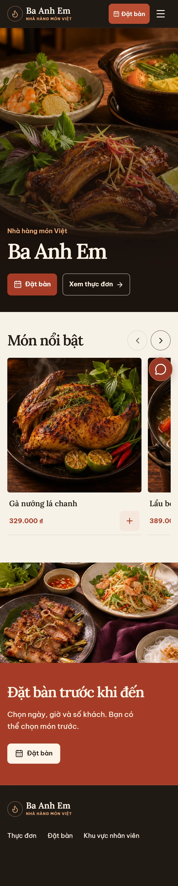</a>
  <a href="docs/assets/screenshots/mobile/thuc-don.webp">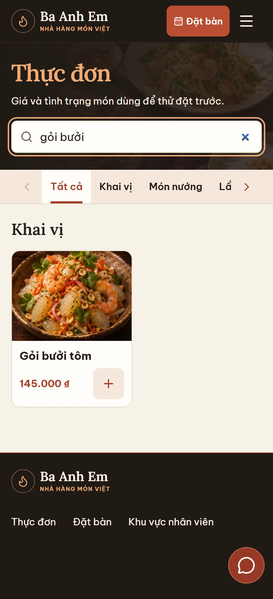</a>
  <a href="docs/assets/screenshots/mobile/dat-ban.webp">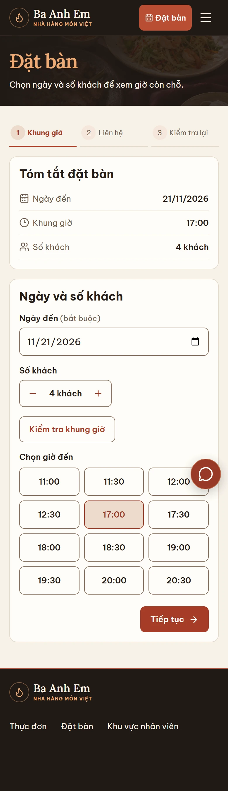</a>
</p>

#### Sơ đồ bàn · Trợ lý chat

Ở chiều rộng mobile, sơ đồ hiển thị dạng danh sách theo khu vực. Cửa sổ chat có khu vực hội thoại và ô nhập riêng.

<p>
  <a href="docs/assets/screenshots/mobile/van-hanh-so-do-ban.webp">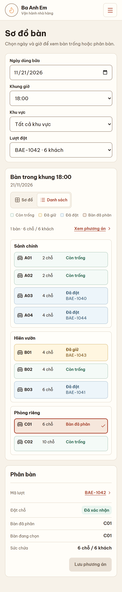</a>
  <a href="docs/assets/screenshots/mobile/tro-ly.webp">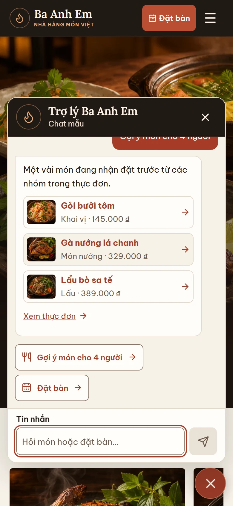</a>
</p>

- [Hóa đơn tạm tính](docs/assets/screenshots/mobile/bill-tam-tinh.webp) · Hộp thoại cập nhật số lượng và xem tổng tiền.
- [Chọn món trước](docs/assets/screenshots/mobile/chon-mon-truoc.webp) · Phần tổng hợp món đã lưu và lối vào đặt cọc.
- [Đặt cọc](docs/assets/screenshots/mobile/dat-coc.webp) · QR mẫu, mã tham chiếu và nút báo đã chuyển.
- [Kết quả đặt bàn](docs/assets/screenshots/mobile/ket-qua-dat-ban.webp) · Trạng thái đặt chỗ, cọc và danh sách món.
- [Đổi hoặc hủy](docs/assets/screenshots/mobile/yeu-cau-doi-huy.webp) · Chi tiết lượt đặt và biểu mẫu yêu cầu.
- [Đặt tiệc](docs/assets/screenshots/mobile/dat-tiec.webp) · Biểu mẫu gửi quy mô và nhu cầu tổ chức.
- [Đánh giá](docs/assets/screenshots/mobile/danh-gia.webp) · Bộ chọn sao và ô nhập nhận xét.
- [Đăng nhập vận hành](docs/assets/screenshots/mobile/van-hanh-dang-nhap.webp) · Bộ chọn vai trò dùng thử.
- [Danh sách đặt chỗ](docs/assets/screenshots/mobile/van-hanh-dat-cho.webp) · Bộ lọc và dữ liệu từng lượt trên màn hình hẹp.
- [Chi tiết lượt đặt](docs/assets/screenshots/mobile/van-hanh-chi-tiet-dat-cho.webp) · Tình trạng phục vụ, bàn, tiền cọc và món đặt trước.
- [Chuẩn bị bếp](docs/assets/screenshots/mobile/van-hanh-chuan-bi-bep.webp) · Nhóm món theo giờ phục vụ.
- [Đối chiếu cọc](docs/assets/screenshots/mobile/van-hanh-doi-chieu-coc.webp) · Danh sách giao dịch trình bày theo từng lượt.
- [Báo cáo](docs/assets/screenshots/mobile/van-hanh-bao-cao.webp) · Các chỉ số vận hành theo kỳ.

</details>

<details>
<summary><strong>Trạng thái phục hồi · Đường dẫn và quyền truy cập</strong></summary>

- [Không tìm thấy trang](docs/assets/screenshots/desktop/khong-tim-thay.webp) · Đưa khách về trang chủ khi mở đường dẫn không hợp lệ.
- [Giới hạn quyền truy cập](docs/assets/screenshots/desktop/van-hanh-gioi-han-quyen.webp) · Nhân viên được hướng về danh sách đặt chỗ khi mở route báo cáo.

</details>

<a name="kien-truc"></a>

## Công nghệ và kiến trúc

| Lớp     | Công nghệ trong repository                                                                                                       |
| ------- | -------------------------------------------------------------------------------------------------------------------------------- |
| Web     | React **19.3.1**, Vite **8.3.8**, React Router **7.18.6**, TanStack Query **5.108.1**, Lucide React, CSS, Lora và Be Vietnam Pro |
| API     | NestJS **12.5.1**, TypeScript **5.9.3**, Swagger/OpenAPI, `openid-client` **6.9.1**                                              |
| Dữ liệu | PostgreSQL **17**, Kysely **0.29.9**, `pg`                                                                                       |
| Công cụ | Node.js **24**, npm workspaces, ESLint, Prettier, Jest, Node Test Runner, Playwright, Docker Compose, GitHub Actions             |

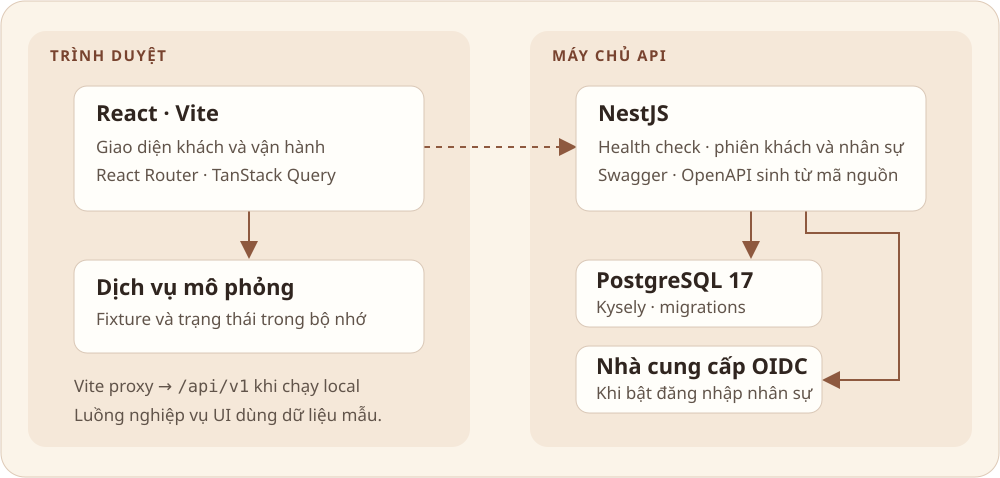

React Router phân tuyến khách và vận hành. TanStack Query đọc menu và lượt đặt từ dịch vụ mô phỏng, còn React Context giữ vai trò và trạng thái demo. Khi chạy local, Vite proxy các request `/api/v1` sang NestJS. Backend dùng Kysely nối PostgreSQL và có thể kết nối nhà cung cấp OIDC. [Mã tuyến web](apps/web/src/routes/index.tsx) · [Cấu hình Vite](apps/web/vite.config.ts) · [Điểm khởi động API](apps/api/src/api-app.ts)

<a name="luong-dat-ban"></a>

## Luồng đặt bàn

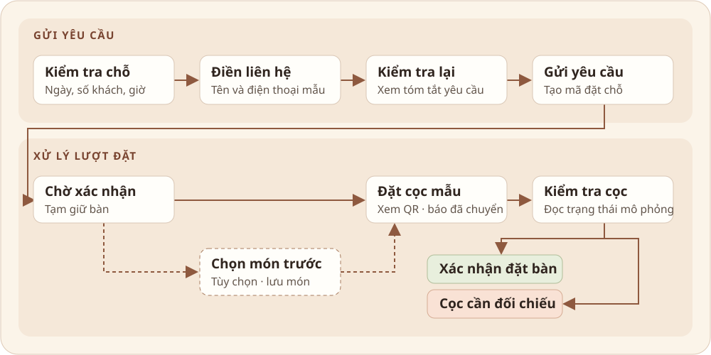

Lượt mới có mã tham chiếu và trạng thái chờ xác nhận. Khách có thể lưu món trước khi thử cọc. Luồng mẫu đưa lượt đặt sang trạng thái đã xác nhận khi cọc được xác minh. Với kịch bản cọc đến muộn, giao diện hiển thị ngoại lệ cần đối chiếu.

<a name="cau-truc"></a>

## Cấu trúc thư mục

```text
ba-anh-em/
├── apps/
│   ├── web/
│   │   ├── public/               # Ảnh món, banner trang chủ và QR mẫu
│   │   └── src/
│   │       ├── app/              # Layout và provider
│   │       ├── routes/           # Tuyến khách và vận hành
│   │       ├── features/         # Màn hình và chức năng
│   │       ├── mocks/            # Dữ liệu demo
│   │       ├── services/         # Mock service và HTTP client nền
│   │       └── shared/           # Model, phân quyền UI và CSS dùng chung
│   └── api/
│       ├── src/modules/auth/     # Phiên khách và đăng nhập nhân sự
│       ├── src/platform/         # Cấu hình, health, OpenAPI và migrations
│       └── test/integration/
├── packages/api-contract/       # OpenAPI sinh từ NestJS và kiểu TypeScript
├── infra/compose/                # PostgreSQL 17 cho local
├── tests/e2e/                    # Smoke test qua trình duyệt
├── docs/
│   ├── assets/
│   │   ├── banner/
│   │   ├── screenshots/
│   │   │   ├── desktop/
│   │   │   └── mobile/
│   │   ├── diagrams/
│   │   └── demo/
│   └── design/                   # Thiết kế UI, SQL và hợp đồng API dự kiến
└── .github/workflows/ci.yml
```

Tài liệu dự án gồm [đặc tả nghiệp vụ](docs/BRS-Nha-hang-Ba-Anh-Em.md), [cấu trúc và checklist nghiệm thu](docs/PROJECT_STRUCTURE.md), [kế hoạch triển khai](docs/IMPLEMENTATION_PLAN.md) và [đánh giá frontend khi tách từ Prototype](docs/FRONTEND_READINESS.md).

<a name="cai-dat"></a>

## Cài đặt và khởi chạy

Yêu cầu **Node.js 24.x từ 24.16.0** và **npm 11.x**. Trên PowerShell, dùng `npm.cmd` nếu chính sách thực thi chặn `npm.ps1`.

```sh
git clone https://github.com/trinhvietmyx/ba-anh-em.git
cd ba-anh-em
npm ci
npm run dev
```

- **Web** mở ở [127.0.0.1:5173](http://127.0.0.1:5173/). Phần demo khách và vận hành chạy ngay với fixture.
- **API** mặc định lắng nghe ở `127.0.0.1:3000`. Swagger mở tại [127.0.0.1:3000/api/v1/docs](http://127.0.0.1:3000/api/v1/docs).
- Chạy riêng web bằng `npm run dev -w @ba-anh-em/web`, hoặc riêng API bằng `npm run dev -w @ba-anh-em/api`. Nếu cổng web mặc định đang bận, dùng `npm run dev -w @ba-anh-em/web -- --port 5174` trong terminal dành cho web.

Workspace Prototype phục vụ đối chiếu được lưu riêng ngoài Git. Nếu máy đã có `apps/prototype`, có thể mở bằng `npm run dev:prototype`.

<details>
<summary><strong>Thiết lập PostgreSQL 17 cho backend</strong></summary>

Tạo `.env` từ [tệp mẫu](.env.example) khi cần cấu hình. Nếu chỉnh mật khẩu, cổng hoặc tên DB của Compose, cập nhật `MIGRATION_DATABASE_URL` cho khớp.

PowerShell

```powershell
if (-not (Test-Path -LiteralPath '.env')) {
  Copy-Item -LiteralPath '.env.example' -Destination '.env'
}
```

Linux hoặc macOS

```sh
test -f .env || cp .env.example .env
```

Dùng PostgreSQL 17 có sẵn hoặc khởi động DB local bằng Compose. Với Compose, chạy từ thư mục gốc.

```sh
docker compose --env-file .env -f infra/compose/compose.dev.yaml config --quiet
docker compose --env-file .env -f infra/compose/compose.dev.yaml up -d --wait
npm run build -w @ba-anh-em/api
npm run db:migrate -w @ba-anh-em/api
```

Dùng database local mới khi từng áp dụng [DDL kiểm chứng](docs/design/BACKEND_SCHEMA.sql) thủ công. Kysely ghi nhận `001_base` và `002_auth` trong `ba_anh_em.kysely_migration`. Đặt `DATABASE_URL` cho role runtime riêng. Nếu role chưa có, DBA có thể chạy `CREATE ROLE ba_anh_em_runtime LOGIN;` và đặt mật khẩu qua `\password ba_anh_em_runtime` trong `psql`. Sau đó cấp quyền đọc nền:

```sql
GRANT USAGE ON SCHEMA ba_anh_em TO ba_anh_em_runtime;
GRANT SELECT ON ba_anh_em.venues, ba_anh_em.kysely_migration TO ba_anh_em_runtime;
```

Để seed fixture DB, dùng database dùng thử có tên kết thúc bằng `_test` hoặc `_test_<id>`, đặt `NODE_ENV=test` và `BAE_TEST_SEED_DATABASE_URL` với quyền ghi, rồi chạy `npm run db:seed:test -w @ba-anh-em/api`. Lệnh `npm run db:validate:import -w @ba-anh-em/api -- <đường-dẫn-tuyệt-đối>` kiểm tra JSON bố trí bàn ở chế độ đọc. [Bộ kiểm tra JSON nhập](apps/api/src/platform/db/foundation-import.ts)

</details>

<a name="bien-moi-truong"></a>

## Biến môi trường

Mẫu cấu hình đầy đủ nằm trong [`.env.example`](.env.example).

| Biến                                                                          | Mục đích                                                                                                   |
| ----------------------------------------------------------------------------- | ---------------------------------------------------------------------------------------------------------- |
| `NODE_ENV`                                                                    | `development` mặc định, `test` hoặc `production`. Production đọc môi trường của tiến trình và tắt Swagger. |
| `API_HOST`, `API_PORT`                                                        | Địa chỉ IP và cổng NestJS, mặc định `127.0.0.1:3000`. Vite dùng `API_PORT` cho proxy local.                |
| `API_CORS_ORIGINS`                                                            | Danh sách origin HTTP/HTTPS chính xác, phân cách bằng dấu phẩy. Để trống khi dùng proxy cùng origin.       |
| `POSTGRES_DB`, `POSTGRES_USER`, `POSTGRES_PASSWORD`, `POSTGRES_PORT`          | Cấu hình PostgreSQL local qua Compose.                                                                     |
| `MIGRATION_DATABASE_URL`, `DATABASE_URL`                                      | Kết nối cho lệnh migration và kết nối riêng cho API lúc chạy.                                              |
| `APP_ORIGIN`, `GUEST_SESSION_TTL_SECONDS`                                     | Origin của web cùng API và hạn phiên khách tính bằng giây.                                                 |
| `OIDC_ISSUER`, `OIDC_CLIENT_ID`, `OIDC_CLIENT_SECRET`                         | Thông tin nhà cung cấp OIDC khi bật đăng nhập nhân sự.                                                     |
| `STAFF_VENUE_CODE`, `STAFF_SESSION_TTL_SECONDS`, `STAFF_SESSION_IDLE_SECONDS` | Mã nhà hàng, thời hạn phiên tuyệt đối và giới hạn không hoạt động tính bằng giây.                          |
| `AUTH_RATE_LIMIT_PER_MINUTE`                                                  | Số yêu cầu mặc định **60** mỗi phút theo endpoint phiên và địa chỉ kết nối của từng tiến trình API.        |
| `BAE_TEST_SEED_DATABASE_URL`                                                  | Kết nối có quyền ghi dành cho seed database dùng thử.                                                      |

<details>
<summary><strong>Bật phiên khách hoặc đăng nhập nhân sự bằng API</strong></summary>

- Đặt `APP_ORIGIN` đúng với origin trình duyệt, ví dụ `http://127.0.0.1:5173` khi phát triển. Production yêu cầu HTTPS.
- Phiên khách cần `GUEST_SESSION_TTL_SECONDS` và quyền `SELECT, INSERT` trên `ba_anh_em.guest_sessions`. Endpoint nhận `Origin` khớp cấu hình và trả CSRF token.
- Đăng nhập nhân sự cần đủ biến nhóm OIDC và nhân sự. IdP hỗ trợ PKCE S256, `client_secret_basic` và JWKS, với redirect URI `${APP_ORIGIN}/api/v1/ops/auth/callback`. Mã nhà hàng khớp `venues.code`. Danh tính dùng cặp issuer/subject trong `staff_users` và quyền theo địa điểm trong `staff_venue_grants`.
- Cookie phiên dùng `HttpOnly`, `Secure` và `SameSite=Lax`. Khi đứng sau reverse proxy, giới hạn yêu cầu tính theo địa chỉ kết nối trực tiếp tới API.

```sql
GRANT SELECT ON ba_anh_em.staff_users, ba_anh_em.staff_venue_grants TO ba_anh_em_runtime;
GRANT SELECT, INSERT ON ba_anh_em.staff_sessions TO ba_anh_em_runtime;
GRANT UPDATE (idle_expires_at, revoked_at) ON ba_anh_em.staff_sessions TO ba_anh_em_runtime;
GRANT SELECT, INSERT, DELETE ON ba_anh_em.staff_login_attempts TO ba_anh_em_runtime;
```

Các endpoint phiên trả `503` khi thiếu cấu hình hoặc kết nối DB. Chọn vai trò trên [trang vận hành demo](#su-dung) diễn ra trong frontend.

</details>

<a name="api"></a>

## API

Prefix của API là `/api/v1`. Bảng dưới đây liệt kê các endpoint trong OpenAPI sinh từ NestJS.

| Method   | Đường dẫn sau prefix | Chức năng                                                                                          |
| -------- | -------------------- | -------------------------------------------------------------------------------------------------- |
| `GET`    | `/health/live`       | Kiểm tra tiến trình API đang phản hồi.                                                             |
| `GET`    | `/health/ready`      | Kiểm PostgreSQL 17, quyền đọc dữ liệu nền và các migration. Trả `503 NOT_READY` nếu chưa sẵn sàng. |
| `POST`   | `/guest/session`     | Cấp hoặc khôi phục phiên khách và trả CSRF token.                                                  |
| `GET`    | `/ops/auth/login`    | Bắt đầu đăng nhập qua OIDC.                                                                        |
| `GET`    | `/ops/auth/callback` | Xử lý phản hồi OIDC, tạo phiên nhân sự và chuyển hướng.                                            |
| `GET`    | `/ops/session`       | Đọc phiên nhân sự và quyền theo nhà hàng.                                                          |
| `DELETE` | `/ops/session`       | Kết thúc phiên nhân sự.                                                                            |

Swagger UI nằm ở `/api/v1/docs` và tài liệu JSON nằm ở `/api/v1/openapi.json` ngoài production. Phản hồi API có `X-Trace-Id` để đối chiếu log. [Ảnh Swagger local](docs/assets/screenshots/desktop/swagger-api.webp) · [OpenAPI hiện hành](packages/api-contract/generated/openapi.json) · [Hướng dẫn hợp đồng](packages/api-contract/README.md)

Bản đặc tả endpoint nghiệp vụ dự kiến được lưu trong [OpenAPI thiết kế](docs/design/BACKEND_OPENAPI.yaml).

<a name="su-dung"></a>

## Hướng dẫn dùng demo

1. **Khách hàng** mở [trang chủ local](http://127.0.0.1:5173/), chọn **Đặt bàn**, kiểm tra giờ và chọn **Dùng thông tin mẫu** ở bước liên hệ.
2. **Chọn món và cọc** mở **Chọn món trước**, lưu món, sau đó chọn **Báo đã chuyển (mẫu)** và **Kiểm tra tiền cọc**. QR trên trang là ảnh minh họa.
3. **Tra cứu hoặc đánh giá** mở mục **Mở rộng** trên thanh điều hướng. Dùng nút thông tin mẫu để thử tra cứu lượt đặt hoặc xác minh một lượt đã dùng bữa.
4. **Nhân viên hoặc quản trị viên** chọn **Khu vực nhân viên** ở chân trang hoặc mở [`/van-hanh`](http://127.0.0.1:5173/van-hanh). Chọn vai trò rồi mở các mục trong thanh điều hướng vận hành. Giữ cùng tab khi chuyển từ thao tác khách sang vận hành để xem dữ liệu vừa tạo.

Trong môi trường dev, query `?kich-ban=slot-conflict`, `?kich-ban=late-deposit` hoặc `?kich-ban=menu-error` bật kịch bản mô phỏng khi mở route. [Danh sách kịch bản](apps/web/src/mocks/fixtures.ts)

<a name="kiem-thu"></a>

## Kiểm thử và triển khai

```sh
npm run lint
npm run format:check
npm run typecheck
npm run test:unit
npm run build
npm run contract:check
npm run test:integration
npm exec -- playwright install --only-shell chromium
npm run test:e2e
```

- **Tích hợp** dùng `BAE_TEST_DATABASE_URL` cho readiness và `BAE_TEST_POSTGRES_ADMIN_URL` cho các ca migration, phiên và phân quyền trên cluster thử nghiệm. Suite phiên dùng IdP giả lập.
- **Playwright** tự chạy Vite và NestJS trên cổng loopback `5317` và `3310`. Có thể đổi bằng `BAE_E2E_WEB_PORT` và `BAE_E2E_API_PORT`. Mặc định smoke test kiểm liveness `200` và readiness `503` khi chưa có DB. Với DB thử đã migrate và quyền phiên khách, đặt `BAE_TEST_DATABASE_URL` cùng `BAE_E2E_GUEST_SESSION=1` để chạy ca cookie.
- **Hợp đồng API** được tạo lại bằng `npm run contract:generate` sau khi thay đổi route hoặc dữ liệu trả về. [Hướng dẫn sinh hợp đồng](packages/api-contract/README.md)

[GitHub Actions](.github/workflows/ci.yml) định nghĩa kiểm tra chất lượng, bí mật trong Git, dependency, build, hợp đồng, test tích hợp PostgreSQL 17 và smoke test. Để chuẩn bị triển khai, dùng `npm run build`, phục vụ `apps/web/dist` với SPA fallback, chạy `npm run start -w @ba-anh-em/api` và cấu hình reverse proxy chuyển `/api/v1` sang NestJS. Khi bật phiên, triển khai web và API cùng origin qua HTTPS. [Lộ trình staging và phát hành](docs/superpowers/plans/2026-11-25-backend-roadmap.md)

<a name="dinh-huong"></a>

## Định hướng phát triển

- Kết nối NestJS với các luồng thực đơn, sức chứa, đặt bàn, món trước, phân bàn, bếp và báo cáo.
- Nối đăng nhập vận hành với phiên OIDC và áp dụng quyền trên API nghiệp vụ.
- Kiểm chứng Groq và VietQR trên staging theo cấu hình được duyệt, bổ sung kiểm thử các tình huống trùng bàn và đối chiếu cọc.
- Hoàn thiện luồng tiệc, đánh giá và công cụ nghiệp vụ của chat theo phạm vi được duyệt.

[Lộ trình backend](docs/superpowers/plans/2026-11-25-backend-roadmap.md) · [Ánh xạ frontend/backend](docs/design/FRONTEND_BACKEND_MAPPING.md)

## Tác giả và giấy phép

**Trịnh Viết Mỹ**, tác giả được ghi nhận trong lịch sử Git. [GitHub](https://github.com/trinhvietmyx)

Giấy phép chưa được khai báo trong repository.
