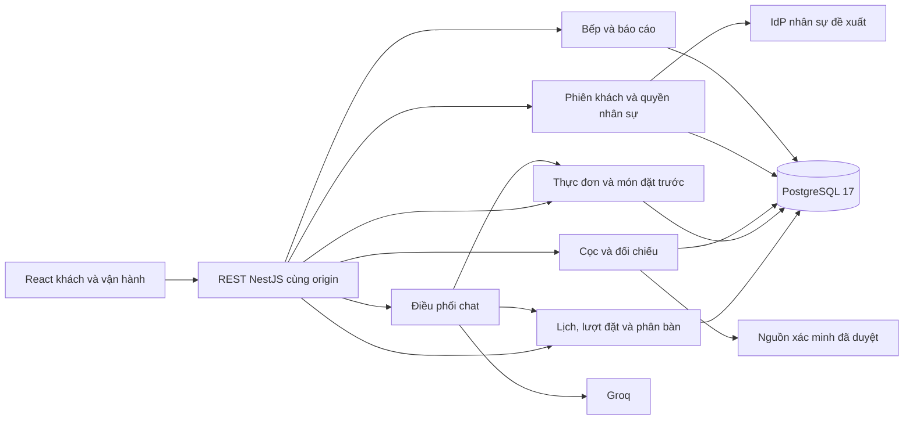

# Giai đoạn 1 · Rà soát Frontend Nhà hàng Ba Anh Em

**Ngày 25/11/2026 · COMPLETED phần phân tích · PENDING phần duyệt**

Mục tiêu của giai đoạn này là đối chiếu màn hình, luồng và dữ liệu hiện có với đề bài, rồi xác định những gì Backend cần cung cấp. `apps/web` đã có giao diện khách, chatbot và vận hành trên dữ liệu mô phỏng. `apps/api` đang ở mức khởi động NestJS với prefix `/api/v1`. Để demo nhận đặt thật, hệ thống cần ghi cùng một lượt từ web hoặc chat vào nguồn dữ liệu bền vững, kiểm quyền trên lượt đó và phản ánh đúng kết quả ở vận hành, bếp, cọc và báo cáo. [Yêu cầu khởi đầu](MASTER_BACKEND_PROMPT.md) · [BRS](BRS-Nha-hang-Ba-Anh-Em.md) · [API hiện tại](../apps/api/src/main.ts)

**Cập nhật sau rà soát.** Chủ dự án duyệt NestJS, PostgreSQL 17 và dùng màn hình `/van-hanh/thuc-don` trong MVP. MVP nghiệm thu cả quản lý và hiển thị thực đơn, đồng thời cho khách đặt và nhận kết quả qua chat. Phân loại UC-02 tùy chọn và số thao tác API bên dưới là hiện trạng lúc rà soát. [Kiến trúc](design/BACKEND_ARCHITECTURE.md) · [Ánh xạ hiện hành](design/FRONTEND_BACKEND_MAPPING.md)

## 1. Hiện trạng Frontend và nền dự án

- **Công nghệ.** npm workspaces, Node.js 24, TypeScript 5.9, React 19, Vite 8, React Router 7, TanStack Query 5, Lucide và CSS riêng theo feature. Lora và Be Vietnam Pro là font cục bộ. Nền API dùng NestJS 12 với Express, Jest và Compose cho PostgreSQL 17. CI kiểm lint, format, kiểu, unit, build, dependency, secret đã commit và cấu hình Compose. [Cấu hình workspace](../package.json) · [Web](../apps/web/package.json) · [API](../apps/api/package.json) · [CI](../.github/workflows/ci.yml)
- **Điều hướng và component.** `BrowserRouter` tách layout khách có điều hướng, footer và `ChatWidget` khỏi `OpsLayout` có kiểm vai trò UI. Router chuyển `/van-hanh` sang danh sách đặt chỗ và có trang phục hồi cho đường dẫn lạ. Các feature gồm `home`, `menu`, `booking`, `preorder`, `chat`, `operations`, `extensions`. `shared/ui.tsx` cung cấp component trạng thái và hộp thoại. `/tro-ly` mở cùng widget trên nền trang chủ. [Điểm khởi động](../apps/web/src/main.tsx) · [Router](../apps/web/src/routes/index.tsx) · [Layout khách](../apps/web/src/app/public-layout.tsx) · [UI dùng chung](../apps/web/src/shared/ui.tsx)
- **Dữ liệu và state.** `RestaurantProvider` khởi tạo `createMockRestaurantApi()` và đặt dữ liệu menu/đặt chỗ vào React Query, dùng fixture làm `initialData`. Mọi trang dưới provider hiện có thể đọc cùng danh sách lượt. Tạo/sửa lượt làm mới cache mock, cập nhật menu thay cả mảng. Vai trò, lượt đang mở, giỏ nháp và chế độ mở rộng là state trong bộ nhớ. `ExtensionsProvider` giữ tiệc, đánh giá và yêu cầu đổi/hủy bằng `useState`. Reload khởi tạo lại dữ liệu, phiên và ngữ cảnh lượt. [Provider](../apps/web/src/app/restaurant-context.tsx) · [Mock service](../apps/web/src/services/mock-restaurant-api.ts) · [Extensions](../apps/web/src/features/extensions/extensions.tsx)
- **Dữ liệu mô phỏng.** Có 64 bản ghi món, 7 lượt, 9 bàn, 12 mốc giờ và 11 kịch bản. Logic khả dụng chọn bàn đơn đủ chỗ và kiểm chồng theo khoảng cách 90 phút. Ngày gốc `2026-11-21`, mức cọc `200.000 ₫`, giới hạn 12 phần mỗi món và trần 10 khách trong chat là tham số demo. Bàn vận hành cho chọn nhiều bàn, vì vậy chính sách ghép bàn phải được chốt trước khi dùng cùng một kết quả khả dụng cho khách và vận hành. [Fixtures](../apps/web/src/mocks/fixtures.ts) · [Model](../apps/web/src/shared/model.ts) · [Chat](../apps/web/src/features/chat/chat.tsx)
- **Transport và dữ liệu trả về.** `createHttpClient` đã xử lý JSON, `204`, `AbortSignal` và dạng lỗi `code`, `message`, `fields`, `traceId`, `retryable`. Feature chưa gọi client này. Vite chỉ proxy `/api/v1` ở dev. `AppModule` rỗng, chưa có route nghiệp vụ, kết nối DB hay health endpoint. Workspace `api-contract` dành cho type sinh từ OpenAPI và hiện mới có mô tả. `Booking` hiện gộp liên hệ, phân bàn, món, cọc, lịch sử và trạng thái. API cần dạng trả về phù hợp với quyền từng màn hình. [HTTP client](../apps/web/src/services/http-client.ts) · [Vite](../apps/web/vite.config.ts) · [AppModule](../apps/api/src/app.module.ts) · [Workspace contract](../packages/api-contract/README.md)
- **Tìm kiếm, lọc và tệp.** Menu tìm theo chữ đã bỏ dấu, lọc nhóm và mở chi tiết theo mã món. Danh sách đặt chỗ tìm mã qua các ngày khi có `q`, lọc giờ/trạng thái và xếp ngày, giờ, mã. Bếp lọc ngày/giờ/lượt thay đổi. Hàng đợi cọc lọc trạng thái và ưu tiên ca trễ. Báo cáo lọc kỳ. Các danh sách hiện lọc mảng, chưa phân trang. Hóa đơn tạm xuất `.txt` tại trình duyệt. Ảnh món và QR demo được phục vụ từ `public/images`. Form hiện tại nhập dữ liệu có cấu trúc, chưa có trường tải tệp. [Menu](../apps/web/src/features/menu/catalog.tsx) · [Hóa đơn tạm](../apps/web/src/features/preorder/temporary-bill.tsx) · [Vận hành](../apps/web/src/features/operations/operations.tsx)

## 2. Nghiệp vụ, tác nhân và yêu cầu Backend

- **Khách và chatbot.** Xem thực đơn công bố, kiểm khả dụng theo ngày/số khách, xác nhận lượt, đọc kết quả và đặt món/cọc trong quyền với lượt của mình. Đặt qua chat dùng cùng quy tắc và hiển thị cùng mã với vận hành. Khi giờ vừa hết, phải kiểm và trả lựa chọn thay thế hợp lệ. Khi mất phản hồi, có đường tra kết quả và gửi lại cùng ý định. Chat tư vấn từ thực đơn thật, làm rõ ngày/giờ tương đối và chuyển sang web nếu dịch vụ gián đoạn. [BRS UC-01, UC-03–04, UC-06, UC-08, UC-17–18](BRS-Nha-hang-Ba-Anh-Em.md#5-đặc-tả-chức-năng-và-use-case)
- **Điều phối và quản lý.** Lọc danh sách, xem dữ liệu thuộc quyền, xem bàn theo khung, phân lại bàn và ghi nhận đến, phục vụ hoặc no-show. API kiểm sức chứa, xung đột và phiên bản trước khi đổi. Khi phương án mới thất bại, phương án cũ giữ hiệu lực. Quản lý đọc báo cáo theo định nghĩa đã duyệt. [BRS UC-11–16](BRS-Nha-hang-Ba-Anh-Em.md#5-đặc-tả-chức-năng-và-use-case)
- **Bếp và người đối chiếu cọc.** Bếp đọc khung, món, lượng và thay đổi ảnh hưởng đến chuẩn bị. Người đối chiếu kiểm bằng chứng được duyệt, cập nhật có audit và xử lý giao dịch sai, trùng hoặc đến trễ. Một giao dịch chỉ có một kết quả đối chiếu hiệu lực. Cọc đến sau hạn phải kiểm lại cam kết bàn hiện tại trước khi chuyển trạng thái lượt. [BRS UC-07, UC-09–10](BRS-Nha-hang-Ba-Anh-Em.md#5-đặc-tả-chức-năng-và-use-case)
- **Trạng thái độc lập.** Tách lượt đặt, phân bổ bàn và cọc. `pending`, `confirmed`, `arrived`, `completed`, `no-show`, `cancelled` ở UI là trạng thái lượt. UI hiện dùng `pending`, `review`, `verified`, `exception`, `expired` cho cọc. API cần biểu diễn cả chưa phát sinh cọc, giữ tạm nếu có và quyền hành động theo tình trạng hiện tại. Trạng thái bếp cần nêu phần thay đổi theo mốc mà nhà hàng duyệt. [Trạng thái trong BRS](BRS-Nha-hang-Ba-Anh-Em.md#7-trạng-thái-và-điều-kiện-chuyển) · [View model hiện tại](../apps/web/src/shared/model.ts)
- **Kiểm soát chung.** Tiếp nhận 24/7 theo lịch dùng bữa, validate ở server, kiểm quyền tác vụ và đối tượng, giới hạn dữ liệu trả về, truy vết bàn/món/cọc quan trọng, chống ghi lặp và xử lý giao dịch cạnh tranh. Chuẩn hóa lỗi, thời gian theo múi giờ nhà hàng và tiền VND theo đơn vị đồng. Tách dữ liệu thử khỏi dữ liệu thực. Đo độ trễ, thử phục hồi và diễn tập lỗi tích hợp theo Q-14 ở các giai đoạn sau. [BRS BR-01–11, NFR-01–08 và AC-01–19](BRS-Nha-hang-Ba-Anh-Em.md#6-quy-tắc-nghiệp-vụ)
- **Phân biệt phạm vi.** MVP gồm M01–M08 với AC-01–19 và demo công khai tại đơn vị theo quyền được duyệt. Duy trì dữ liệu thực đơn là yêu cầu MVP, còn quản trị menu qua giao diện là UC-02 tùy chọn. Tra cứu độc lập và đổi/hủy là UC-05/15 tùy chọn. Tool Calling nghiệp vụ, tiệc và đánh giá thuộc mức Tốt ở UC-19–21, dù hiện đã có màn hình hoặc công tắc mô phỏng. [Phạm vi BRS](BRS-Nha-hang-Ba-Anh-Em.md#2-mục-tiêu-và-phạm-vi) · [Tiêu chí nghiệm thu](BRS-Nha-hang-Ba-Anh-Em.md#10-tiêu-chí-nghiệm-thu)

## 3. Ánh xạ Frontend – Backend

Các đường dẫn API dưới đây có prefix `/api/v1`. Quyền là đề xuất theo BRS Q-08. **PENDING** nghĩa là có hành vi UI mô phỏng và còn chờ duyệt/triển khai API. Tại thời điểm rà soát, bản OpenAPI có 25 thao tác, gồm 15 thao tác từ outline, 9 thao tác tích hợp và 1 thao tác báo đã chuyển có điều kiện. [OpenAPI dự thảo cập nhật](design/BACKEND_OPENAPI.yaml) · [Ánh xạ đến service và DB](design/FRONTEND_BACKEND_MAPPING.md)

| Trang hoặc component                                 | Chức năng                                                     | Dữ liệu cần thiết                                                                          | API dự kiến                                                                                                                                         | Quyền truy cập                                                         | Trạng thái                                                    |
| ---------------------------------------------------- | ------------------------------------------------------------- | ------------------------------------------------------------------------------------------ | --------------------------------------------------------------------------------------------------------------------------------------------------- | ---------------------------------------------------------------------- | ------------------------------------------------------------- |
| `/`, `/thuc-don`, `DishDetails`                      | Đọc món nổi bật, tìm, lọc nhóm, xem chi tiết                  | Mã món ổn định, nhóm, tên, giá, ảnh, mô tả, còn nhận đặt                                   | `GET /menu`                                                                                                                                         | Công khai, chỉ món công bố                                             | PENDING · fixture, tải/lỗi theo timer                         |
| `/dat-ban`, các bước khung giờ và liên hệ            | Kiểm ngày/số khách, chọn giờ, xác nhận                        | Ngày, số khách, giờ, tên, điện thoại, ghi chú, nguồn                                       | `GET /availability`, `POST /guest/session`, `POST /reservations`                                                                                    | Tra giờ công khai, ghi qua phiên khách                                 | PENDING · quy tắc demo, lưu bộ nhớ                            |
| `/dat-ban/ket-qua` và kiểm tra kết quả trên web/chat | Đọc lượt, phục hồi khi mất phản hồi hoặc tải lại              | Mã lượt, trạng thái, ngữ cảnh phiên, khóa thao tác, hành động tiếp theo                    | `GET /reservations/{id}`, `GET /guest/reservation-attempts`                                                                                         | Phiên khách có quyền đối với lượt/lần gửi                              | PENDING · dùng `activeId` hoặc tham chiếu chat trong bộ nhớ   |
| `/dat-ban/chon-mon`, `TemporaryBill`                 | Chọn, tăng/giảm, bỏ món, lưu danh sách, tải hóa đơn tạm       | Mã món, lượng, tồn tại/khả dụng, giá snapshot, phiên bản lượt                              | `GET /menu`, `PUT /reservations/{id}/preorders` khi lưu                                                                                             | Menu công khai, ghi theo quyền lượt                                    | PENDING · giỏ nháp/tải tệp chạy tại web, lưu món là mock      |
| `/dat-ban/dat-coc`                                   | Cấp VietQR, ghi báo đã chuyển nếu duyệt, kiểm trạng thái      | Mã cọc và lượt, tiền, tài khoản, tham chiếu, hạn, trạng thái                               | `POST /reservations/{id}/deposits`, `GET /reservations/{id}/deposits/{depositId}`, `POST /reservations/{id}/deposits/{depositId}/notices` theo Q-04 | Phiên khách có quyền với lượt/cọc                                      | PENDING · QR tĩnh, cập nhật trực tiếp trạng thái mock         |
| `ChatWidget`, `/tro-ly`                              | Tư vấn có căn cứ, hỏi thêm, xác nhận đặt bàn, chuyển sang web | Tin nhắn/ngữ cảnh tối thiểu, mã món, ngày/giờ, số khách, kết quả đặt                       | `POST /chat/messages`, dùng chung phiên, khả dụng và tạo lượt                                                                                       | Khách có phiên phù hợp, xác nhận trước khi ghi                         | PENDING · regex, mẫu hội thoại và danh mục cục bộ             |
| `/van-hanh/dang-nhap`, `OpsLayout`                   | Đăng nhập, kiểm phiên, đăng xuất                              | Danh tính IdP, phiên, danh sách quyền, đường dẫn quay lại                                  | `GET /ops/auth/login`, `GET /ops/auth/callback`, `GET /ops/session`, `DELETE /ops/session`                                                          | Nhân sự được cấp quyền                                                 | PENDING · chọn `employee`/`admin` phía client                 |
| `/van-hanh/dat-cho`                                  | Danh sách, tìm mã, lọc, sắp xếp và phân trang                 | `date`, `time`, `q`, `status`, cursor, nguồn và trạng thái                                 | `GET /ops/reservations`                                                                                                                             | Điều phối/quản lý có quyền đọc                                         | PENDING · lọc mảng, chưa có cursor                            |
| `/van-hanh/dat-cho/:id`                              | Chi tiết, lịch sử và ghi nhận phục vụ                         | Lượt, bàn, món, cọc, liên hệ theo quyền, event, version                                    | `GET /ops/reservations/{id}`, `POST /ops/reservations/{id}/service-events`                                                                          | Nhân sự có quyền theo tác vụ và dữ liệu                                | PENDING · `Partial<Booking>` và lịch sử chuỗi ở client        |
| `/van-hanh/so-do-ban`                                | Xem sơ đồ theo giờ/khu, đổi bàn một hoặc nhiều bàn            | Ngày/giờ, khu, mã bàn, sức chứa, phân bổ hiệu lực, version                                 | `GET /ops/floorplan`, `PUT /ops/reservations/{id}/allocation`                                                                                       | Điều phối/quản lý theo quyền                                           | PENDING · bàn fixture, so phiên bản bằng độ dài lịch sử       |
| `/van-hanh/chuan-bi-bep`                             | Đọc theo ngày/giờ và xem lượt có đổi món                      | Món, số lượng, khung, ghi chú cần thiết, tín hiệu thay đổi                                 | `GET /ops/kitchen/preparations`                                                                                                                     | Bếp/quản lý theo quyền                                                 | PENDING · lọc lượt `confirmed`/`arrived`, cờ `kitchenChanged` |
| `/van-hanh/dat-coc`                                  | Hàng đợi, chi tiết và đối chiếu khớp/sai lệch                 | Trạng thái, mã lượt/cọc/giao dịch, số tiền, nội dung, lý do, thời điểm theo nguồn, version | `GET /ops/deposits`, `GET /ops/deposits/{depositId}`, `POST /ops/deposits/{depositId}/reconciliations`                                              | Người đối chiếu theo quyền, audit theo quyền                           | PENDING · kiểm trên mảng và chuỗi lịch sử                     |
| `/van-hanh/bao-cao`                                  | Tổng hợp lượt, khách, no-show và tiền cọc theo kỳ             | Từ/đến, tổng lượt/khách, số và tỷ lệ no-show, cọc xác minh, phân tách nguồn/trạng thái     | `GET /ops/reports`                                                                                                                                  | Quản lý có quyền báo cáo                                               | PENDING · tính từ fixture phía client                         |
| `/van-hanh/thuc-don`                                 | Tạo/sửa món, công bố/ẩn, đổi tình trạng nhận đặt              | Tên, nhóm, mô tả, giá, cờ trạng thái                                                       | CRUD theo món nếu duyệt UC-02                                                                                                                       | Người duy trì thực đơn được cấp quyền                                  | PENDING · tùy chọn, thay mảng menu mock                       |
| `/tra-cuu-dat-cho`, `/van-hanh/dat-cho/:id/doi-huy`  | Xác minh lượt, gửi và quyết định yêu cầu đổi/hủy              | Mã/điện thoại demo, khung mới, số khách, lý do, quyết định, ảnh hưởng cọc/bàn              | API xác minh và workflow nếu duyệt UC-05/15                                                                                                         | Khách đã xác minh lượt, nhân sự có quyền quyết định                    | PENDING · tùy chọn, tra cục bộ và state React                 |
| `/dat-tiec`, `/van-hanh/dat-tiec`                    | Gửi yêu cầu tiệc, tiếp nhận và quyết định                     | Ngày/giờ, số khách, loại tiệc, liên hệ, ghi chú, kết quả                                   | API đặt tiệc nếu duyệt UC-20                                                                                                                        | Khách gửi, nhân sự được phân công xử lý                                | PENDING · mức Tốt, fixture và state React                     |
| `/danh-gia`, `/van-hanh/danh-gia`                    | Xác minh đủ điều kiện, gửi sao/nhận xét, công bố hoặc từ chối | Lượt, số sao, nội dung, tình trạng và lý do                                                | API công khai/ghi/kiểm duyệt nếu duyệt UC-21                                                                                                        | Công khai đọc bản đã duyệt, khách đủ điều kiện gửi, nhân sự kiểm duyệt | PENDING · mức Tốt, fixture và state React                     |
| Preview Tool Calling trong chat                      | Trình diễn lời gọi và phản hồi nghiệp vụ                      | Ý định, tham số, bước xác nhận và kết quả server                                           | Danh sách công cụ và schema nếu duyệt UC-19                                                                                                         | Theo đúng quyền của khách, kiểm lại ở Backend                          | PENDING · mức Tốt, preview cục bộ                             |
| Điều hướng, trang phục hồi, giỏ nháp và xuất `.txt`  | UI cục bộ                                                     | Route, dữ liệu nháp và view model hiện tại                                                 | Không cần endpoint riêng                                                                                                                            | Theo trang và dữ liệu nguồn                                            | NOT APPLICABLE cho endpoint riêng                             |

## 4. Sai lệch và quyết định còn mở

1. **P0 · Tiền cọc.** Trang khách tạo tham chiếu `COC-{mã lượt}`, còn form đối chiếu mẫu yêu cầu nội dung bằng mã lượt. Nút kiểm tra tiền ở khách tự đặt `verified`/`confirmed` hoặc hủy trong kịch bản trễ. Cần một tham chiếu server thống nhất, nguồn chứng cứ và vòng đời riêng cho cọc/lượt/bàn. Form vận hành chưa thu thời điểm chuyển. Nếu sao kê thủ công là nguồn duy nhất, cần xác nhận cách cung cấp thời điểm để đối chiếu trước/sau hạn. Casso công bố API tạo QR cũ dừng ngày 01/01/2027, trước hạn cuối kỳ 14/01/2027. Đề xuất thử tạo VietQR offline và chốt nguồn đối chiếu riêng. **Q-03, Q-04, Q-06.** [Trang cọc](../apps/web/src/features/booking/booking.tsx) · [Form đối chiếu](../apps/web/src/features/operations/operations.tsx) · [Thông báo Casso](https://www.vietqr.io/generate)
2. **P0 · Lịch, sức chứa và trùng bàn.** Frontend dựa ngày/giờ mẫu, tự lấy bàn đơn đầu tiên đủ chỗ khi khách đặt và cho phép chọn nhiều bàn ở vận hành. Chốt lịch và ngoại lệ, số khách, thời lượng dùng bàn, khoảng đệm, ghép bàn, thời điểm gán và hết hạn giữ. Một lần sửa bố trí phải giữ bố trí cũ nếu kiểm chỗ mới thất bại. **Q-01, Q-02, Q-03.** [Hàm khả dụng](../apps/web/src/shared/model.ts) · [Form sơ đồ](../apps/web/src/features/operations/operations.tsx)
3. **P0 · Phiên, quyền và phục hồi.** Tránh nối danh sách vận hành đầy đủ vào provider chung. Tách cache menu, lượt của khách và vận hành. Phiên khách cần quyền theo lượt, phiên nhân sự cần quyền theo tác vụ và trường dữ liệu. Chốt đặt nhanh, quyền đọc liên hệ/audit, IdP, cách khôi phục sau reload/mất phản hồi, thời hạn khóa idempotency và dữ liệu khi chuyển kênh. Tra cứu mã + điện thoại cục bộ chỉ là hành vi demo. **Q-07, Q-08, Q-15.** [Provider](../apps/web/src/app/restaurant-context.tsx) · [Quyền UI](../apps/web/src/shared/access.ts) · [OWASP Session Management](https://cheatsheetseries.owasp.org/cheatsheets/Session_Management_Cheat_Sheet.html)
4. **P0 · Thành công khi lưu và xung đột.** Lưu món, đổi bàn và đối chiếu đang có đường hiển thị thành công ngay sau lúc gọi `updateBooking`. Khi nối HTTP, chờ kết quả server rồi mới báo lưu hoặc bỏ giỏ nháp. Dùng version cho xung đột. Xác nhận cách xử lý giá thay đổi, món hết, đặt một phần, hạn sửa, mốc chốt bếp và dấu vết sau chốt. **Q-05, Q-09.** [Form món](../apps/web/src/features/booking/booking.tsx) · [Vận hành](../apps/web/src/features/operations/operations.tsx)
5. **P0 · Chatbot và dữ liệu.** Tư vấn đang chọn món cục bộ, hiểu ngày tương đối từ ngày mẫu, Tool Calling chỉ là bản xem trước. Chốt phần hoàn thành trong chat, ngữ cảnh được gửi sang Groq, cách tránh chuyển liên hệ và chính sách dữ liệu dị ứng. Giữ đường chuyển đặt bàn qua web khi chat timeout/chạm hạn mức. **Q-07, Q-09, Q-11.** [Chat](../apps/web/src/features/chat/chat.tsx) · [Chính sách dữ liệu Groq](https://console.groq.com/docs/your-data)
6. **P1 · Báo cáo, bếp và dữ liệu thật.** Công thức demo đếm khách dự kiến trừ lượt hủy, mẫu số no-show là `completed + no-show`, cọc tính theo lượt trong kỳ dùng bữa. Chốt mốc kỳ và trạng thái, cách đếm tiền nhiều giao dịch, dữ liệu menu/xuất báo cáo nếu cần, quyền đổi trạng thái và dữ liệu tối thiểu cho bếp. Xác nhận thiết bị, lưu giữ, tải, sao lưu/khôi phục và môi trường dùng thử. **Q-05, Q-08–10, Q-14.** [Báo cáo và bếp](../apps/web/src/features/operations/operations.tsx) · [BRS Q-01–15](BRS-Nha-hang-Ba-Anh-Em.md#11-các-điểm-cần-xác-nhận)
7. **P2 · Tùy chọn và mức Tốt.** Chốt độc lập việc duyệt quản trị món, tra cứu/đổi/hủy, đặt tiệc, đánh giá và Tool Calling. Làm rõ tài nguyên dùng chung giữa tiệc/lượt thường và điều kiện gửi, chống trùng, kiểm duyệt đánh giá nếu mở. **Q-06, Q-09, Q-11–13.** [BRS UC-02, UC-05, UC-15, UC-19–21](BRS-Nha-hang-Ba-Anh-Em.md#5-đặc-tả-chức-năng-và-use-case)
8. **P0 · Thông tin xác thực.** Tệp `../documents/01-tai-lieu/Ghi chú.txt` chứa chuỗi dạng khóa Groq và một mật khẩu PostgreSQL dạng văn bản. Chủ sở hữu cần rà hiệu lực và thay/thu hồi giá trị còn dùng trước khi tích hợp thật. Đưa bí mật vào cấu hình phía server của môi trường đích.
9. **P1 · Khả năng tái lập và tài liệu.** `apps/prototype` tồn tại tại máy làm việc nhưng nằm trong `.gitignore`; checkout sạch chưa có baseline prototype từ repo này. Hai đường dẫn README đến báo cáo readiness và BRS cũ không trỏ đúng vị trí hiện có. Các bản kiến trúc, schema, OpenAPI, mapping và kế hoạch đang là bản để duyệt. Bản báo cáo readiness cũ mô tả Git ở thời điểm trước commit `77db973`. [Git ignore](../.gitignore) · [README](../README.md) · [Readiness](FRONTEND_READINESS.md)

## 5. Kiến trúc và lộ trình đề xuất để duyệt

Giữ Node.js 24, TypeScript, NestJS/Express, PostgreSQL 17 và REST cùng origin. Chọn một ứng dụng NestJS chia module Auth, Menu, Booking, Preorder, Deposit, Operations, Kitchen, Reports và Chat. Controller/DTO chuẩn hóa HTTP, service sở hữu quy tắc và transaction, repository cùng adapter xử lý DB/dịch vụ ngoài. Cách này dùng chung quy tắc web/chat, giữ ghi bàn/lượt/cọc trong cùng transaction khi cần và có ít thành phần cần triển khai. Kysely với `pg` là đề xuất cho query có kiểu và migration. Chốt khả năng dùng `btree_gist` ở môi trường đích trước khi duyệt ràng buộc chồng khoảng. [Thiết kế kiến trúc](design/BACKEND_ARCHITECTURE.md) · [Thiết kế DB](design/DATABASE_DESIGN.md) · [PostgreSQL 17 Range Types](https://www.postgresql.org/docs/17/rangetypes.html#RANGETYPES-CONSTRAINT)

Đề xuất phiên khách theo lượt và OIDC cho nhân sự theo kế hoạch T07, cookie an toàn, kiểm Origin/CSRF khi ghi, kiểm quyền theo tài nguyên, log có `traceId` và che dữ liệu nhạy cảm. Dùng DTO và validation thống nhất, Swagger/OpenAPI và type sinh cho web. Giữ ảnh món tĩnh khi MVP chưa duyệt upload. Dùng Jest, Supertest, PostgreSQL thật và Playwright cho các lớp kiểm thử. Compose dùng local, Caddy cùng origin là phương án staging/demo. Chi phí phụ thuộc máy chạy, DB, IdP, tài khoản đối chiếu và hạn mức Groq. Chốt quyền hạ tầng và ngân sách trước khi chọn nhà cung cấp. [Stack và môi trường](design/BACKEND_ARCHITECTURE.md#5-công-nghệ-và-lý-do-lựa-chọn) · [OWASP Session Management](https://cheatsheetseries.owasp.org/cheatsheets/Session_Management_Cheat_Sheet.html)

1. **Duyệt nền và hợp đồng.** Xác nhận phạm vi, chính sách bàn/cọc/phiên và nguồn dữ liệu. Duyệt các bản kiến trúc, DDL, OpenAPI và kế hoạch hiện có. Chốt ánh xạ theo quyền và cách nối tải/lỗi nào cần điều chỉnh trong luồng UI.
2. **Foundation và quyền.** Cấu hình, health, log, validation/lỗi, PostgreSQL 17, migration/seed thử, sinh hợp đồng, phiên và phân quyền. Nghiệm thu trên checkout sạch bằng kiểm migration và kiểm quyền theo đối tượng.
3. **MVP theo lát.** Nối thực đơn trước, sau đó khả dụng → đặt và phục hồi → món, sơ đồ và vận hành → cọc/đối chiếu → bếp và báo cáo. Nối tư vấn Groq khi menu sẵn sàng và nối đặt qua chat sau khi đặt web ổn định. Mỗi lát hoàn tất API, DB, tích hợp UI và test tương ứng.
4. **Nghiệm thu staging.** Chứng minh AC-01–19, ưu tiên tranh bàn AC-04, cọc lặp/trễ AC-08–09, phân bàn/quyền AC-11–12, công thức AC-14 và gửi lại AC-18. Kiểm sao lưu/khôi phục, đo độ trễ và diễn tập tích hợp lỗi theo Q-14. Công khai và dùng thử sau phê duyệt triển khai.
5. **Phạm vi mở rộng.** Ước lượng và lên lịch riêng cho các tính năng tùy chọn và mức Tốt sau khi quyết định phạm vi.

Lịch dự thảo đặt mốc foundation 08/12/2026, MVP xuyên hệ thống 30/12/2026, staging 08/01/2027 và dùng thử 12/01/2027. Đây là mốc dựa trên giả định ba người, mỗi người năm giờ tập trung mỗi ngày làm việc, cùng đầu vào nhà hàng và quyền hạ tầng đúng hạn. [Kế hoạch theo module](superpowers/plans/2026-11-25-backend-implementation.md) · [Lộ trình và giả định](superpowers/plans/2026-11-25-backend-roadmap.md)

## 6. Kiểm chứng và bàn giao

- **VERIFIED.** `npm.cmd run lint`, `npm.cmd run typecheck`, `npm.cmd run build` đều thoát `0`. Typecheck và build chạy cho API, web và prototype có sẵn tại máy.
- **VERIFIED.** `npm.cmd run test:unit` chạy 24/24 test, gồm API 9 ca kiểm cấu hình cổng, web 9 ca cho transport/mock/fixture và prototype 6 ca cho model/quyền demo.
- **FAILED.** `npm.cmd run format:check` thoát `1`; báo lỗi định dạng tại `docs/MASTER_BACKEND_PROMPT.md` trên cây làm việc ban đầu.
- **BLOCKED tại máy hiện tại.** Lệnh `docker compose --env-file .env.example -f infra/compose/compose.dev.yaml config --quiet` không chạy được do shell không tìm thấy `docker`. Kiểm migration/constraint PostgreSQL 17, API nghiệp vụ, E2E trên dữ liệu thật, Groq và VietQR vẫn PENDING. Kết quả trình duyệt trước đó có trong [Frontend Readiness](FRONTEND_READINESS.md).
- **Files.** Tạo `docs/BACKEND_PHASE_1_AUDIT.md`. Mã nguồn và các tệp dự thảo có sẵn được giữ nguyên. Các thay đổi có trước được ghi nhận bằng `git status`.

### Checklist nghiệm thu Giai đoạn 1

- [x] Đối chiếu cấu trúc, công nghệ, router, form, state, mock, transport, quyền UI và tài liệu nghiệp vụ.
- [x] Lập ánh xạ màn hình, dữ liệu, API, quyền và trạng thái cho MVP và các màn hình mở rộng.
- [x] Ghi yêu cầu Backend, rủi ro, quyết định cần làm rõ, kiến trúc đề xuất và thứ tự triển khai.
- [x] Chạy kiểm tra baseline và ghi kết quả thực tế.
- [ ] Chủ dự án duyệt kết quả, phạm vi MVP và quyết định ảnh hưởng lớn trước Giai đoạn 2.

**Giai đoạn tiếp theo · PENDING.** Duyệt đề xuất kiến trúc ở Giai đoạn 2 và xác nhận đầu vào nghiệp vụ cho thiết kế dữ liệu, API và kế hoạch. Các giai đoạn triển khai, tích hợp, QA, production readiness và phát hành đi sau quyết định này theo yêu cầu khởi đầu.
