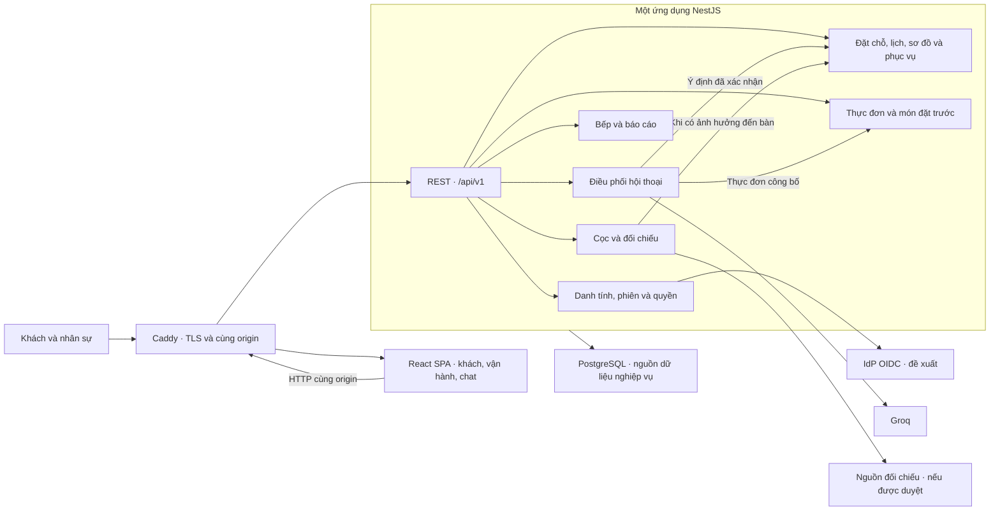

# Kiến trúc Backend Nhà hàng Ba Anh Em

**Giai đoạn 2 · Stack đã duyệt, thiết kế chi tiết chờ duyệt · Cập nhật 25/11/2026**

Chủ dự án duyệt NestJS và PostgreSQL 17 ngày 25/11/2026. Bản thiết kế đề xuất một ứng dụng NestJS theo module, dùng REST cùng origin với React. Web, chatbot và nhân sự đi qua cùng quy tắc đặt chỗ. PostgreSQL giữ dữ liệu đã cam kết của lượt đặt, bàn, món và giao dịch. Groq hỗ trợ hội thoại. VietQR cung cấp thông tin chuyển khoản. Nguồn đối chiếu đã duyệt xác định tiền thực nhận.

Phạm vi Giai đoạn 2 là kiến trúc, quy tắc nghiệp vụ và dữ liệu mức khái niệm. Danh sách yêu cầu chủ dự án gửi ngày 25/11/2026 là căn cứ phạm vi MVP. Schema vật lý, hợp đồng từng endpoint và kế hoạch triển khai sẽ được đối chiếu theo phạm vi này ở các giai đoạn duyệt tiếp theo. [BRS v0.1](../BRS-Nha-hang-Ba-Anh-Em.md) · [Rà soát Giai đoạn 1](../BACKEND_PHASE_1_AUDIT.md) · [Kế hoạch hiện có](../IMPLEMENTATION_PLAN.md#2-kiến-trúc-công-nghệ-và-cấu-trúc-thư-mục) · [Bản nháp API Frontend](api-contract.md)

`apps/web` là Frontend đã hoàn thành và chuẩn hóa. Các màn hình, component, route, cấu trúc thư mục và luồng hiện có là đầu vào để thiết kế API. Backend cần cung cấp dữ liệu và kết quả nghiệp vụ mà các luồng đó cần.

## 1. Yêu cầu chức năng và phi chức năng

### Phạm vi MVP theo đề bài

- **Quản lý và hiển thị thực đơn, UC-01/02.** Chủ dự án đã duyệt dùng màn hình `/van-hanh/thuc-don` hiện có trong MVP. Người được cấp quyền tạo và sửa món, giá, công bố và tình trạng nhận đặt. Web và chatbot đọc cùng nguồn công bố. Demo nghiệm thu AC-01 và AC-20a. Q-08/Q-09 xác định người được cấp quyền và dữ liệu thực đơn chính thức. [Màn hình quản lý món](../../apps/web/src/features/extensions/extensions.tsx)
- **Đặt bàn, UC-03/04 và AC-02–04/18.** Tiếp nhận yêu cầu 24/7 cho các khung được phục vụ. Kiểm lịch, sức chứa và cam kết chỗ đang hiệu lực. Ghi lượt, trả mã và trạng thái. Kiểm soát trùng bàn và gửi lại sau mất phản hồi.
- **Món và bếp, UC-06/07 và AC-05/06.** Ghi món vào lượt đủ điều kiện. Nhân sự theo quyền xem số lượng theo khung và nhận ra thay đổi ảnh hưởng đến phần đã chuẩn bị.
- **Cọc, UC-08–10 và AC-07–09/18.** Cấp VietQR cho khoản phát sinh. Đối chiếu bằng chứng theo chính sách. Truy được từ tiền thực nhận đến khoản cọc và lượt đặt. Xử lý được giao dịch đến trễ, sai lệch và giao dịch gửi lặp.
- **Sơ đồ, phân bàn và quản lý đặt chỗ, UC-11–14 và AC-10–13.** Đọc bàn theo khung và lượt theo phạm vi quyền. Kiểm tra khi phân lại bàn. Ghi nhận đến, đã phục vụ và no-show theo điều kiện được duyệt, kèm lịch sử.
- **Báo cáo, UC-16 và AC-14.** Tổng hợp theo kỳ, công thức và quyền đã duyệt. Đối chiếu được với dữ liệu nguồn và biểu diễn được kỳ trống hoặc tỷ lệ có mẫu số bằng 0.
- **Chatbot AI, UC-17/18 và AC-15–17.** Dùng Groq API gói miễn phí để tư vấn theo thực đơn và thu thập ý định đặt bàn. Khi dịch vụ hoạt động, khách xác nhận trong chat, nhận mã và trạng thái thực từ Backend. Nhân sự xem được cùng lượt trong vận hành. Q-11 chốt thông tin cần thu, cách xác nhận và cách tiếp tục trên web khi chat gián đoạn hoặc khi khách cần đặt món/cọc.
- **Demo và dùng thử, AC-19.** Có URL công khai và bằng chứng dùng thử tại đơn vị thực tế, gồm đầy đủ chức năng MVP và Chatbot AI. Nghiệm thu quản lý món và khách xem bản công bố. Đối chiếu mã lượt được xác nhận qua chat với vận hành. Ghi lại kết quả theo phạm vi giao dịch và dữ liệu được duyệt.

**Phạm vi có điều kiện.** UC-05/15 là tra cứu độc lập và quy trình đổi/hủy. Đặt tiệc/sự kiện, đánh giá và Tool Calling nghiệp vụ là ba chức năng của mức Tốt theo UC-19/20/21. Quyền truy cập đúng lượt trong kết quả, chọn món và cọc thuộc MVP. Phạm vi phục vụ tại bàn lấy một nhà hàng Ba Anh Em làm đơn vị dùng thử theo BRS.

**Quản lý dự án và bàn giao.** Dùng chung mã WBS giữa Jira, MS Project và GitHub để liên kết công việc với bằng chứng kiểm thử/demo. D01–D27 là 27 sản phẩm phải bàn giao. Việc gán tên, đầu ra và người phụ trách theo từng mã cần danh mục chính thức. [Kế hoạch và truy vết](../IMPLEMENTATION_PLAN.md#10-bảng-truy-vết-yêu-cầu-công-việc-và-nghiệm-thu)

### Chất lượng cần chứng minh

- **NFR-01 và NFR-06 · Khả dụng và dễ sử dụng.** Kiểm chứng nhận đặt từ URL công khai ngoài giờ phục vụ. UI phân biệt đang chờ, đã xác nhận, hết chỗ và tình huống cần tiếp tục. Thu kết quả theo thiết bị và kịch bản dùng thử đã duyệt.
- **NFR-02 · Gián đoạn tích hợp.** Khi Groq timeout hoặc chạm hạn mức, khách vẫn có đường đặt qua web. Khi nguồn đối chiếu gián đoạn, trạng thái cọc phản ánh thông tin đã ghi kèm bước xử lý theo chính sách.
- **NFR-03 · Toàn vẹn.** Web, chat và vận hành đối chiếu được cùng dữ liệu. Ca cần chứng minh gồm tranh bàn cuối, khung chồng một phần, phân lại thất bại, gửi lại sau commit và đối chiếu lặp.
- **NFR-04 và NFR-05 · Bảo vệ và truy vết.** Kiểm quyền theo thao tác, đối tượng và dữ liệu trả về, kể cả sai lượt, sai vai trò, hết phiên và thu hồi quyền. Thay đổi bàn, lượt và cọc quan trọng đối chiếu được người/nguồn, thời điểm và kết quả.
- **NFR-07 · Hiệu năng.** Đo p95 và tỷ lệ lỗi riêng cho menu, khả dụng, tạo lượt và chat. Tách thời gian chờ khóa DB và thời gian gọi Groq. Chốt tải, ngưỡng và thời hạn chờ tại Q-14.
- **NFR-08 · Khôi phục.** Có sao lưu và thử phục hồi trên môi trường cô lập. Sau phục hồi, xác định được lượt, khóa thao tác và cọc cần đối chiếu, kể cả giao dịch đến trong lúc gián đoạn. Q-14 quyết định RPO, RTO, thời hạn lưu và người phụ trách.

## 2. Luồng nghiệp vụ và bất biến

### Đặt bàn từ web và chat

1. Backend chuẩn hóa ngày/giờ theo lịch và múi giờ nhà hàng, kiểm giới hạn số khách, khung và khả năng bố trí theo cam kết đang hiệu lực. Kết quả tra giờ có giá trị tại thời điểm đọc. Khung thay thế chỉ được đề xuất sau khi đã kiểm tra.
2. Khách xác nhận ý định. Web và chat chuyển dữ liệu qua cùng use case tạo lượt. Server xác định quyền và nguồn từ ngữ cảnh tin cậy. Groq hỗ trợ thu thập ý định. Bước xác nhận hiện có trong chat gửi yêu cầu tới Backend và hiển thị mã, trạng thái từ kết quả ghi. Tool Calling nghiệp vụ mức Tốt sẽ dùng quyền và hợp đồng được duyệt cho từng thao tác.
3. Thao tác ghi đặt chỗ dùng transaction ngắn. Lấy khóa theo nhà hàng trước khi đọc lại cam kết, xác định phần giữ đã hết hiệu lực, kiểm phương án bàn rồi ghi lượt, quyền truy cập lượt, phân bổ nếu có, lịch sử và kết quả khóa thao tác. Mọi lệnh tác động đến cam kết bàn tuân cùng thứ tự khóa, gồm phân lại, hủy, hết hạn và đối chiếu cọc có hệ quả lên bàn. Cập nhật lịch hoặc sức chứa trong lúc nhận đặt cũng đi qua kiểm tra ảnh hưởng đến các cam kết đã có. Các truy vấn trong transaction dùng cùng kết nối DB. Đo mốc hiện tại theo đồng hồ DB sau khi lấy khóa để tính đúng thời hạn kể cả khi phải chờ. [Khóa hàng PostgreSQL](https://www.postgresql.org/docs/17/explicit-locking.html) · [Transaction trong node-postgres](https://node-postgres.com/features/transactions)
4. Đề xuất dùng khoảng sử dụng gồm đầu, loại trừ cuối, sau khi cộng khoảng đệm đã duyệt. Với bàn vật lý, PostgreSQL có thể chặn các khoảng hiệu lực chồng nhau trên cùng bàn. Nếu Q-02 cho cam kết trước khi gán, cần chứng minh các cam kết giao nhau còn bố trí được theo bàn hoặc tổ hợp hợp lệ. Nếu Q-03 duyệt giữ tạm, lệnh ghi giải phóng phần hết hiệu lực trong cùng luồng kiểm tra và ghi. Tác vụ dọn định kỳ có thể giúp cập nhật hiển thị. Tính đúng khi ghi dựa vào transaction và ràng buộc dữ liệu. [Kiểu khoảng và ràng buộc loại trừ PostgreSQL](https://www.postgresql.org/docs/17/rangetypes.html)
5. Sau commit, trả mã, trạng thái đặt chỗ, bàn, cọc và hành động còn được phép theo quyền. Khi khung vừa hết, trả xung đột và phương án thay thế đã kiểm nếu có. Khi thay bố trí thất bại, phương án cũ vẫn có hiệu lực.

**Gửi lại sau mất phản hồi.** Giữ cùng khóa cho cùng một ý định. Khóa có phạm vi theo chủ thể đã xác minh và loại thao tác. Lưu dấu vết dữ liệu chuẩn hóa và tham chiếu kết quả trong transaction nghiệp vụ. Cùng khóa và dữ liệu trả kết quả trong quyền hiện hành. Cùng khóa với dữ liệu khác báo xung đột. Cách xác định chủ thể liên kênh, tra kết quả và thời hạn lưu khóa phụ thuộc Q-07/Q-15. Khi timeout sau lệnh ghi, UI tra kết quả hoặc gửi lại cùng khóa theo contract được duyệt.

### Lưu món và chuyển bếp

1. Kiểm quyền, trạng thái và hạn chọn món trong cùng transaction với việc ghi món. Phối hợp khóa hoặc kiểm phiên bản với lệnh đổi trạng thái lượt và cập nhật thực đơn để tránh lưu theo giá, tình trạng món hoặc trạng thái lượt đã thay đổi. Lưu giá đã áp dụng theo dòng khi cần đối chiếu giá lịch sử. Q-05/Q-09 quyết định chính sách khi thấy giá hoặc tình trạng đã đổi.
2. Đề xuất ghi danh sách nguyên tử với phiên bản kỳ vọng để form hiện tại nhận kết quả rõ ràng. Nếu Q-05 duyệt chấp nhận một phần, phản hồi chỉ rõ dòng đã lưu, dòng cần sửa và danh sách đang có hiệu lực. Giá và khả dụng trên bill tạm phục vụ hiển thị trong lúc chọn.
3. Bếp đọc từ các lượt đủ điều kiện. Khi thông tin món đã chuyển bếp thay đổi, kíp phục vụ cần biết món và lượng bị ảnh hưởng. Nếu quy trình yêu cầu xác nhận bàn giao, lưu trạng thái giao/nhận tương ứng. Mốc chuyển bếp và dữ liệu được phép xem thuộc Q-05/Q-08.

### Cấp VietQR và đối chiếu cọc

1. Khi lượt đủ điều kiện, ghi bền yêu cầu cọc và tham chiếu trước khi phát hành QR hoặc gọi nguồn tạo yêu cầu bên ngoài. Nếu khoản đang hiệu lực đã có, trả lại khoản đó trong phạm vi quyền. Người nhận, số tiền, hạn và tham chiếu lấy từ dữ liệu server theo Q-03/Q-04. Phía khách và vận hành dùng một tham chiếu thống nhất. Trạng thái đang chờ được hiển thị khi mới cung cấp QR.
2. Đề xuất nhân sự có quyền đối chiếu thủ công với sao kê được duyệt cho MVP nếu nhà hàng có người phụ trách. Nếu chọn nguồn tự động, adapter kiểm xác thực và định danh nguồn theo tài liệu đã duyệt. Cả hai đi qua cùng use case đối chiếu. Thông báo đã chuyển của khách có thể đưa vào trạng thái chờ kiểm tra nếu chính sách duyệt. [Chuyển khoản VietQR theo NAPAS](https://napas.com.vn/dich-vu-chuyen-tien-nhanh-napas-247)
3. Chuẩn hóa định danh giao dịch theo nguồn để chống đối chiếu lặp. Q-04 quyết định cách nhận biết cùng giao dịch giữa hai nguồn hoặc xử lý trường hợp chưa đối chiếu được. Ghi bằng chứng, kết quả và audit trong transaction. Khi điều kiện cọc ảnh hưởng đến lượt hoặc bàn, kiểm lại hiệu lực trong cùng transaction. Với tiền đến muộn sau khi bàn đã cấp lại, giữ cam kết mới và đưa tiền vào nhánh ngoại lệ. Hoàn hoặc bù trừ phụ thuộc Q-04/Q-06.
4. Lời gọi nhà cung cấp chạy ngoài transaction và có timeout. Khi chưa biết kết quả của thao tác ngoài có thể đã tạo yêu cầu, dùng tham chiếu đã lưu để tra hoặc gửi lại theo khả năng chống lặp của nguồn trước khi tạo mới. Tính đúng của khoản cọc dựa vào bằng chứng đã ghi và chính sách chuyển trạng thái.

### Tư vấn AI, vận hành và báo cáo

- **Chat.** Server lấy menu công bố, gửi phần được phép sang Groq và kiểm dữ liệu trả về. Gợi ý tham chiếu món còn công bố theo server. Với dị ứng hoặc thành phần thiếu căn cứ, phản hồi nêu phần chưa xác minh. Thu thông tin liên hệ qua trường riêng nếu cần và lọc cả liên hệ có trong tin nhắn trước khi gửi sang LLM theo Q-07/Q-11. Mô hình chỉ có quyền đề xuất. Quyền thao tác và kết quả lấy từ use case. Tool Calling nghiệp vụ phụ thuộc phạm vi mức Tốt, danh sách công cụ và điều kiện xác nhận đã duyệt. [Groq Data Controls](https://console.groq.com/docs/your-data)
- **Vận hành.** Lệnh phục vụ có điều kiện về quyền, trạng thái hiện tại và chứng cứ nếu nghiệp vụ yêu cầu. No-show cần đáp ứng mốc thời gian và quyền Q-06/Q-08. UI nhận riêng tình trạng lượt, bàn và cọc.
- **Báo cáo.** Tính từ dữ liệu có hiệu lực hoặc lịch sử cần thiết. Mỗi chỉ số có mốc kỳ, trạng thái, đơn vị, bộ lọc và cách xử lý mẫu số rỗng. Nếu Q-10 cần tái hiện báo cáo ở thời điểm quá khứ, phải xác định lịch sử cần lưu trước khi chốt mô hình.

## 3. Mô hình dữ liệu khái niệm

- **Nhà hàng, lịch, ngoại lệ, khu và bàn.** Nhà hàng có múi giờ và bộ lịch phục vụ. Lịch có khung và hiệu lực. Ngoại lệ gắn ngày hoặc khoảng đặc biệt. Bàn có mã, khu, sức chứa và tình trạng sử dụng. Một nhà hàng có nhiều bàn. Ghép bàn và khóa bàn phụ thuộc Q-02.
- **Lượt đặt và liên hệ.** Lượt có định danh nội bộ, mã tham chiếu, nhà hàng, khung, số khách, nguồn, tình trạng, thời điểm và dữ liệu kiểm soát cập nhật đồng thời nếu cần. Liên hệ thuộc lượt hoặc chủ thể đã xác minh theo Q-07. Tên, điện thoại và ghi chú chỉ thu trong phạm vi được duyệt. Mã nhìn thấy trên UI dùng để tham chiếu.
- **Phân bổ bàn.** Mỗi phân bổ liên kết một lượt với một bàn, có khoảng sử dụng, tình trạng hiệu lực và hạn giữ nếu phát sinh. Một lượt có thể có nhiều phân bổ do ghép bàn hoặc thay bố trí. Một bàn có nhiều phân bổ theo thời gian, với ràng buộc về khoảng hiệu lực trên cùng bàn.
- **Món và dòng đặt trước.** Món có mã ổn định, tên, nhóm, mô tả, ảnh, giá và tình trạng công bố/nhận đặt. Một lượt có nhiều dòng, mỗi dòng tham chiếu món và lưu lượng, giá hoặc ghi chú theo nghiệp vụ. Thành phần và dị ứng chỉ dùng nếu có nguồn nhà hàng xác nhận.
- **Khoản cọc, giao dịch và kết quả đối chiếu.** Khoản cọc thuộc lượt, có số tiền dự kiến, tham chiếu, thời hạn và tình trạng. Giao dịch có định danh nguồn, số thực nhận, thời điểm, nội dung và tham chiếu bằng chứng. Kết quả đối chiếu liên kết khoản cọc với giao dịch, tác nhân, thời điểm và lý do. Bội số, khoản hiệu lực và trạng thái hoàn/bù trừ phụ thuộc Q-03/Q-04/Q-06.
- **Nhân sự, phiên và quyền.** Nhân sự có định danh IdP và trạng thái sử dụng. Quyền gắn hành động, đối tượng và phạm vi công việc. Phiên nhân sự và phiên khách có phạm vi, thời hạn và khả năng thu hồi theo thiết kế được duyệt. Quyền riêng của khách gắn với các lượt đã xác minh.
- **Sự kiện, audit và khóa thao tác.** Sự kiện ghi đối tượng, thời điểm, hành động, người/nguồn và kết quả. Audit nghiệp vụ giữ dữ liệu cần đối chiếu. Khóa thao tác ghi chủ thể, hành động, dấu vết yêu cầu và tham chiếu kết quả. Thời hạn lưu và quyền đọc thuộc Q-14/Q-15.
- **Dữ liệu tổng hợp và dữ liệu có điều kiện.** Sơ đồ trạng thái, danh sách bếp và báo cáo có thể đọc từ các nguồn trên. Dữ liệu xác nhận giao bếp, lưu hội thoại và workflow đổi/hủy tùy phạm vi được duyệt. Tiệc và đánh giá thuộc mức Tốt.

**Quy ước đề xuất.** Lưu mốc thời gian có múi giờ cho khoảng sử dụng và sự kiện. Diễn giải ngày/giờ phục vụ theo múi giờ nhà hàng đã duyệt. Tiền VND dùng số nguyên đơn vị đồng. Bội số chính thức, kiểu cột, khóa và chỉ mục được xác nhận ở Giai đoạn 3.

## 4. Kiến trúc và ranh giới module

### Các phương án cân nhắc

- **NestJS monolith theo module — đề xuất.** Một ứng dụng phát hành giúp thử xuyên module và ghi thay đổi lượt, bàn và cọc trong cùng transaction khi cần. Ranh giới ghi dữ liệu và chiều phụ thuộc được giữ qua service interface, review và kiểm thử. Phù hợp với một nhà hàng và nền NestJS hiện có.
- **API Express với phân lớp kỹ thuật dùng chung.** Có thể triển khai gọn trên một DB, nhưng cần tự ghép guards, validation, OpenAPI và ranh giới nghiệp vụ. Lợi ích giảm framework chưa bù công thay nền NestJS đã có.
- **Tách booking, payments và chat thành dịch vụ riêng.** Có thể triển khai và cấp tài nguyên độc lập. Việc đồng bộ đặt chỗ và cọc sẽ cần xử lý giao tiếp liên dịch vụ, sự kiện lặp, bù trừ và thêm chi phí vận hành. Có thể đánh giá tách Chat khi tải hoặc yêu cầu cô lập lỗi thực tế đòi hỏi.

### Quyền sở hữu và chiều phụ thuộc

- **Auth** cung cấp danh tính, phiên và quyền. **Booking** sở hữu lịch, khả dụng, lượt, phân bổ và quy tắc cam kết bàn. Sơ đồ và vận hành gọi use case Booking. **Menu** sở hữu thực đơn. **Preorders** sở hữu ghi món và kiểm điều kiện từ Menu và Booking.
- **Deposits** sở hữu khoản cọc, bằng chứng, đối chiếu và adapter liên quan. Khi đối chiếu tác động đến bàn, use case điều phối gọi Booking trong cùng transaction. Booking áp dụng quy tắc cam kết bàn từ ngữ cảnh nhận được. Adapter ngoài chạy trước hoặc sau ranh giới transaction theo luồng.
- **Kitchen** và **Reports** đọc và tổng hợp có phạm vi quyền từ dữ liệu nghiệp vụ. **Chat** đọc menu công bố và chuyển ý định đã xác nhận tới Booking. Đường ghi của từng miền đi qua use case sở hữu.
- Controller tiếp nhận HTTP. Dịch vụ ứng dụng thực hiện nghiệp vụ và quản lý transaction. Repository/adapter xử lý DB và dịch vụ ngoài. Tách quy tắc khỏi HTTP để kiểm thử được. Chỉ dùng abstraction ở điểm có cách triển khai thay thế, như DB, Groq, VietQR và IdP. Lỗi và audit dùng chuẩn thống nhất.

### Cấu trúc thư mục và quy ước

- `apps/api/src/modules/` chứa `auth`, `menu`, `booking`, `preorders`, `floorplan`, `operations`, `kitchen`, `deposits`, `reports` và `chat`. Giữ controller, DTO, service và adapter gần module sở hữu. `floorplan` và `operations` gọi Booking khi thay đổi cam kết bàn. `menu` phục vụ đọc công khai và quản lý theo quyền `menu.read` và `menu.write`.
- `apps/api/src/platform/` chứa cấu hình, kết nối và transaction DB, log, xử lý lỗi HTTP và health. `apps/api/db/` chứa migration, fixture kiểm thử và dữ liệu import được duyệt. Unit test đặt cạnh module, integration test ở `apps/api/test/integration/`, luồng trình duyệt ở `tests/e2e/`.
- Đặt tên tệp theo `kebab-case` và hậu tố `.module.ts`, `.controller.ts`, `.service.ts`, `.dto.ts`, `.spec.ts` theo trách nhiệm. DTO kiểm đầu vào và lớp ánh xạ giới hạn trường đầu ra. Service kiểm quyền trên tài nguyên và điều kiện chuyển trạng thái. Lệnh ghi liên quan nhiều bảng dùng một transaction. `packages/api-contract/` chứa hợp đồng và type sinh cho web. [Cấu trúc dự án](../PROJECT_STRUCTURE.md) · [Kế hoạch theo module](../superpowers/plans/2026-11-25-backend-implementation.md)

## 5. Công nghệ và lý do lựa chọn

- **NestJS đã duyệt.** Tái sử dụng nền NestJS 12/Express, Node.js 24, TypeScript strict và npm workspaces đang có. NestJS có module, guard, pipe và exception filter cho phân quyền, validation và lỗi. [NestJS Validation](https://docs.nestjs.com/techniques/validation)
- **PostgreSQL 17 đã duyệt, Kysely và `pg` là phương án kết nối.** PostgreSQL đáp ứng giao dịch, khóa và kiểm chồng khoảng. Kysely cung cấp query builder có kiểu và migration, dùng `pg` làm driver. Cách này vẫn cho phép tính năng đặc thù của PostgreSQL ở chỗ cần bảo toàn ràng buộc. Xác nhận quyền dùng `btree_gist` ở DB đích trước khi chốt phương án vật lý. [PostgreSQL btree_gist](https://www.postgresql.org/docs/17/btree-gist.html) · [PostgreSQL dialect trong Kysely](https://kysely.dev/docs/getting-started) · [Kysely Migrations](https://kysely.dev/docs/migrations)
- **REST JSON cùng origin, `/api/v1` và OpenAPI.** Tận dụng transport hiện có. Đề xuất DTO class với `ValidationPipe`, `class-validator` và `class-transformer`. Dùng `@nestjs/swagger` xuất OpenAPI và `openapi-typescript` sinh type vào workspace hợp đồng. Kiểm sự phù hợp giữa DTO, schema và response. Chọn phiên bản thư viện tương thích khi được phép tích hợp. [NestJS OpenAPI](https://docs.nestjs.com/openapi/introduction) · [OpenAPI TypeScript](https://openapi-ts.dev/introduction)
- **OIDC và phiên server — theo kế hoạch T07.** Dùng IdP do nhóm hoặc nhà hàng quản lý. `openid-client` là ứng viên sau khi xác nhận tương thích. Chọn IdP theo quyền sở hữu, chi phí và khả năng vận hành tài khoản. [OpenID Connect Core](https://openid.net/specs/openid-connect-core-1_0.html) · [RFC 9700](https://www.rfc-editor.org/rfc/rfc9700.html)
- **Groq qua adapter phía server.** Bắt đầu với `fetch` của Node là đủ cho API hội thoại, cùng lớp nhỏ kiểm timeout, hạn mức và lỗi. Chọn model theo tài khoản thật, chất lượng tiếng Việt, khả năng tư vấn từ menu và Q-11. Xác nhận quota, cách dùng dữ liệu và fallback trước dùng thử. [Hạn mức Groq](https://console.groq.com/docs/rate-limits) · [Chính sách dữ liệu Groq](https://console.groq.com/docs/your-data)
- **VietQR qua adapter cấp mã.** Ưu tiên kiểm chứng nhánh tạo mã offline bằng thư viện `vietqr` của Casso với tài khoản được duyệt. Casso thông báo API tạo mã cũ dừng từ **01/01/2027**, trước hạn cuối kỳ **14/01/2027**. Chọn nguồn đối chiếu độc lập theo Q-04. Kiểm mã quét, người nhận, số tiền, tham chiếu và bằng chứng bằng cấu hình dùng thử. [Thông báo API tạo QR của Casso](https://www.vietqr.io/generate) · [Hướng dẫn VietQR của NAPAS](https://napas.com.vn/dich-vu-chuyen-tien-nhanh-napas-247)
- **Kiểm thử và vận hành.** Giữ Jest và CI hiện có. Kế hoạch đã dự kiến Supertest cho HTTP, PostgreSQL thật cho integration và Playwright cho luồng xuyên web. Docker Compose và Caddy là phương án môi trường hiện có trong kế hoạch. Nhu cầu dùng k6 phụ thuộc tiêu chí tải Q-14. [Stack hiện có và đề xuất](../IMPLEMENTATION_PLAN.md#22-stack-và-giả-định-kỹ-thuật)

## 6. Xác thực, phân quyền, bảo mật và xử lý lỗi

### Danh tính và quyền

- **Khách công khai** đọc menu và khả dụng tổng hợp, chỉ nhận thông tin cần chọn khung. Với phương án đặt nhanh được đề xuất, thiết lập phiên khách do server quản lý trước yêu cầu ghi đầu tiên. Ghi quyền với lượt và kết quả khóa thao tác cùng transaction tạo lượt để khách vẫn có chủ thể gửi lại khi mất phản hồi. Quyền đọc, sửa món và cọc được kiểm trên từng lượt. Cách xác minh quyền ở phiên hoặc trình duyệt khác phụ thuộc Q-07/Q-15.
- **Nhân sự** đăng nhập OIDC Authorization Code với PKCE. Backend kiểm `state`, `nonce`, issuer, audience, chữ ký và thời hạn theo thư viện đã chọn, rồi ánh xạ `issuer + subject` vào tài khoản được cấp quyền. Phiên dùng mã opaque ở cookie `HttpOnly`, `Secure` trên HTTPS và `SameSite` theo luồng đăng nhập. Xoay mã khi nâng quyền, đặt hạn tuyệt đối và hạn không hoạt động, hủy khi đăng xuất và kiểm quyền có hiệu lực ở mỗi thao tác. Phiên có thể lưu ở PostgreSQL để hỗ trợ thu hồi và dùng chung giữa tiến trình. Cookie và kiểm CSRF áp dụng cả cho phiên khách có quyền ghi. [RFC 9700](https://www.rfc-editor.org/rfc/rfc9700.html) · [OWASP CSRF Prevention](https://cheatsheetseries.owasp.org/cheatsheets/Cross-Site_Request_Forgery_Prevention_Cheat_Sheet.html)
- **Quyền nghiệp vụ** được kiểm ở biên API và trong use case với đối tượng cụ thể. Điều phối xem lượt, phân bàn và ghi phục vụ theo quyền. Bếp chỉ cần khung, món, lượng và ghi chú được duyệt. Người đối chiếu có quyền riêng trên dữ liệu cọc. Quản lý xem báo cáo và quản trị theo quyền. Đây là các nhóm năng lực dự thảo, chờ ma trận tài khoản Q-08.
- **Nguồn tự động**, nếu được chọn, có thông tin xác thực riêng. Adapter xác minh nguồn và nội dung, kiểm định danh sự kiện/giao dịch và điều phối qua cùng use case. Gửi lặp đi qua cơ chế chống ghi trùng.

### Biên HTTP, lỗi và dữ liệu riêng tư

- Kiểm đầu vào theo kiểu, danh sách trường cho phép, độ dài, kích thước, ngày/giờ và giá trị hợp lệ. Kiểm quy tắc nghiệp vụ trong use case. Dùng truy vấn tham số hóa. Trả dữ liệu công khai, khách và vận hành theo phạm vi tách biệt. Request ghi dùng cookie có CSRF token và kiểm origin phù hợp. Cấu hình TLS, header, proxy tin cậy và giới hạn tần suất trên đăng nhập, tra cứu, đặt bàn và chat. [NestJS Validation](https://docs.nestjs.com/techniques/validation) · [OWASP CSRF Prevention](https://cheatsheetseries.owasp.org/cheatsheets/Cross-Site_Request_Forgery_Prevention_Cheat_Sheet.html)
- Giữ dạng lỗi mà `ApiServiceError` đọc, gồm `code`, `message`, `fields`, `traceId` và `retryable` khi phù hợp. Có mã ổn định cho lỗi định dạng, thiếu phiên/quyền, xung đột, vi phạm nghiệp vụ, giới hạn và gián đoạn. Áp dụng quy tắc che tồn tại tài nguyên theo quyền. Chốt HTTP status cho từng endpoint ở Giai đoạn 3. Xung đột dữ liệu dẫn UI tải lại, còn timeout sau ghi dẫn tới kiểm kết quả hoặc gửi lại cùng khóa theo contract.
- Log có mã truy vết và kết quả tối thiểu. Che liên hệ, khóa, cookie, token, bằng chứng và nội dung hội thoại ngoài phạm vi. Audit thay đổi nghiệp vụ ghi trong cùng transaction khi có thể. Đề xuất `no-store` cho dữ liệu riêng tư và phiên. Sao lưu và log tuân quyền đọc, thời hạn lưu và quy trình xử lý sự cố được duyệt.

## 7. Lưu trữ, cấu hình và môi trường

- **Local.** Giữ Vite proxy và Compose PostgreSQL hiện có. Fixture tách khỏi dữ liệu nhà hàng. Kiểm cấu hình khi khởi động. Ảnh món hiện có tiếp tục là tài sản web. Upload và quản lý ảnh phụ thuộc Q-09.
- **CI.** Dùng PostgreSQL dùng một lần cùng major và kiểm được extension của môi trường đích. Thử migration từ DB trống và dữ liệu bản trước. Kiểm độ lệch OpenAPI và type sinh. Dùng adapter mock hoặc sandbox theo kịch bản và tách tài khoản test.
- **Staging và production — phương án đề xuất.** Tách URL, DB, khóa, tài khoản tích hợp và dữ liệu. Caddy phục vụ SPA và đưa `/api/v1` vào mạng nội bộ của API, có fallback cho route React Router. API lắng nghe trên mạng container nội bộ để proxy kết nối. Reverse proxy là điểm tiếp nhận công khai. PostgreSQL quản lý là lựa chọn nếu ngân sách, quyền dùng extension, TLS và quyền mạng được duyệt. [Caddy Automatic HTTPS](https://caddyserver.com/docs/automatic-https)
- **Cấu hình và secrets.** Tách cấu hình ứng dụng, chính sách nhà hàng và secret. Chỉ cấu hình công khai đi vào bản build Vite. DSN, secret IdP và Groq key được cấp phía server bằng cơ chế nơi triển khai. Tách quyền migration khỏi tài khoản ứng dụng. Rà hiệu lực và thu hồi hoặc thay thế thông tin xác thực dạng văn bản đã phát hiện ở Giai đoạn 1 nếu còn được dùng.
- **Vận hành dữ liệu.** Migration chạy qua bước phát hành có kiểm soát, nhập menu/lịch/bàn từ dữ liệu đã duyệt, kiểm trùng/thiếu và ghi nguồn. Sao lưu và thử khôi phục theo Q-14. Khi khôi phục lùi về bản sao cũ, đối chiếu sao kê hoặc nguồn xác minh qua toàn bộ khoảng có thể mất dữ liệu trước khi đóng các khoản đang chờ. Theo dõi lỗi theo nhóm API, độ trễ DB/Groq, chờ khóa, xung đột và cọc tồn. Tách sức khỏe tiến trình và kết nối DB khỏi lỗi ngắn hạn của dịch vụ ngoài.

## 8. Kết nối Backend với Frontend hiện có

- **Chuẩn giao diện.** Giữ trang, layout, component, route, cấu trúc thư mục và các bước tương tác hiện có làm mốc nghiệm thu. Khi thiết kế contract, truy vết dữ liệu từ từng màn hình và ánh xạ DTO sang view model hiện có ở lớp tích hợp nếu cần.
- **Phạm vi kết nối dự kiến.** Dùng `ApiClient` và `ApiServiceError` để nối API thật, giữ mock cho phát triển local. Tách cache theo quyền truy cập, nối phiên và lấy kết quả thao tác từ server. Tận dụng trạng thái tải, thành công và lỗi đã có trên từng màn hình. Giỏ nháp tiếp tục do Frontend quản lý.
- **Khi có khác biệt nghiệp vụ.** Nếu bước hiện có thiếu dữ liệu hoặc có hành vi lệch chính sách đã duyệt, ghi rõ màn hình, lý do và tác động. Thay đổi nội dung, bố cục, route, quyền hiển thị hoặc luồng tương tác cần được chủ dự án duyệt riêng trước khi chỉnh. [Route Frontend](../../apps/web/src/routes/index.tsx) · [Provider hiện tại](../../apps/web/src/app/restaurant-context.tsx) · [HTTP client hiện tại](../../apps/web/src/services/http-client.ts)

## 9. Điểm cần duyệt và checklist Giai đoạn 2

- **Q-01/Q-02 · Lịch và bàn.** Chốt lịch, sức chứa, ghép bàn, giới hạn và khả năng cam kết khi chưa gán. Ảnh hưởng thiết kế thời gian, phân bổ và kiểm xung đột.
- **Q-03/Q-04/Q-06 · Giữ chỗ, cọc và phục vụ.** Chốt thời điểm giữ/cấp lại bàn, nguồn đối chiếu, tiền lệch hoặc trễ, no-show và xử lý tiền. Ảnh hưởng vòng đời trạng thái và ranh giới ghi.
- **Q-07/Q-08/Q-15 · Danh tính, quyền và phục hồi.** Chốt phiên khách, khả năng tra cứu, nhân sự, dữ liệu được phép và phục hồi giữa web/chat. Ảnh hưởng hợp đồng xác thực, cache và retry.
- **Q-05/Q-09/Q-10 · Món, bếp và báo cáo.** Màn hình quản lý đã vào phạm vi MVP tại T29. Còn chốt dữ liệu thực đơn chính thức, quy tắc giá và hết món trên lượt đang sửa, thời điểm chốt bếp và chỉ số báo cáo. [OpenAPI dự thảo](BACKEND_OPENAPI.yaml)
- **Q-11/Q-12/Q-13 · Chat và mức Tốt.** Chốt bước xác nhận, dữ liệu gửi Groq, phạm vi Tool Calling, tiệc/đánh giá nếu chọn.
- **Q-14 và điều kiện kỹ thuật.** Xác nhận tiêu chí chất lượng, quyền và thời hạn lưu, hạ tầng, tài khoản IdP, DB hỗ trợ extension, Groq model/quota và VietQR/nguồn đối chiếu. [BRS mục 11](../BRS-Nha-hang-Ba-Anh-Em.md#11-các-điểm-cần-xác-nhận)

- [x] Đối chiếu yêu cầu chức năng và phi chức năng với đề bài và BRS.
- [x] Mô tả luồng, transaction, xung đột, khôi phục và ranh giới Groq/VietQR.
- [x] Xác định thực thể, thuộc tính và quan hệ mức khái niệm.
- [x] So sánh phương án, giải thích kiến trúc, stack và ranh giới module.
- [x] Ghi cấu trúc thư mục, quy ước code và hồ sơ quyết định kiến trúc.
- [x] Mô tả xác thực, quyền đối tượng, bảo vệ dữ liệu, lỗi, cấu hình và môi trường.
- [x] Xác định phạm vi kết nối API với Frontend hiện có và các thay đổi giao diện hoặc luồng cần duyệt riêng.
- [x] Chủ dự án duyệt NestJS và PostgreSQL 17.
- [x] Chủ dự án duyệt màn hình quản lý thực đơn hiện có trong MVP.
- [ ] Duyệt các quyết định kiến trúc và chính sách nghiệp vụ còn mở theo từng module.

## 10. Hồ sơ quyết định kiến trúc

- **ADR-001 · NestJS và PostgreSQL 17 đã duyệt ngày 25/11/2026.** Nền repo đã dùng NestJS. Đề xuất chia một ứng dụng theo module và dùng REST cùng origin. Một nơi ghi cam kết bàn giảm số điểm cần phối hợp giữa web, chat và vận hành. Các module cần giữ quyền sở hữu dữ liệu và kiểm thử giao dịch chồng khoảng trên PostgreSQL đích.
- **ADR-002 · Đề xuất xác nhận trong chat qua cùng nghiệp vụ đặt bàn.** Chat dùng Groq để tư vấn và thu thập dữ liệu, khách xác nhận trong luồng hiện có, Backend kiểm khả dụng và ghi lượt. Cần nghiệm thu cuộc đặt thành công qua chat, cạnh tranh cùng bàn với web và phương án tiếp tục khi dịch vụ AI lỗi.
- **ADR-003 · Đề xuất tách cấp VietQR và đối chiếu.** Cấp mã gắn với yêu cầu cọc do Backend tạo. Nguồn đã duyệt cung cấp bằng chứng tiền thực nhận. Cần chốt hạn giữ, mốc no-show và cách xử lý giao dịch trễ theo Q-03/Q-04/Q-06.
- **ADR-004 · Màn hình quản lý thực đơn hiện có đã được duyệt cho MVP.** Demo cần chứng minh người có quyền thêm, sửa, công bố, ẩn và thay đổi khả dụng. Web và chatbot dùng danh mục công bố mới. Lượt đã lưu giữ được giá đã áp dụng. Thiết kế bổ sung API đọc và ghi, quyền theo nhà hàng, khóa gửi lại và phiên bản món. [Ánh xạ tích hợp](FRONTEND_BACKEND_MAPPING.md)
