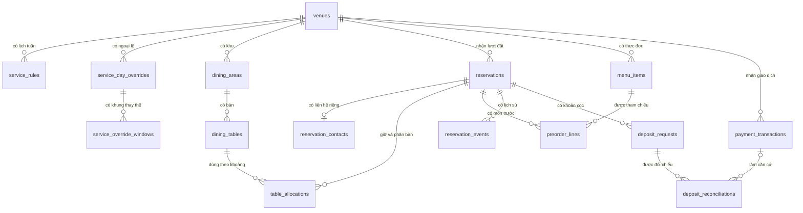
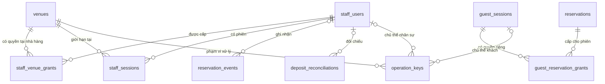

# Thiết kế database Nhà hàng Ba Anh Em

**Giai đoạn 3 · Bản đề xuất để duyệt · 25/11/2026**

PostgreSQL 17 là phiên bản đích đã được chủ dự án duyệt ngày 25/11/2026. DDL là bản thiết kế vật lý để kiểm trên một DB trống, còn schema và chính sách phụ thuộc nghiệp vụ đang chờ duyệt. OpenAPI và bảng ánh xạ mô tả hợp đồng tiêu thụ dữ liệu. Các giá trị trong fixture và ví dụ chỉ phục vụ kiểm chứng. [DDL kiểm chứng](BACKEND_SCHEMA.sql) · [OpenAPI](BACKEND_OPENAPI.yaml) · [Ánh xạ Frontend](FRONTEND_BACKEND_MAPPING.md) · [Quyết định stack](BACKEND_ARCHITECTURE.md#10-hồ-sơ-quyết-định-kiến-trúc) · [BRS v0.1](../BRS-Nha-hang-Ba-Anh-Em.md)

## 1. ERD nghiệp vụ

## 2. ERD phiên, quyền và gửi lại

Mỗi khóa thao tác thuộc đúng một chủ thể. `outcome_id` tham chiếu logic tới PK của tài nguyên theo `operation`. Use case giữ liên kết này trong cùng transaction và kiểm quyền khi phát lại. Khóa là dữ liệu vận hành có hạn lưu, kết quả nghiệp vụ được lưu riêng.

## 3. Schema vật lý và trách nhiệm dữ liệu

| Nhóm                  | Bảng và khóa                                                                                                                                                                           | Ràng buộc và dữ liệu sử dụng                                                                                                                                                                                                                                                                                                  |
| --------------------- | -------------------------------------------------------------------------------------------------------------------------------------------------------------------------------------- | ----------------------------------------------------------------------------------------------------------------------------------------------------------------------------------------------------------------------------------------------------------------------------------------------------------------------------- |
| Nhà hàng và bàn       | `venues(id)`, `dining_areas(id)`, `dining_tables(id)`                                                                                                                                  | Dùng mã ổn định theo nhà hàng. Bàn thuộc khu cùng nhà hàng và sức chứa dương. `active` điều khiển nhận phân bổ mới. Cập nhật khu/bàn phải kiểm ảnh hưởng cam kết hiện hữu.                                                                                                                                                    |
| Lịch                  | `service_rules(id)`, `service_day_overrides(venue_id, service_date)`, `service_override_windows(venue_id, service_date, opens_at)`                                                     | Lịch tuần theo ngày ISO và khoảng ngày hiệu lực. Một ngoại lệ/ngày, có thể đóng hoặc chỉ định các khung thay thế. Khung hỗ trợ qua nửa đêm. Dịch vụ kiểm trùng các khung, logic ngày mở/đóng, không cho ngày đóng có khung thay thế và xác nhận múi giờ IANA.                                                                 |
| Lượt và liên hệ       | `reservations(id)`, `reservation_contacts(reservation_id)`                                                                                                                             | Mã công khai duy nhất theo nhà hàng, số khách dương, giờ bắt đầu nhỏ hơn giờ kết thúc. Tình trạng, nguồn và phiên bản theo lượt. Liên hệ lưu riêng để projection công khai và vận hành tối thiểu không đọc nhầm PII.                                                                                                          |
| Bố trí                | `table_allocations(id)`                                                                                                                                                                | FK ghép xác nhận lượt và bàn cùng nhà hàng. Khoảng chiếm bàn bao gồm phần đệm theo chính sách, độc lập với khoảng dùng bữa của lượt. GiST chặn hai khoảng hiệu lực chồng nhau trên cùng bàn. Giữ cả bản đã giải phóng để đối chiếu.                                                                                           |
| Thực đơn và món trước | `menu_items(id)`, `preorder_lines(reservation_id, menu_item_id)`                                                                                                                       | Mã món public duy nhất theo nhà hàng, tách khỏi PK và giữ ổn định cho UI. Một dòng mỗi món trên một lượt. FK ghép chống lấy món nhà hàng khác. Ghi lượng dương, giá VND và tên đã áp dụng để hiển thị lịch sử.                                                                                                                |
| Cọc                   | `deposit_requests(id)`                                                                                                                                                                 | Tham chiếu duy nhất theo nhà hàng. Lưu người nhận, số tiền, hạn, phiên bản và mốc khách báo đã chuyển nếu áp dụng. Đề xuất tối đa một khoản hiện hành trên lượt cho màn hình hiện tại. Khoản cũ lưu để truy vết.                                                                                                              |
| Tiền và đối chiếu     | `payment_transactions(id)`, `deposit_reconciliations(id)`                                                                                                                              | Giữ định danh giao dịch trong namespace nguồn do server xác định. Mỗi giao dịch chỉ có một kết quả khớp trong baseline này. Đối chiếu ghi quyết định, người hoặc nguồn và thời điểm. Ngoại lệ có mã lý do do server gán và có thể lưu quan sát chưa đủ bằng chứng trong `observation`. Quan sát nằm ngoài tổng tiền xác minh. |
| Phiên và truy cập     | `guest_sessions(id)`, `guest_reservation_grants(guest_session_id, reservation_id)`, `staff_users(id)`, `staff_sessions(id)`, `staff_venue_grants(staff_user_id, venue_id, permission)` | Duy nhất cặp issuer/subject của IdP, lưu digest token phiên, hạn và thu hồi. Khách có quyền theo từng lượt của phiên được xác minh. Nhân sự có quyền phù hợp nhà hàng, danh tính và thao tác.                                                                                                                                 |
| Audit và retry        | `reservation_events(id)`, `operation_keys(id)`                                                                                                                                         | Sự kiện có tác nhân, nguồn, loại, thời điểm và kết quả. Delta món trong `changes` có schema theo loại sự kiện, chỉ lưu dữ liệu nghiệp vụ được phép. Khóa gửi lại duy nhất theo nhà hàng, chủ thể và thao tác, có digest yêu cầu, tham chiếu kết quả và hạn lưu.                                                               |

**Quy ước vật lý.** Timestamps dùng `timestamptz`. `date` và `time` nhập hoặc hiển thị theo múi giờ nhà hàng. Backend tính khoảng tra theo mốc tuyệt đối và kiểm giờ địa phương không hợp lệ hoặc trùng nghĩa. Tiền VND là số nguyên dùng `bigint`, chỉ đổi sang JSON integer sau khi kiểm giới hạn chính xác JavaScript. Tính tổng bằng số nguyên chính xác. FK mặc định giữ lịch sử. Cascade chỉ dùng khi dọn phiên khách để dọn quyền và khóa phụ thuộc sau thời hạn lưu. Không sao chép số lượng tối đa, hạn giữ, số tiền cọc hay giờ mẫu vào luật DB. [PostgreSQL về ràng buộc](https://www.postgresql.org/docs/17/ddl-constraints.html)

## 4. Toàn vẹn, version và giao dịch

- **Giữ, phân lại và hết hạn bàn.** Sau khi xác thực và kiểm đầu vào, khóa hàng `venues` trước, dùng một kết nối/transaction và lấy mốc hiện tại từ đồng hồ DB sau khi khóa. Đọc lại đủ sức chứa và cam kết. Với phương án giữ tạm, chuyển các dòng hết hạn sang `released` trước khi ghi phân bổ mới. Truy vấn đọc tính hiệu lực từ hạn và trạng thái. Ràng buộc GiST dùng tình trạng đã ghi, độc lập với đồng hồ. Phân lại khóa cùng chiều, ghi trạng thái cũ/mới và sự kiện trong cùng transaction. Khi phương án mới xung đột, rollback cả lần giải phóng cũ. Lịch và sức chứa sửa trong lúc mở đặt đi qua cùng hàng khóa nếu làm thay đổi tính khả dụng. Q-02 duyệt ghép bàn hoặc cam kết trước khi gán thì cần ca thử khả thi của toàn bộ các lượt giao nhau. [Kiểu khoảng và chống chồng lấn](https://www.postgresql.org/docs/17/rangetypes.html) · [Khóa hàng PostgreSQL](https://www.postgresql.org/docs/17/explicit-locking.html)
- **Version và món.** Với thao tác cập nhật từng tài nguyên, đối chiếu `expectedVersion` trong transaction. `reservations.version` đổi khi trạng thái, bố trí hoặc món thay đổi. `deposit_requests.version` đổi khi trạng thái cọc hoặc bằng chứng thay đổi. Khi thay đổi cọc làm đổi trạng thái lượt, cập nhật cả hai trong cùng giao dịch. Lệnh ghi món giữ đồng bộ với lệnh đổi trạng thái lượt và phiên bản giá/khả dụng menu đã kiểm. Đề xuất khóa lượt trước rồi khóa các món theo thứ tự ID nếu dùng khóa hàng. Delta tên/mã và lượng trước/sau trong sự kiện món hỗ trợ dấu hiệu bếp sau mốc chốt, kể cả khi dòng cuối bị xóa. [Thiết kế luồng món và bếp](BACKEND_ARCHITECTURE.md#lưu-món-và-chuyển-bếp)
- **Quản lý thực đơn.** `menu_items.version` là số nguyên dương, mặc định 1. Khi sửa, cập nhật theo nhà hàng, mã công khai và phiên bản kỳ vọng trong một lệnh, tăng version và cập nhật `updated_at`. Lưu kết quả và khóa gửi lại cùng transaction. Kiểm quyền trước khi ghi hoặc phát lại. Mã và ảnh món giữ giá trị từ nguồn danh mục. Các dòng đã lưu giữ `dish_name_snapshot` và `unit_price_vnd` khi sửa thực đơn. Kiểm kết quả khi cập nhật giá và lưu món đồng thời. [OpenAPI](BACKEND_OPENAPI.yaml)
- **Cọc và tiền.** Ghi yêu cầu/tham chiếu trước khi trả QR. Lệnh đối chiếu xác minh bằng chứng, chuẩn hóa định danh theo nguồn, ghi giao dịch, ghi quyết định và chuyển trạng thái phù hợp trong cùng transaction. Thời điểm chuyển phải có căn cứ từ nguồn duyệt. Quan sát thiếu bằng chứng chỉ đi vào nhánh ngoại lệ, với lý do và người ghi. Nếu có khả năng cấp/giải phóng bàn, lấy khóa nhà hàng trước khóa lượt rồi khoản cọc. Q-04 quyết định nhận diện cùng giao dịch qua nhiều nguồn. Khi tiền đến sau hạn, lưu nguyên bằng chứng và giữ cam kết bàn mới. Công thức tổng tiền, nhiều lần chuyển, hoàn/bù trừ và sửa một đối chiếu đã khớp thuộc Q-04/Q-06.
- **Gửi lại an toàn.** Xác thực chủ thể và tài nguyên trước khi phát lại, kiểm cùng khóa/cùng payload trước kiểm version hiện tại. Digest lấy từ dữ liệu chuẩn hóa, gồm tài nguyên và body của lệnh. Lưu khóa và kết quả thành công cùng transaction. Khi hai request tranh cùng khóa, bản thua rollback nghiệp vụ rồi đánh giá lại bản đã commit. Trả cùng mã kết quả và HTTP status, có thể đọc projection hiện tại trong quyền hiện hành. Sau timeout, Frontend dùng lại khóa của ý định đã gửi. Thời hạn giữ khóa cần bao phủ cửa sổ retry được duyệt, và quyền replay của khách chỉ còn trong phiên đã xác minh.
- **Phạm vi cưỡng chế.** DB chịu PK/FK, điều kiện trường, chồng khoảng và duy nhất. Use case chịu điều kiện chuyển trạng thái, sự phù hợp của cấp bàn, chính sách giữ/cọc, quyền, điều kiện bếp và ý nghĩa ngày/giờ. Liên kết tài nguyên theo `outcome_id` và payload delta được kiểm khi ghi. Giữ quyền migration tách khỏi ứng dụng. Mọi request đọc hoặc ghi được giới hạn nhà hàng và projection theo quyền.

## 5. Chỉ mục và migration

- **Đọc thường xuyên.** `reservations_ops_time` phục vụ kỳ/ngày và phân trang theo `starts_at,id`. `reservations_ops_status_time` hỗ trợ thêm lọc tình trạng. `menu_items_public_order` và `dining_tables_active_area` bám thứ tự danh sách. Các unique index trên mã tham chiếu và mã món phục vụ đọc một mục. Tìm chuỗi con mã đặt theo UI được giữ trong contract. Chỉ bổ sung chỉ mục chuyên cho chuỗi con khi tải và kế hoạch thực thi cho thấy cần.
- **Phân bổ, lịch sử và tiền.** Chỉ mục loại trừ GiST được PostgreSQL tạo cùng ràng buộc. Chỉ mục phần giữ theo hạn hỗ trợ dọn; các chỉ mục theo lượt, khoản, tình trạng đối chiếu và thời điểm giao dịch phục vụ tra cứu. Hàng đợi cọc có lọc theo trạng thái. Thứ tự ưu tiên trễ và giờ dùng bữa cần sắp xếp có JOIN, vì vậy đo trên dữ liệu đại diện trước khi thêm chỉ mục.
- **Migration nền.** Kysely chạy `001_base` trong transaction và ghi lịch sử trong `ba_anh_em.kysely_migration`. Migration cài `btree_gist` và tạo bảng nhà hàng, khu, bàn và lịch. Tài khoản migration sở hữu schema. Runtime đọc bảng nền và lịch sử migration. Các migration nghiệp vụ nối tiếp theo thứ tự FK khi triển khai từng module. [PostgreSQL btree_gist](https://www.postgresql.org/docs/17/btree-gist.html) · [Kysely Migrations](https://kysely.dev/docs/migrations)
- **Migration phiên.** `002_auth` thêm tài khoản, quyền theo nhà hàng, phiên khách, phiên nhân sự và giao dịch OIDC một lần. Phiên nhân sự gắn với nhà hàng. API lấy giao của quyền lúc đăng nhập và quyền còn hiệu lực mỗi khi truy cập. Giao dịch OIDC hết hạn sau 5 phút và được dọn theo lô khi bắt đầu đăng nhập. Tài khoản runtime có quyền giới hạn trên các bảng phiên. [Cấu hình role runtime](../../README.md#biến-môi-trường)
- **Migration thực đơn.** `003_menu` thêm `menu_items` và `menu_write_keys`. Khóa gửi lại món thuộc nhà hàng, người ghi và thao tác. Khóa tham chiếu món cùng nhà hàng và được lưu trong cùng transaction với thay đổi. Thực đơn công khai lấy món đã công bố theo thứ tự hiển thị rồi mã món. Khóa được giữ trong bước kiểm chứng local, với chính sách dọn chờ Q-14/Q-15. [Hướng dẫn chạy local](../../README.md#thử-thực-đơn-postgresql-trên-local)
- **Migration đặt bàn.** `004_booking` thêm lượt, liên hệ, quyền theo phiên, phân bổ, sự kiện và khóa gửi lại. `lock_booking_venue` khóa hàng nhà hàng tới cuối transaction qua quyền `EXECUTE`. Sau khi lấy khóa, API lấy thời điểm DB, kiểm lại lịch và bàn, giải phóng giữ chỗ hết hạn và ghi cả lượt cùng quyền và khóa. Khả dụng bỏ qua giữ chỗ hết hạn. Ràng buộc GiST chặn khoảng giao nhau trên cùng bàn đang giữ hoặc đã cam kết. [Hướng dẫn chạy local](../../README.md#thử-đặt-bàn-trên-postgresql-local)
- **Tiến hóa schema.** Migration đã phát hành được giữ nguyên. Khi có dữ liệu, thêm cấu trúc tương thích, điền dữ liệu cũ, kiểm điều kiện rồi siết constraint. Kiểm DB trống và DB phiên bản trước trên PostgreSQL 17. Với thay đổi có thể làm mất dữ liệu, xác định đường khôi phục và thử restore trước phát hành. Đo thời gian giữ khóa và truy vấn bằng dữ liệu đại diện.

## 6. Các điều kiện cần duyệt

- **Q-01–03, Q-06.** Lịch, khoảng đệm, giới hạn, ghép bàn, thời điểm cam kết, giữ và giải phóng, điều kiện thu cọc và no-show. Tình trạng `cancelled` kèm lý do hết giữ là phương án tương thích với enum UI khi chính sách yêu cầu.
- **Q-04.** Nguồn bằng chứng, tham chiếu và trùng liên nguồn, cách khớp thiếu/thừa, có thu nhiều lần hay hoàn. Một khoản hiện hành mỗi lượt và một lần khớp mỗi giao dịch là ràng buộc đề xuất theo bề mặt hiện tại. Tính năng thanh toán cần đối chiếu chính sách trước khi chốt.
- **Q-05, Q-09, Q-10.** Chốt toàn phần/một phần, cách áp giá cho dòng sửa sau khi đổi giá, mốc giao bếp, nguồn danh mục và định nghĩa báo cáo. Màn hình quản lý thực đơn đã được duyệt trong MVP. Schema bổ sung `menu_items.version` và quyền `menu.read`/`menu.write` theo nhà hàng. [Phạm vi thực đơn](BACKEND_ARCHITECTURE.md#1-yêu-cầu-chức-năng-và-phi-chức-năng)
- **Q-07/Q-08/Q-15.** Phiên khách là đề xuất cho luồng vừa đặt, khôi phục ngoài phiên còn mở. Cần duyệt ma trận quyền, IdP, thời hạn phiên/khóa và nguyên tắc xác thực lại.
- **Q-11–Q-14.** Phạm vi chat, dữ liệu Groq, mức Tốt và mục tiêu tải/khôi phục. Lưu hội thoại, tiệc, đánh giá, webhook và hoàn tiền tự động chỉ được đặc tả khi có lý do và phạm vi duyệt. [Sổ Q trong BRS](../BRS-Nha-hang-Ba-Anh-Em.md#11-các-điểm-cần-xác-nhận)

## 7. Kiểm chứng trên PostgreSQL 17

Migration `001_base` đã chạy trên database rỗng của PostgreSQL 17.12, cài `btree_gist` và ghi lịch sử phiên bản. Thử chạy lại, seed giữ chỉnh sửa, rollback khi DDL xung đột và readiness qua tài khoản chỉ đọc đều đạt. Các ca tranh bàn, cọc và gửi lại nghiệp vụ vẫn **PENDING** đến khi các module tương ứng hoạt động. CI dùng Compose để tạo môi trường kiểm thử mới và chạy cùng CLI migration. [Kế hoạch kiểm chứng](../superpowers/plans/2026-11-25-backend-implementation.md) · [Compose local](../../infra/compose/compose.dev.yaml)

- **Khởi tạo và quyền.** Chạy DDL kiểm chứng trên DB PostgreSQL 17 cô lập. Ghi phiên bản server, phiên bản `btree_gist` và kết quả tạo schema. Kiểm quyền cài extension của tài khoản migration hoặc xác nhận extension đã được cấp sẵn. Kiểm tài khoản runtime dùng được bảng được cấp và thiếu quyền sửa schema. [PostgreSQL btree_gist](https://www.postgresql.org/docs/17/btree-gist.html)
- **Phân bổ và rollback.** Kiểm hai khoảng liền kề cùng bàn được chấp nhận, khoảng chồng bị chặn và dòng đã giải phóng không chặn phân bổ mới. Thử hai transaction tranh bàn cuối. Thử phân lại thất bại và kiểm phương án cũ còn hiệu lực. [Ràng buộc loại trừ PostgreSQL](https://www.postgresql.org/docs/17/ddl-constraints.html#DDL-CONSTRAINTS-EXCLUSION)
- **Tham chiếu, cọc và gửi lại.** Kiểm FK ghép từ chối đối tượng khác nhà hàng. Kiểm mỗi lượt chỉ có một khoản cọc hiện hành, một giao dịch chỉ có một kết quả khớp, cùng chủ thể và khóa thao tác không ghi lần hai. Ở lớp dịch vụ, gửi lại cùng payload trả cùng kết quả, còn payload khác trả xung đột. [Ràng buộc duy nhất PostgreSQL](https://www.postgresql.org/docs/17/ddl-constraints.html#DDL-CONSTRAINTS-UNIQUE-CONSTRAINTS)
- **Migration và dữ liệu thử.** Sau khi có migration và fixture, chạy từ DB trống, chạy seed lặp lại và thử lỗi giữa migration. Kiểm dữ liệu thử cho bàn, menu và các tình huống cọc. Ghi phiên bản migration và bằng chứng từng ca để đối chiếu với AC-04, AC-08–09, AC-11–12 và AC-18. [Tiêu chí nghiệm thu BRS](../BRS-Nha-hang-Ba-Anh-Em.md#10-tiêu-chí-nghiệm-thu)
- **Công bố và sửa đồng thời.** Hai lần sửa cùng phiên bản món với khóa khác nhau chỉ có một lần ghi thành công. Món ẩn chỉ xuất hiện ở danh mục vận hành. Thử nhân sự có quyền sửa giá hoặc tắt đặt trước và kiểm dòng món đã lưu giữ nguyên snapshot.

## 8. Checklist nghiệm thu Giai đoạn 3

- [x] ERD thể hiện thực thể nghiệp vụ, phiên, quyền và khóa gửi lại.
- [x] DDL mô tả cột, PK, FK, kiểm tra toàn vẹn và chỉ mục, kèm quy ước transaction và migration.
- [x] OpenAPI mô tả method, endpoint, quyền, input/output, validation, lỗi và phân trang ở nơi cần.
- [x] Bảng ánh xạ truy được từ trang và component hiện có đến endpoint, service và bảng.
- [x] Các điểm phụ thuộc Q được đánh dấu, có giải thích cho endpoint kỹ thuật bổ sung và thao tác có điều kiện.
- [ ] Chủ dự án duyệt bản thiết kế trước khi chuyển Giai đoạn 4. Thử migration chính thức trên PostgreSQL 17 và kiểm thử tích hợp theo các giai đoạn được duyệt.
