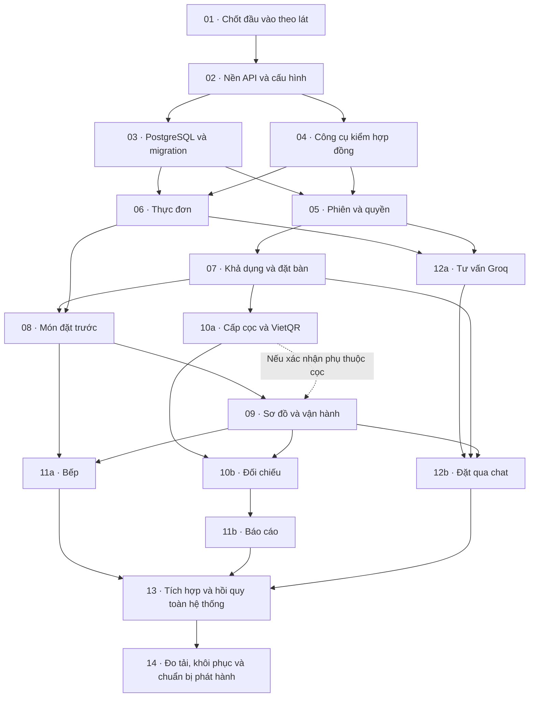

# Kế hoạch triển khai Backend Nhà hàng Ba Anh Em

> **Dành cho người thực hiện:** Sau khi chủ dự án cho phép triển khai, dùng quy trình `superpowers:subagent-driven-development` hoặc `superpowers:executing-plans` phù hợp với phương thức được duyệt. Checklist dưới đây ghi công việc và điều kiện nghiệm thu của từng bước.

**Giai đoạn 4 · Bản để duyệt · 25/11/2026**

**Mục tiêu** — Triển khai Backend MVP và kết nối các luồng đặt bàn, món, cọc, vận hành và chatbot với Frontend Nhà hàng Ba Anh Em đã hoàn thành.

**Kiến trúc** — NestJS monolith theo module và PostgreSQL. Web và chat dùng chung use case đặt bàn. Groq, VietQR, nguồn đối chiếu và IdP được tích hợp theo ranh giới đã thiết kế. Web gọi REST cùng origin qua transport sẵn có.

**Công nghệ** — Node.js 24, npm workspaces, TypeScript strict, NestJS/Express, PostgreSQL 17, Kysely/`pg`, OpenAPI, Jest/Supertest, Playwright, Docker Compose, GitHub Actions, Caddy và GHCR theo điều kiện hạ tầng được duyệt.

**Đặc tả đầu vào** — [BRS](../../BRS-Nha-hang-Ba-Anh-Em.md) · [Kiến trúc Backend](../../design/BACKEND_ARCHITECTURE.md) · [ERD và database](../../design/DATABASE_DESIGN.md) · [OpenAPI dự thảo](../../design/BACKEND_OPENAPI.yaml) · [Ánh xạ Frontend–Backend](../../design/FRONTEND_BACKEND_MAPPING.md) · [WBS T01–T35 hiện có](../../IMPLEMENTATION_PLAN.md).

## 1. Ràng buộc chung

- `apps/web` là chuẩn cho trang, route, thành phần giao diện, cấu trúc thư mục và bước tương tác. Dùng `ApiClient`, `ApiServiceError`, React Query và adapter để đưa dữ liệu thật vào các màn hình hiện có. Mọi thay đổi nội dung, điều hướng, bố cục hoặc luồng tác nghiệp cần mô tả tác động và được duyệt riêng trước khi sửa.
- `apps/api`, npm workspaces, lint/format/typecheck/build, Jest, nền CI và Compose đã có. Bước nền kiểm và hoàn thiện phần còn thiếu. `packages/api-contract` hiện dành cho hợp đồng sinh từ API.
- OpenAPI Giai đoạn 3 mô tả thiết kế API nghiệp vụ. Đối chiếu `operationId` và các Q trước khi bật route tương ứng. DDL kiểm chứng đã áp dụng thành công trên database rỗng của PostgreSQL 17.12. Kiểm migration và hành vi nghiệp vụ trên PostgreSQL 17 thuộc các bước phụ thuộc.
- Quyết định chưa chốt chỉ chặn nhánh phụ thuộc. Có thể chuẩn bị fixture giả định được gắn nhãn, ca kiểm thử, công cụ, tài liệu và hoạt động nền độc lập sau khi được phép thực hiện. Kết quả fixture là bằng chứng kỹ thuật.
- Bước 13–14 kiểm thử toàn hệ thống và chuẩn bị phát hành. T29 thuộc lát thực đơn MVP theo quyết định dùng màn hình hiện có. T27 phát hành công khai và dùng thử, T28 ổn định/bàn giao, T30–T35 theo phạm vi tùy chọn hoặc mức Tốt được duyệt riêng.
- Các tên file mới bên dưới là vị trí dự kiến trong repo. Phiên bản các migration song song được cấp theo thứ tự ghép đã duyệt để giữ thứ tự chạy. Khi một file hiện có đã đảm nhiệm cùng trách nhiệm, cập nhật file đó. Test nghiệp vụ đặt gần module hoặc ở `apps/api/test/integration/` tùy lớp kiểm chứng.
- Khi thực thi từng lát, ghi ca kiểm dẫn chứng, xác nhận ca phát hiện thiếu sót, triển khai phần nhỏ, chạy lại và mở review kèm kết quả. Lưu SHA, phiên bản schema/contract, môi trường, mã AC và kết quả dùng để nghiệm thu. Che PII, bằng chứng thanh toán, khóa và token.

## 2. Thứ tự phụ thuộc

Đường tích hợp ưu tiên đi từ phiên khách đến đặt bàn, món, điều phối và cọc. Ngay khi từng nhóm endpoint có hợp đồng và dữ liệu kiểm chứng, nối vào một màn hình hiện có để đối chiếu các trạng thái tải, lỗi và thành công. Công cụ hợp đồng và PostgreSQL làm song song khi nền API đã sẵn sàng. Thực đơn, VietQR và tư vấn Groq có thể tiến theo nhánh độc lập tương ứng. Nhánh 10a có thể bắt đầu ngay sau bước 07. Khi xác nhận lượt cần đọc cọc, hoàn tất phần đó của bước 09 sau bảng và truy vấn của 10a. Báo cáo chỉ được nghiệm thu sau khi có dữ liệu vận hành và đối chiếu. Xác nhận đăng nhập nhân sự ở bước 05 trước khi kiểm quyền vận hành, còn điều kiện riêng của từng quyền được kiểm tại bước sở hữu nghiệp vụ.

## 3. Lệnh kiểm tra

- **Đã có tại repo** — `npm ci`, `npm run dev`, `npm run lint`, `npm run format:check`, `npm run typecheck`, `npm run test:unit`, `npm run build`. Có thể dùng `npm.cmd` trên PowerShell. Kiểm cấu hình PostgreSQL bằng `docker compose --env-file .env.example -f infra/compose/compose.dev.yaml config --quiet` khi Docker khả dụng.
- **Dự kiến thêm ở bước 03** — `npm run db:migrate -w @ba-anh-em/api`, `npm run db:seed:test -w @ba-anh-em/api`, `npm run test:integration -w @ba-anh-em/api`. Lệnh chạy tài khoản và DB đúng môi trường. Test integration nhận bộ lọc tên file từ Jest khi cần kiểm một lát.
- **Công cụ ở Bước 04** — `npm run contract:generate`, `npm run contract:check` và `npm run test:e2e`. Lệnh generate xuất OpenAPI và type từ NestJS. Lệnh check đối chiếu dữ liệu sinh với hai tệp đã lưu. Có thể lọc Playwright theo spec, ví dụ `npm run test:e2e -- tests/e2e/smoke.spec.ts`.
- **Tổng kiểm bước 13–14** — Chạy unit, integration, contract và toàn bộ E2E ở CI theo phạm vi đã duyệt. Bước 14 dùng `k6 run tests/load/backend-mvp.js` sau khi có ngưỡng và môi trường phù hợp.

Khi kiểm một lát, chạy unit cho rule mới, rồi chạy integration/API theo file đã ghi ở bước đó. Ví dụ bước 07 dùng `npm run test:integration -w @ba-anh-em/api -- --runTestsByPath test/integration/booking.spec.ts` và chạy riêng Playwright cho form đặt bàn. Trong review, xác nhận ca mới phát hiện sai lệch trước khi sửa và so kết quả sau sửa với các assertion trong checklist của lát. Chạy suite liên quan khi thay đổi transaction, projection hoặc contract mà các lát khác đang dùng.

## 4. Trọng tâm rà soát

- **Tranh tài nguyên** — Hai yêu cầu cùng tranh bàn cuối, kể cả bắt đầu khác giờ. Thử bằng kết nối DB riêng trong bước 07, rồi thử đồng thời web/chat ở bước 13.
- **Trạng thái không còn hợp lệ** — Bố trí mới thất bại sau khi đề xuất giải phóng bàn cũ, hoặc món đổi khả dụng trong lúc lưu. Test rollback bước 09 và test phiên bản món/lượt bước 08.
- **Ghi thành công nhưng mất phản hồi** — Lượt tạo và lần ghi đối chiếu cần truy kết quả của chính chủ thể và không ghi thêm. Test bước 07, 10 và 13.
- **Tiền đến sau hạn** — Khi bàn đã cấp lại, đối chiếu theo bằng chứng, giữ cam kết mới và truy được dấu vết. Test bước 10 và diễn tập khôi phục ở bước 14.
- **Quyền, dữ liệu và nguồn ngoài** — Sai phiên, thu hồi quyền, thiếu CSRF, chat không suy đoán dị ứng và không gửi liên hệ sang LLM ngoài phạm vi. Test bước 05, 12 và 13. Test timeout/gián đoạn ở bước 14.

## 5. Kế hoạch theo từng bước

### Bước 01 · Chốt phạm vi, quy tắc và baseline tài liệu

**Truy vết WBS** — T01, T03, T04. Tận dụng đầu ra T02 và Frontend đã có.

**Mục tiêu** — Mỗi lát có hợp đồng, quy tắc, dữ liệu thử và người xác nhận trước khi bắt đầu phần phụ thuộc.

**Phụ thuộc và thứ tự** — Dựa trên Giai đoạn 1–3. Chốt theo nhánh Q-01–Q-15. Phần phiên/cọc/chat có thể duyệt riêng theo nhóm quyết định.

**Công việc**

- [ ] Đối chiếu BRS, ERD, OpenAPI và bảng ánh xạ. Duyệt operationId cho từng lát, đánh dấu endpoint kết nối đề xuất và thao tác báo chuyển chỉ bật nếu Q-04 duyệt.
- [ ] Ghi quyết định và tác động vào từng luồng. Lập ma trận trạng thái, quyền, thời điểm cam kết và điều kiện trả lỗi cho đặt chỗ, bàn, món và cọc.
- [ ] Chốt chính sách lịch/bàn/cọc, danh mục, quyền, chat và chất lượng theo phạm vi từng lát. Ghi chủ sở hữu, ngày chốt, dữ liệu xác nhận và thứ tự phụ thuộc.
- [ ] Chốt dữ liệu fixture có kết quả tính được và danh mục nguồn thật tách môi trường. Ghi trạng thái checkout, tài liệu Frontend và cách nhóm truy cập Prototype local nếu cần đối chiếu.

**File và thư mục dự kiến**

- Tạo `docs/decisions/backend-policy-register.md`, `docs/design/backend-state-transitions.md` và `tests/fixtures/README.md`.
- Cập nhật `docs/design/BACKEND_OPENAPI.yaml`, `docs/design/DATABASE_DESIGN.md` và bảng ánh xạ khi quyết định tác động trực tiếp.

**Công nghệ và công cụ** — Markdown, OpenAPI và công cụ theo dõi của nhóm. Dùng mã Q/AC và T hiện có.

**Đầu ra** — Sổ quyết định, ma trận trạng thái/quyền và tập operation theo lát đã duyệt để thực hiện.

**Checklist nghiệm thu**

- [ ] Mỗi lệnh ghi có tác nhân, điều kiện đầu vào, trạng thái trước/sau, hậu quả liên miền và mã AC.
- [ ] Mỗi Q còn mở có nhánh phụ thuộc được chỉ định. Mọi thay đổi có ảnh hưởng UI có vị trí và chủ thể duyệt.
- [ ] Tách dữ liệu mẫu khỏi chính sách thật và xác định cách kiểm fixture theo nguồn.

**Lỗi thường gặp và cách phòng tránh** — Hiểu việc chuyển giai đoạn là duyệt toàn bộ nghiệp vụ hoặc dùng mặc định fixture làm luật. Phòng bằng sổ quyết định và kịch bản có nhãn dữ liệu thử.

### Bước 02 · Hoàn thiện cấu trúc API và cấu hình phát triển

**Truy vết WBS** — T05.

**Mục tiêu** — Checkout sạch chạy được web và NestJS nền với cấu hình có kiểm, lỗi chuẩn và CI tái lập.

**Phụ thuộc và thứ tự** — Bước 01 chốt baseline stack và các ràng buộc dùng chung. Chức năng chạy nền độc lập với nghiệp vụ.

**Công việc**

- [x] Kiểm workspace và lockfile bằng bản sao sạch của tệp dự án. Xác nhận web, API và package contract. README ghi Prototype local được lưu riêng.
- [x] Mở rộng cấu hình bootstrap để kiểm môi trường, cổng, host, allowlist CORS và URL database. Tách biến public web khỏi biến server.
- [x] Bổ sung validation, biên lỗi dùng chung, mã truy vết, log giới hạn trường và hai endpoint liveness/readiness. Readiness kiểm PostgreSQL 17 và quyền đọc bảng nền.
- [x] Cập nhật pipeline để chạy bộ test HTTP với PostgreSQL 17 và hướng dẫn chạy local Windows/Linux. Kết quả chạy pipeline trên GitHub vẫn đang chờ.

**File và thư mục dự kiến**

- Sửa `apps/api/src/main.ts`, `apps/api/src/app.module.ts`, `.env.example`, `.github/workflows/ci.yml` và `README.md`.
- Tạo `apps/api/src/platform/config/runtime-config.ts`, `apps/api/src/platform/http/api-error.filter.ts`, `apps/api/src/platform/health/health.controller.ts` và test bootstrap tương ứng.

**Công nghệ và công cụ** — NestJS/Express, npm, Jest, GitHub Actions và Compose hiện có.

**Đầu ra** — Bootstrap, tài liệu local, biên lỗi và health nội bộ có thể kiểm thử.

**Checklist nghiệm thu**

- [x] `npm ci`, lint, format, typecheck, unit và build chạy trên bản sao sạch. Hướng dẫn local chỉ rõ phần Prototype cần có riêng.
- [x] Cấu hình không hợp lệ làm khởi động thất bại với thông báo an toàn. Phản hồi lỗi có code, message và trace ID, không trả nội dung cấu hình hoặc chi tiết lỗi nội bộ.
- [x] Vite proxy gọi được API local. Liveness đáp ứng và readiness phân biệt DB chưa sẵn sàng với PostgreSQL 17 có schema/quyền phù hợp.

**Kết quả local ngày 25/11/2026 · VERIFIED.** Workspace hiện tại đạt 35 unit test. Bản sao sạch đạt `npm ci`, lint, format, typecheck, 29 unit test của API và web, cùng build. Chạy 11 ca HTTP thành công, gồm readiness với tài khoản chỉ có quyền đọc bảng nền trên PostgreSQL 17.12 tạm. Smoke kiểm API từ bootstrap đã build, Swagger và Vite proxy. `npm audit --audit-level=high` đạt ngưỡng và ghi 18 mục moderate trong chuỗi Jest. Format toàn bộ cây làm việc vẫn báo lỗi có trước ở `docs/MASTER_BACKEND_PROMPT.md`. YAML và cú pháp Bash của workflow CI đã được kiểm tra. Hosted CI, migration theo phiên bản và seed còn chờ.

**Lỗi thường gặp và cách phòng tránh** — Đụng cổng, tin mọi proxy, đưa khóa vào build Vite hoặc coi Prototype ignored là phụ thuộc CI. Kiểm từ checkout sạch, giới hạn nơi lắng nghe và kiểm cấu hình theo môi trường.

### Bước 03 · Cấu hình PostgreSQL, migration và dữ liệu thử

**Truy vết WBS** — T06.

**Mục tiêu** — Có PostgreSQL 17 tái lập và đường migration/import kiểm soát được.

**Phụ thuộc và thứ tự** — Bước 02. Dùng phần nền của ERD đã duyệt tại bước 01. Có quyền trên PostgreSQL 17 và xác minh `btree_gist`.

**Công việc**

- [x] Dùng pool `pg` và Kysely cho runtime/CLI với URL tài khoản riêng. Readiness kiểm kết nối, quyền đọc và lịch sử migration với timeout.
- [x] Chuyển phần nền DDL thành migration `001_base`, gồm `btree_gist`, nhà hàng, khu, bàn và lịch. Các module thêm bảng ở bước sở hữu theo thứ tự FK.
- [x] Tạo `db:migrate`, `db:seed:test` và `db:validate:import`. Test tạo database riêng cho từng ca. Seed chạy lại giữ dữ liệu đã chỉnh sửa. Lệnh kiểm tra nhập xác nhận nguồn, trường, kiểu, mã trùng và khóa tham chiếu trong tệp bố trí.
- [ ] Nhập dữ liệu nhà hàng đã duyệt khi có nguồn chính thức. Quy tắc chỉnh lịch/sức chứa sau khi nhận cam kết thuộc Bước 07/09.

**File và thư mục dự kiến**

- Đặt CLI, migration `migrations/001-base.ts`, validator và fixture trong `apps/api/src/platform/db/` để build cùng API. Ca PostgreSQL nằm tại `apps/api/test/integration/migrations.test.cjs`.
- Thêm lệnh workspace, cấu hình quyền trong README và đổi CI sang chạy migration trên PostgreSQL 17 từ Compose.

**Công nghệ và công cụ** — PostgreSQL 17, Compose, Kysely, `pg`, `btree_gist` và Jest integration.

**Đầu ra** — Migration nền, DB test và dữ liệu thử tái lập trên phiên bản đích.

**Checklist nghiệm thu**

- [x] Migration từ database trống thành công trên PostgreSQL 17.12, cài `btree_gist` và chạy lại giữ một bản ghi version. Readiness chạy qua tài khoản được cấp quyền đọc.
- [x] Seed lặp lại giữ số bản ghi và chỉnh sửa trên fixture. Lệnh kiểm tra dữ liệu từ chối tệp không hợp lệ trước khi ghi.
- [x] Xung đột DDL giữa migration rollback bảng đã tạo và giữ lịch sử trống. Sau khi xử lý xung đột trên DB test, migration chạy lại thành công. Readiness trả `503` khi thiếu bản ghi phiên bản.
- [ ] Kiểm nâng cấp từ phiên bản trước khi có migration thứ hai và xác minh workflow trên GitHub.

**Kết quả local · VERIFIED.** PostgreSQL 17.12 cô lập chạy thành công 16 ca tích hợp. Cả workspace đạt 40 unit test, lint, typecheck và build. CLI kiểm dữ liệu chấp nhận tệp hợp lệ và từ chối tham chiếu khu bị thiếu. Bash của bước CI đã qua kiểm cú pháp. Migration và seed được kiểm trên các database thử tạo riêng.

**Lỗi thường gặp và cách phòng tránh** — Dùng kết quả chạy DDL kiểm chứng thay cho bằng chứng migration. Dùng DB cô lập để thử từ DB trống và bản trước, tách vai trò runtime/migration và chỉ nhập dữ liệu vào môi trường được duyệt.

### Bước 04 · Thiết lập validation và kiểm hợp đồng API

**Truy vết WBS** — Phần kỹ thuật còn lại của T03 và T08.

**Mục tiêu** — Từng lát có request/response typed, lỗi đồng nhất và kiểm drift trước khi nối Frontend.

**Phụ thuộc và thứ tự** — Bước 02 và hợp đồng tương ứng được duyệt ở bước 01. Có thể tiến song song với bước 03.

**Công việc**

- [x] Bổ sung schema, mã thao tác ổn định, security công khai và response headers cho liveness/readiness. DTO của các route nghiệp vụ thuộc bước triển khai tương ứng.
- [x] Dùng chung bộ tạo OpenAPI giữa Swagger runtime và CLI, sinh kiểu bằng openapi-typescript vào package dùng chung. Artifact hiện có `getLiveness` và `getReadiness`.
- [x] Thêm `contract:generate`, `contract:check` và gate CI. Ca HTTP đối chiếu OpenAPI runtime, ví dụ và response thực bằng JSON Schema.
- [x] Kiểm type sinh gắn với `ApiClient` từ frontend. Các ca unit hiện có kiểm `204`, lỗi có trường và response sai định dạng.
- [x] Tạo cấu hình Playwright và `test:e2e` chạy web và API qua loopback, với tùy chọn PostgreSQL 17 đã migrate.

**File và thư mục dự kiến**

- Tạo `apps/api/src/platform/openapi/api-document.ts`, `export.ts`, hai artifact trong `packages/api-contract/generated/`, `scripts/contract.mjs`, `playwright.config.ts` và `tests/e2e/smoke.spec.ts`.
- Cập nhật bộ tích hợp HTTP, ca unit transport web, package manifests, README và CI.

**Công nghệ và công cụ** — NestJS ValidationPipe, Swagger/OpenAPI, openapi-typescript, Ajv JSON Schema, Node test runner và Playwright.

**Đầu ra** — Artifact contract cùng kiểu client cho phần đã triển khai, gate kiểm lệch và cấu hình chạy smoke/E2E theo lát.

**Checklist nghiệm thu**

- [x] OpenAPI runtime khớp artifact đã lưu. Xác minh ID, method/path, security, response headers, ví dụ và payload HTTP của hai endpoint health.
- [x] Thay đổi có chủ đích ở schema response làm `contract:check` thất bại cho cả JSON và type. Sau hoàn nguyên gate đạt.
- [ ] Cookie, CSRF, schema `oneOf`/điều kiện và lỗi tương thích transport hiện có được kiểm bằng ca HTTP đại diện khi route sẵn sàng.
- [x] Smoke trên Chromium mở được web và xác minh Vite proxy chuyển tiếp tới NestJS với readiness `200` trên PostgreSQL 17.12 cô lập và `503` khi chưa cấu hình DB.

**Kết quả local · VERIFIED.** 40 unit test và 16 ca tích hợp đạt. Playwright smoke đạt trong cả hai cấu hình readiness. CI có bước kiểm artifact, cài Chromium headless và chạy smoke sau khi migrate database thử. Lần chạy trên GitHub còn chờ.

**Lỗi thường gặp và cách phòng tránh** — Sinh type từ bản nháp rồi coi đó là hợp đồng chạy thật, hoặc so bộ full MVP với một API mới có vài route. So artifact đã sinh với phần operation được phê duyệt của lát và kiểm HTTP thực.

### Bước 05 · Triển khai phiên khách, xác thực nhân sự và quyền

**Truy vết WBS** — T07 và phần phiên của T08.

**Mục tiêu** — Cấp được chủ thể tin cậy cho khách và nhân sự, kiểm soát quyền tại API và giữ dữ liệu riêng đúng phạm vi.

**Phụ thuộc và thứ tự** — Bước 03–04. API dùng IdP giả lập và cấu hình phiên trong kiểm thử local. Trước khi nối khu vận hành thực tế cần xác nhận IdP, phân quyền Q-08, thời hạn lưu Q-14 và phạm vi nhận diện/phục hồi phiên Q-07/Q-15.

**Công việc**

- [x] Triển khai 5 endpoint `establishGuestSession`, `beginStaffLogin`, `finishStaffLogin`, `getStaffSession` và `endStaffSession`. Đăng nhập dùng OIDC Authorization Code với PKCE S256, kiểm state, nonce, chữ ký, issuer, audience và quyền của đường dẫn quay lại.
- [x] Lưu digest cookie, kiểm thời hạn và thu hồi. Tách phiên khách và nhân sự. Kiểm Origin và CSRF khi ghi có phiên. Cấu hình hạn phiên bằng biến môi trường.
- [x] Có cổng kiểm quyền và audit cho phiên và quyền nhân sự theo từng nhà hàng. Gắn vào các use case thực đơn ở Bước 06. Gắn quyền khách với lượt và kiểm đối tượng hoàn tất cùng đặt chỗ ở Bước 07.
- [x] Giới hạn tần suất trên các endpoint phiên. Tiêu thụ một lần yêu cầu đăng nhập đã khớp state và dọn các yêu cầu đã hết hạn theo lô.
- [ ] Nối sớm `OpsSignIn` và `OpsLayout` qua lớp xác thực/transport khi flow đăng nhập thật đã duyệt. Đánh dấu tác động lên bộ chọn vai trò demo để chủ dự án duyệt nếu cần.

**File và thư mục dự kiến**

- `apps/api/src/modules/auth/` chứa controller, dịch vụ phiên khách và nhân sự, dịch vụ đăng nhập OIDC và giới hạn tần suất. `apps/api/src/platform/db/migrations/002-auth.ts` bổ sung bảng phiên, tài khoản và quyền. `apps/api/test/integration/auth.test.cjs` kiểm luồng API.
- Nối `apps/web/src/services/http-client.ts` hoặc adapter phiên `apps/web/src/services/staff-session.ts`, cùng điểm gọi trong `apps/web/src/features/operations/operations.tsx` khi được phép thực thi.

**Công nghệ và công cụ** — NestJS, PostgreSQL 17, `openid-client`, trình chạy test Node.js, Chromium và IdP giả lập tại loopback.

**Đầu ra** — Các endpoint phiên, quyền nhân sự và đường đăng nhập thật cho khu vận hành hiện có.

**Checklist nghiệm thu**

- [x] Phiên khách còn hiệu lực được giữ khi bootstrap lại qua Vite proxy trên Chromium. Phiên nhân sự khôi phục quyền đã cấp và bị thu hồi khi đăng xuất.
- [x] Ca kiểm thử API từ chối phiên thiếu, hết hạn hoặc đã thu hồi, sai Origin/CSRF, quyền đã thu hồi, sai nhà hàng, sai đường dẫn và nhầm loại phiên. Mã OIDC chỉ đổi được một lần. IdP gián đoạn trả `503` và quá giới hạn tần suất trả `429`.
- [x] Ca kiểm tra log xác nhận audit và log HTTP không chứa token, cookie, CSRF token hoặc OAuth code của fixture.

**Kết quả local · VERIFIED cho API.** 25 ca tích hợp đạt trên PostgreSQL 17.12 với role runtime giới hạn và IdP giả lập. Hai ca Chromium đạt qua Vite proxy. Migration `002_auth` áp dụng trên schema rỗng và nâng cấp từ `001_base` mà giữ dữ liệu nhà hàng. OpenAPI sinh từ NestJS mô tả cả năm endpoint. Giao diện đăng nhập vận hành chờ IdP và ma trận quyền thực tế. Cấu hình hạn phiên, mặc định giới hạn tần suất theo địa chỉ kết nối trực tiếp và các bước cấp quyền được mô tả trong [README](../../../README.md#phiên-khách-và-đăng-nhập-nhân-sự).

**Lỗi thường gặp và cách phòng tránh** — Dùng nhãn Admin trên UI để cấp quyền hoặc áp CORS rộng để sửa sai cookie. Lấy quyền từ server, dùng cùng origin, kiểm quyền từng đối tượng ở bước sở hữu dữ liệu.

### Bước 06 · Công bố và quản lý thực đơn

**Truy vết WBS** — T09 và T29.

**Mục tiêu** — Trang chủ, thực đơn, chi tiết và giỏ nháp dùng cùng danh mục công bố từ Backend.

**Phụ thuộc và thứ tự** — Đọc công khai cần Bước 03–04 và dữ liệu Q-09. Quản lý cần thêm phiên và quyền ở Bước 05. Hoàn thành cả hai để đạt AC-01 và AC-20a của MVP.

**Công việc**

- [ ] Thêm bảng món và import danh mục có tên, nhóm, ảnh, giá VND, trạng thái công bố và khả dụng. Dùng public key hiện có để giữ liên kết món nổi bật và `?mon=`.
- [ ] Triển khai `listPublishedMenu`, kiểm truy vấn chỉ trả món công bố và thứ tự ổn định. Giữ data công khai ở projection riêng.
- [ ] Nối query menu trong `RestaurantProvider` qua adapter HTTP và kiểu contract. Kiểm thử `Home` và `Catalog` với dữ liệu thật từ fixture DB cùng trạng thái trống/lỗi.
- [ ] Ghi tài liệu cách cập nhật menu được duyệt và cách tránh thay mã món, ảnh hoặc dữ liệu giá đã dùng để đối chiếu các dòng đặt trước.
- [ ] Kiểm API quản lý từ phiên khách, nhân sự thiếu quyền, chỉ có `menu.read` và có cả quyền đọc/ghi. Kiểm danh mục công khai chỉ có món công bố. Thử giá ngoài giới hạn, trường lạ và sửa mã/ảnh qua body.
- [ ] Triển khai `listForStaff`, `create` và `update` trong `MenuService` theo `listOpsMenu`, `createOpsMenuItem` và `updateOpsMenuItem` của OpenAPI. Dùng version dương, khóa gửi lại cùng transaction và cấp mã ổn định ở server. Khi cập nhật, khóa theo nhà hàng/món và giữ snapshot đã lưu. Ghi log thay đổi sau commit.
- [ ] Nối `MenuAdmin` và `DishEditor` vào API, lấy quyền từ phiên, lưu phiên bản khi mở form và tạo khóa cho lần gửi. Làm mới cache danh mục vận hành và thực đơn công khai sau thành công. Khi xung đột giữ bản nháp để so lại dữ liệu. Khi lỗi ghi giữ thông báo và khả năng thử lại hiện có.
- [ ] Chạy lại test và thử từ màn hình theo AC-20a. Tạo món ẩn, công bố, đổi giá và dừng nhận đặt. Kiểm thực đơn khách và cùng nguồn menu mà chatbot sẽ đọc. Gửi lại cùng khóa sau mất phản hồi và gửi hai lần sửa cùng phiên bản với hai khóa.

**File và thư mục dự kiến**

- Tạo `apps/api/src/modules/menu/menu.controller.ts`, `ops-menu.controller.ts`, `menu.dto.ts`, `menu.service.ts`, migration hậu tố `_menu.ts` và `apps/api/test/integration/menu.spec.ts`. Migration cấp mô hình quyền, còn bộ quyền của từng nhân sự lấy từ Q-08.
- Nối `apps/web/src/app/restaurant-context.tsx`, `apps/web/src/features/extensions/extensions.tsx`, `apps/web/src/features/operations/operations.tsx`, `apps/web/src/services/restaurant-api.ts` dự kiến và `tests/e2e/menu.spec.ts`.

**Công nghệ và công cụ** — NestJS, PostgreSQL/Kysely, OpenAPI, TanStack Query, Jest/Supertest và Playwright.

**Đầu ra** — Danh mục công bố dùng chung cho web và chatbot, màn hình quản lý nối API và bằng chứng AC-01/AC-20a.

**Checklist nghiệm thu**

- [ ] AC-01 đạt với món công bố còn nhận, món công bố tạm hết và món chưa công bố. Món nổi bật và mở chi tiết bằng mã ổn định vẫn chạy.
- [ ] Lỗi đọc, tập dữ liệu rỗng và dữ liệu cache không được ghi nhận như thực đơn đã tải thành công. Món công bố được đọc giống nhau từ web và nguồn nội bộ của chat.
- [ ] Qua phần quản lý của AC-20a, tài khoản đúng quyền lưu được từ màn hình và khách nhìn thấy kết quả công bố. Gửi lặp cùng khóa chỉ ghi một lần. Sửa đồng thời chỉ có một lần lưu từ cùng phiên bản. Bước 13 kiểm cả chatbot đã nối và snapshot của lượt cũ.

**Lỗi thường gặp và cách phòng tránh** — Đưa dữ liệu vận hành hoặc món ẩn vào API công khai, thay ID làm mất liên kết món hoặc lưu giỏ nháp như dữ liệu đã đặt. Dùng projection công khai và giữ public key.

### Bước 07 · Tính khả dụng, tạo lượt và phục hồi kết quả

**Truy vết WBS** — T10, T11 và kết nối T12.

**Mục tiêu** — Tạo được lượt từ form hiện có, giữ nhất quán cam kết bàn và nhận biết cùng yêu cầu sau khi mất phản hồi.

**Phụ thuộc và thứ tự** — Bước 03–05. Q-01–Q-03, Q-07 và Q-15 phải đủ để chốt lịch, phân bàn, chủ thể và xử lý lặp. Q-02 quyết định có ghép hoặc cam kết trước gán bàn.

**Công việc**

- [ ] Viết rule thời gian từ lịch/ngoại lệ theo múi giờ đã duyệt. `getAvailability` lấy trạng thái có hiệu lực và trả khung thay thế đã kiểm.
- [ ] Tạo bảng lượt, liên hệ, quyền lượt, phân bổ, sự kiện và khóa gửi lại. `createReservation` khóa nhà hàng và dùng cùng transaction cho kiểm lại, ghi lượt, cấp quyền, ghi audit và kết quả khóa. Dùng thời điểm DB sau khi lấy khóa để tính hết hạn.
- [ ] Triển khai `getGuestReservation` và `getReservationAttempt` trong phạm vi phiên. Khi timeout, nút Kiểm tra kết quả đọc khóa lần gửi, còn thử lại lệnh ghi dùng cùng khóa và payload.
- [ ] Nối ưu tiên `BookingPage` và `BookingResult` qua adapter. Dùng dữ liệu/API đã duyệt cho bước chọn giờ, báo xung đột và mã kết quả. Kiểm bằng web và hai kết nối DB độc lập.
- [ ] Trong lát đặt bàn, chỉ công bố hành động phụ trợ khi module tương ứng đã sẵn sàng. Kiểm lại projection kết quả khi món và cọc có dữ liệu ở bước 08/10.

**File và thư mục dự kiến**

- Tạo `apps/api/src/modules/booking/availability.service.ts`, `booking.service.ts`, `reservations.controller.ts`, `apps/api/src/platform/db/operation-keys.ts`, migration `_booking.ts` và `apps/api/test/integration/booking.spec.ts`.
- Nối adapter web và các điểm gọi trong `apps/web/src/features/booking/booking.tsx`. Thêm `tests/e2e/booking-web.spec.ts`.

**Công nghệ và công cụ** — PostgreSQL 17, transaction Kysely, GiST exclusion, NestJS, Jest/Supertest và Playwright.

**Đầu ra** — Lát cắt tra giờ, ghi đặt, đọc lại lượt và phục hồi, chạy xuyên UI–API–DB.

**Checklist nghiệm thu**

- [ ] AC-02/03 đạt với ngày đóng, ngoài giờ nhận phục vụ và khung còn/hết, đồng thời tạo được lượt hợp lệ với đúng mã.
- [ ] AC-04 đạt với hai transaction cạnh tranh và khoảng chồng dù khác giờ bắt đầu. Hai khoảng liền kề trong fixture `[11:00Z, 12:30Z)` và `[12:30Z, 14:00Z)` được xử lý đúng quy tắc khoảng đã duyệt.
- [ ] AC-12/18 đạt với sai phiên, commit mất phản hồi, cùng khóa/cùng payload, cùng khóa/khác payload và hai ý định độc lập. Cùng yêu cầu có một mã, một lần ghi hiệu lực.

**Lỗi thường gặp và cách phòng tránh** — Tin kết quả GET khả dụng như một cam kết, chạy kiểm và ghi ngoài cùng transaction, giải phóng bằng đồng hồ app hoặc tạo lại bằng khóa mới sau timeout. Kiểm lại dưới khóa DB, tách luồng đọc kết quả và giữ khóa qua retry.

### Bước 08 · Lưu món trước và giữ dữ liệu giá

**Truy vết WBS** — T13.

**Mục tiêu** — Danh sách món được ghi đúng lượt, quyền, phiên bản và quy tắc áp dụng tại lúc lưu.

**Phụ thuộc và thứ tự** — Bước 06–07. Cần Q-05/Q-09 cho giá, lượng, thời hạn, món đã ẩn và ghi toàn phần hoặc một phần.

**Công việc**

- [ ] Triển khai `replacePreorder` theo `expectedVersion` và khóa gửi lại. Chỉ lấy giá/khả dụng từ dữ liệu server. Phối hợp với các cập nhật lượt và menu để kết quả đúng tại thời điểm ghi.
- [ ] Hiện thực quy tắc đã duyệt cho thêm/tăng và giữ/giảm dòng cũ. Lưu giá/tên theo snapshot và delta món cho bếp. Kiểm số lượng lặp, món không thuộc nhà hàng, hạn khóa và lỗi từng dòng.
- [ ] Nối phần lưu của `Preorder` với adapter. Chỉ đồng bộ dữ liệu từ kết quả đã commit. Giữ giỏ nháp hiện có để tiếp tục khi lỗi.
- [ ] Thêm unit rule và integration trên PostgreSQL. Thử hai yêu cầu cùng phiên bản, đổi tình trạng món và thay trạng thái lượt trong lúc lưu.

**File và thư mục dự kiến**

- Tạo `apps/api/src/modules/preorders/preorders.controller.ts`, `preorder.service.ts`, migration `_preorders.ts` và `apps/api/test/integration/preorders.spec.ts`.
- Nối `Preorder` trong `apps/web/src/features/booking/booking.tsx`, adapter web và `tests/e2e/preorder.spec.ts`.

**Công nghệ và công cụ** — NestJS, Kysely, version, validation và Jest/Supertest, Playwright.

**Đầu ra** — API ghi món, dữ liệu giá đã lưu và dấu thay đổi dùng cho chuẩn bị bếp.

**Checklist nghiệm thu**

- [ ] AC-05 đạt với dòng hợp lệ, món hết/ẩn, lượng sai, giá cập nhật, danh sách rỗng và lỗi phiên bản theo chính sách đã chọn.
- [ ] Một lần ghi thất bại giữ nguyên danh sách đã cam kết. Hai lần gửi cùng version không ghi đè âm thầm. Payload từ client không tự quyết giá.

**Lỗi thường gặp và cách phòng tránh** — So mọi dòng cũ với trạng thái hiện tại như món mới, báo đã lưu sau khi chỉ gửi request hoặc ghi giá client. So delta và điều kiện theo version, xác nhận commit trước cập nhật UI.

### Bước 09 · Nối sơ đồ, điều phối và kết quả phục vụ

**Truy vết WBS** — T14 → T15.

**Mục tiêu** — Nhân sự xem đúng lượt, phân bàn theo khung và ghi sự kiện phục vụ theo quyền.

**Phụ thuộc và thứ tự** — Đọc và phân bàn sau bước 05, 07–08. Nếu xác nhận lượt cần dữ liệu cọc, hoàn tất lệnh phụ thuộc sau phần bảng/query của 10a và dùng fixture đã xác minh. Q-01–Q-03 quyết định phân bàn, Q-06/Q-08 quyết định quyền và điều kiện phục vụ.

**Công việc**

- [ ] Triển khai `getFloorplan` và `replaceAllocation`, dùng chung kiểm khoảng và khóa của Booking. Trả trạng thái bàn theo khung, kiểm đủ sức chứa và giữ bố trí cũ nếu thay thất bại.
- [ ] Triển khai `listOpsReservations` và `getOpsReservation` với lọc, cursor, thứ tự ổn định và projection liên hệ/lịch sử theo quyền. Giữ nghĩa của tìm mã đang có trên UI.
- [ ] Triển khai `recordServiceEvent` theo trạng thái nguồn, version, xác nhận no-show và audit. Khi phụ thuộc cọc, thực thi điều kiện từ dữ liệu cọc theo ranh giới đã duyệt.
- [ ] Nối `OpsList`, `OpsDetail`, `OpsFloor` vào các query/mutation hiện có. Xác minh UI đồng bộ lượt và sơ đồ khi chuyển khung hoặc ghi thành công.

**File và thư mục dự kiến**

- Tạo `apps/api/src/modules/floorplan/floorplan.controller.ts`, `floorplan.service.ts`, `apps/api/src/modules/operations/operations.controller.ts`, `operations.service.ts` và `apps/api/test/integration/operations.spec.ts`.
- Nối `apps/web/src/features/operations/operations.tsx`, adapter web và `tests/e2e/operations.spec.ts`.

**Công nghệ và công cụ** — NestJS, Kysely, transaction, keyset pagination, Jest/Supertest và Playwright.

**Đầu ra** — Sơ đồ, danh sách/chi tiết và ghi phục vụ qua API, có audit và kiểm quyền.

**Checklist nghiệm thu**

- [ ] AC-10/11 đạt với chuyển khung bàn, đổi sang bàn xung đột/thiếu sức chứa và rollback. Bố trí trước đó vẫn đọc được khi lệnh lỗi.
- [ ] AC-12/13 đạt với sai quyền, version cũ, đến/hoàn tất, no-show thiếu xác nhận hoặc chưa đủ điều kiện và lịch sử đúng tác nhân.
- [ ] Tìm mã qua các ngày, lọc trạng thái và cursor dùng đúng bộ lọc. Projection danh sách không chứa liên hệ.

**Lỗi thường gặp và cách phòng tránh** — Mỗi màn hình tính bàn trống từ cache riêng, cho phép patch trạng thái tùy ý hoặc dùng mã đặt chỗ làm quyền. Dùng một luật khoảng, lệnh rõ tác vụ và guard theo đối tượng.

### Bước 10 · Cấp VietQR, đối chiếu và xử lý ngoại lệ cọc

**Truy vết WBS** — T17 → T18.

**Mục tiêu** — Khách thấy khoản cọc có tham chiếu đúng và nhân sự có quyền xác minh theo nguồn đã duyệt.

**Phụ thuộc và thứ tự** — Nhánh cấp cọc 10a sau bước 07 và Q-03/Q-04 phần cấp mã. Nhánh đối chiếu 10b sau 10a và bước 09, có quyết định Q-03/Q-04/Q-06/Q-08 nếu ảnh hưởng bàn, tiền hoặc quyền. Chốt cửa sổ retry Q-15.

**Công việc**

- [ ] 10a · Chốt adapter cấp QR, tài khoản nhận và tham chiếu. Ghi khoản và tham chiếu trước phát QR. Triển khai `createOrGetDeposit` và `getGuestDeposit`. Chỉ thêm `reportDepositTransfer` nếu được duyệt.
- [ ] 10b · Triển khai `listOpsDeposits`, `getOpsDeposit` và `recordDepositReconciliation`. Nguồn đối chiếu dùng quy tắc chứng cứ và namespace đã duyệt. Nếu Backend thiếu thời điểm chuyển có căn cứ, trả lỗi đã định nghĩa. Nhánh quan sát sai lệch giữ lý do hiện có và không ghi thành tiền đã xác minh.
- [ ] Ghi đối chiếu và trạng thái liên quan trong một transaction, giữ thứ tự khóa nhà hàng/lượt/cọc khi ảnh hưởng bàn. Tách gọi provider ra khỏi transaction. Điều kiện tiền đến muộn hoặc lặp có test riêng.
- [ ] Nối `DepositPage` và `OpsDeposits`, dùng chức năng đọc theo khóa tại GET chi tiết khi mất phản hồi. Thử QR và đối chiếu thật ở staging sau khi phạm vi giao dịch được phép.

**File và thư mục dự kiến**

- Tạo `apps/api/src/modules/deposits/deposits.controller.ts`, `deposit.service.ts`, `reconciliation.service.ts`, `vietqr.adapter.ts`, migration `_deposits.ts` và `apps/api/test/integration/deposits.spec.ts`.
- Nối các điểm gọi trong `apps/web/src/features/booking/booking.tsx`, `apps/web/src/features/operations/operations.tsx` và `tests/e2e/deposit.spec.ts`.

**Công nghệ và công cụ** — VietQR, adapter nguồn xác minh theo Q-04, PostgreSQL 17, Kysely, Jest/Supertest, Playwright.

**Đầu ra** — Khoản cọc và QR, hàng đợi/chi tiết đối chiếu, đối chiếu có audit và phục hồi kết quả.

**Checklist nghiệm thu**

- [ ] AC-07 đạt, QR và dữ liệu chuyển đọc được, tham chiếu client/ops khớp và trạng thái chờ cho đến khi xác minh.
- [ ] AC-08/09 đạt với giao dịch lặp, sai tham chiếu/tiền, thiếu thời điểm có căn cứ và tiền đến khi bàn đã cấp cho lượt khác.
- [ ] AC-18 đạt khi mất phản hồi sau ghi đối chiếu. Đọc lại bằng khóa chỉ trả kết quả của chính nhân sự trong phạm vi quyền còn hiệu lực.

**Lỗi thường gặp và cách phòng tránh** — Xác nhận từ QR hoặc lời khách, dùng giờ thao tác làm thời gian chuyển, chấp nhận giao dịch vào hai lượt hoặc cấp lại bàn đã có cam kết. Cưỡng chế nguồn xác minh, khóa duy nhất/dấu vết và test tiền đến muộn.

### Bước 11 · Tổng hợp món cho bếp và số liệu báo cáo

**Truy vết WBS** — T16, T19.

**Mục tiêu** — Bếp và quản lý đọc dữ liệu dựa trên trạng thái đã ghi và công thức đã duyệt.

**Phụ thuộc và thứ tự** — Nhánh bếp 11a sau bước 08–09 và Q-05/Q-08. Nhánh báo cáo 11b sau bước 09–10 và Q-10 cùng các quyết định về ghi nhận tiền liên quan ở Q-04.

**Công việc**

- [ ] 11a · Triển khai `getKitchenPreparations` theo ngày, giờ và dấu thay đổi. Tạo fixture cắt qua mốc giao bếp, gồm đổi số lượng và xóa dòng cuối. Projection dành cho bếp không trả liên hệ.
- [ ] 11b · Duyệt chỉ số, mốc kỳ, mẫu số và tập fixture tính tay trước khi triển khai `getOpsReports`. Đếm theo đơn vị nghiệp vụ và nguồn, đối chiếu số tiền đã xác minh.
- [ ] Nối `OpsKitchen` và `OpsReports` theo adapter, kiểm kỳ trống và trường hợp không tính được tỷ lệ. Kiểm giờ địa phương, quyền và hiệu quả truy vấn đúng kỳ.
- [ ] Ghi kết quả thử cho từng công thức, nguồn bảng, khoảng kỳ, dữ liệu dùng thử và trường hợp phải báo lỗi.

**File và thư mục dự kiến**

- Tạo `apps/api/src/modules/kitchen/kitchen.controller.ts`, `kitchen.service.ts`, `apps/api/src/modules/reports/reports.controller.ts`, `reports.service.ts`, `apps/api/test/integration/kitchen-reports.spec.ts` và fixture chỉ số trong `apps/api/db/fixtures/report-cases.ts`.
- Nối `apps/web/src/features/operations/operations.tsx` và `tests/e2e/kitchen-reports.spec.ts`.

**Công nghệ và công cụ** — PostgreSQL/Kysely, NestJS, fixture tính tay, Jest/Supertest và Playwright.

**Đầu ra** — Hai API đọc theo quyền, trạng thái thay đổi bếp và báo cáo đối chiếu được.

**Checklist nghiệm thu**

- [ ] AC-06 đạt khi phiếu có món đổi sau mốc chốt và khi xóa món cuối. Bếp chỉ nhận thông tin phục vụ.
- [ ] AC-14 đạt với tập mẫu đã tính, kỳ trống, mẫu số 0, giáp biên ngày và tiền đã xác minh. Ví dụ kiểm thử nếu dùng công thức đề xuất, một no-show trên bốn lượt đủ điều kiện trả tỷ lệ 0,25.

**Lỗi thường gặp và cách phòng tránh** — Tổng hợp trên cache trang, lẫn ngày nhận tiền với ngày dùng bữa, đếm lặp vì JOIN nhiều giao dịch hoặc mất delta khi xóa dòng cuối. Kiểm fixture tính tay, kiểm phạm vi kỳ và giữ lịch sử cần thiết.

### Bước 12 · Tích hợp Groq và nối đặt bàn qua chatbot

**Truy vết WBS** — T20 → T21.

**Mục tiêu** — Chatbot tư vấn từ menu công bố và tạo lượt qua cùng đường nghiệp vụ sau khi khách xác nhận.

**Phụ thuộc và thứ tự** — Nhánh tư vấn 12a sau bước 05–06 và phạm vi Q-07/Q-11. Nhánh đặt bàn 12b cần bước 07, 09, 12a và quyết định Q-11/Q-15 về xác nhận, chuyển kênh và phục hồi.

**Công việc**

- [ ] 12a · Xây adapter Groq, kiểm model/quota của tài khoản đã duyệt, timeout, giới hạn request và lỗi. `replyToChatMessage` chỉ dùng menu công bố, lọc dữ liệu gửi đi và kiểm kết quả mô hình.
- [ ] 12b · Dùng khả dụng và ngữ cảnh chat gắn phiên. Ở bước xác nhận hiện có trong `ChatWidget`, gọi `createReservation` với cùng thiết kế quyền, khóa và phục hồi như web.
- [ ] Thử hỏi dị ứng thiếu dữ liệu, mô hình đề xuất món ẩn, model lỗi hoặc hết quota, khung vừa hết và mất phản hồi. Ghi minh chứng web vẫn đặt được khi chat gián đoạn.
- [ ] Nối nội dung, gợi ý và trạng thái chat ở lớp dữ liệu của widget. Mọi quyết định đổi bước chat/handoff cần căn cứ Q-11 và duyệt trước khi chỉnh luồng.

**File và thư mục dự kiến**

- Tạo `apps/api/src/modules/chat/chat.controller.ts`, `chat.service.ts`, `groq.adapter.ts` và `apps/api/test/integration/chat.spec.ts`.
- Nối adapter web và điểm gọi trong `apps/web/src/features/chat/chat.tsx`. Thêm `tests/e2e/booking-chat.spec.ts`.

**Công nghệ và công cụ** — Groq, Node fetch, NestJS, OpenAPI, provider stub, Jest/Supertest và Playwright.

**Đầu ra** — Lát cắt tư vấn và đặt qua chat, cùng khả năng chuyển sang web khi được duyệt hoặc khi chat lỗi.

**Checklist nghiệm thu**

- [ ] AC-15 đạt, giá và món khớp danh mục công bố, thiếu thông tin dị ứng được nêu rõ. Dữ liệu ngoài phạm vi Q-07/Q-11 được lọc.
- [ ] AC-16/18 đạt với cùng mã/lượt ở chat và vận hành, khung vừa hết và phục hồi sau mất phản hồi. Nội dung mô hình không trực tiếp ghi lượt.
- [ ] Timeout hoặc giới hạn Groq có phản hồi phù hợp và không chặn luồng web. Có kết quả kiểm với adapter giả và điều kiện kiểm staging thật.

**Lỗi thường gặp và cách phòng tránh** — Để mô hình tự gọi đường ghi, tin giờ/giá do mô hình tạo, gửi nguyên input liên hệ hoặc nhân đôi luật đặt bàn. Kiểm dữ liệu, dùng một use case và tách đường gọi Groq khỏi transaction.

### Bước 13 · Chốt tích hợp Frontend, kiểm thử toàn hệ thống và rà quyền

**Truy vết WBS** — T22 và T23.

**Mục tiêu** — Xác nhận toàn bộ lát cắt hoạt động qua UI hiện có với API thật, dữ liệu bền và quyền đúng.

**Phụ thuộc và thứ tự** — Bước 05–12 cho toàn bộ phần MVP được duyệt. Cần quyết định dữ liệu Q-07/Q-11/Q-14 để chạy bộ test và rà dữ liệu riêng tư.

**Công việc**

- [ ] Hoàn tất cách chọn adapter API ở cấu hình mục tiêu. Kiểm query công khai, khách và vận hành có phạm vi riêng. Đồng bộ cache sau commit, xóa cache quyền cũ khi đăng xuất/hết phiên và giữ hồi phục theo khóa.
- [ ] Viết Playwright từ web/chat → lượt → món/cọc → vận hành/sơ đồ/bếp → báo cáo trên DB thật và adapter ngoài xác định được dữ liệu. Dùng fixture theo worker và lưu trace đã che khi thất bại.
- [ ] Bổ sung integration/API test cho tranh chỗ khác kênh, phân lại thất bại, quyền chéo lượt, mất phản hồi sau đối chiếu, lỗi validation và các luồng thay đổi trạng thái. Với AC-20a, đổi giá và trạng thái món từ vận hành, đối chiếu thực đơn công khai, gợi ý chat và snapshot món trong lượt cũ. Gắn AC-01–AC-18 và AC-20a với bằng chứng của từng lát.
- [ ] Rà an toàn API, dữ liệu trả về/log/build, cookie/Origin/CSRF, giới hạn tần suất và dữ liệu gửi Groq. Chạy kiểm hồi quy UI desktop/mobile theo baseline và ghi riêng các thay đổi được duyệt.

**File và thư mục dự kiến**

- Hoàn thiện `apps/web/src/services/restaurant-api.ts`, `apps/web/src/app/restaurant-context.tsx` và config đặt adapter hiện có. Nối chỗ gọi còn thiếu ở các feature đã nêu.
- Mở rộng `playwright.config.ts`, thêm `tests/e2e/mvp-journey.spec.ts` và `tests/e2e/access-boundaries.spec.ts`, cập nhật `.github/workflows/ci.yml` và ghi `docs/qa/backend-mvp-evidence.md`.

**Công nghệ và công cụ** — Playwright, Jest/Supertest, PostgreSQL 17, kiểm contract, lint và CI.

**Đầu ra** — Bộ kiểm thử xuyên hệ thống, ma trận bằng chứng AC và kết quả kiểm quyền/giữ baseline Frontend.

**Checklist nghiệm thu**

- [ ] Các luồng MVP đi qua API và DB thật. Ca thử định rõ provider mô phỏng hay thật. Mã lượt, bàn, trạng thái và tiền khớp giữa khách, chat và vận hành.
- [ ] Các ca cạnh tranh và rollback đạt. Khách/nhân sự sai quyền hoặc đã hết phiên không đọc được thông tin ngoài phạm vi, kể cả sau reload hoặc retry.
- [ ] Các màn hình, route và bước tương tác khớp baseline hoặc thay đổi đã duyệt. Tất cả quality gate, contract, integration và E2E liên quan đều đạt.

**Lỗi thường gặp và cách phòng tránh** — Chuyển một lần toàn bộ provider, chia sẻ cache giữa khách và ops, test E2E tự gọi API bỏ qua UI, hoặc dùng tài khoản thật trong CI. Chuyển theo lát, fixture cô lập và xác nhận nguồn dữ liệu ở UI lẫn DB.

### Bước 14 · Đo tải, diễn tập khôi phục và chuẩn bị phát hành

**Truy vết WBS** — T24 → T25 → T26.

**Mục tiêu** — Có release candidate trên staging, bằng chứng đo được và đường phát hành/khôi phục được duyệt.

**Phụ thuộc và thứ tự** — Bước 13, ngưỡng Q-14 và quyền dùng hạ tầng/dữ liệu. T24 đo trong môi trường kiểm soát. T25 chuẩn bị staging và pipeline. T26 chạy lại các kiểm tra trên artifact dự kiến phát hành.

**Công việc**

- [ ] Đo tải `menu`, `availability`, tạo lượt và chat theo profile Q-14. Ghi p95, lỗi, pool/chờ khóa và thời gian provider. Sửa theo số liệu và đo lại các hồi quy liên quan.
- [ ] Diễn tập timeout Groq/nguồn cọc, backup/restore PostgreSQL cô lập và đối chiếu giao dịch trong cửa sổ có thể mất dữ liệu. Đo thời gian phục hồi và lượng dữ liệu có thể mất theo Q-14.
- [ ] Chuẩn bị image web/API theo digest, Caddy HTTPS, SPA fallback, `/api/v1` cùng origin, network nội bộ, quyền migration/runtime, secrets và cảnh báo. Migration chạy một lần trong pipeline.
- [ ] Chạy T26 trên staging với dữ liệu được duyệt. Thử đăng nhập, VietQR/đối chiếu và Groq theo quyền thực tế. Kiểm chứng rollback ứng dụng tương thích với schema, đường phục hồi khi migration lỗi và runbook.
- [ ] Bàn giao kết quả AC, digest, phiên bản DB/contract, phạm vi dữ liệu đã thử, cửa sổ phát hành và các điều kiện để chủ dự án quyết định T27.

**File và thư mục dự kiến**

- Tạo `tests/load/backend-mvp.js`, `apps/api/Dockerfile`, `apps/web/Dockerfile`, `infra/compose/compose.staging.yaml`, `infra/caddy/Caddyfile` và `.github/workflows/release.yml`.
- Ghi `docs/runbooks/backend-release.md`, `docs/runbooks/database-recovery.md` và `docs/qa/backend-release-candidate.md`.

**Công nghệ và công cụ** — k6, Docker/Compose, Caddy, GitHub Actions/GHCR, PostgreSQL backup/restore và Playwright smoke.

**Đầu ra** — Artifact staging theo digest, kế hoạch phát hành/rollback, bằng chứng hiệu năng, khôi phục và nghiệm thu release candidate.

**Checklist nghiệm thu**

- [ ] AC-17 đạt theo ngưỡng Q-14 hoặc có quyết định xử lý kèm đo lại. Kết quả tách lỗi DB, API và provider, có bằng chứng diễn tập phục hồi.
- [ ] Staging dùng HTTPS, đúng PostgreSQL 17, migration/readiness chạy và các kiểm smoke được ghi theo digest. Khi Groq hỏng, luồng đặt web và readiness nền vẫn đúng.
- [ ] AC-19 được diễn tập trên staging. Ghi SQL schema version, config, dữ liệu/provider đã thử và điều kiện phê duyệt trước phát hành thật.

**Lỗi thường gặp và cách phòng tránh** — Đưa secret vào image, mở cổng API/DB, dùng ngưỡng tự đặt, rollback image khi schema chưa tương thích hoặc phục hồi DB cũ làm mất dấu tiền đã về. Kiểm artifact, network, backup và đối chiếu sau restore trong staging.

## 6. Checklist nghiệm thu kế hoạch Giai đoạn 4

Đối chiếu AC-01 ở bước 06, AC-02–04 ở bước 07, AC-05 ở bước 08, AC-06 và AC-14 ở bước 11, AC-07–09 ở bước 10, AC-10–13 ở bước 09, AC-15–16 ở bước 12. AC-17 được kiểm qua quyền và lỗi tích hợp ở bước 13–14. AC-18 có ca riêng ở bước 07, 10, 12 và kiểm lại ở bước 13. AC-19 diễn tập ở bước 14, nghiệm thu công khai tại T27 theo phạm vi được duyệt. AC-20a có ca màn hình quản lý ở bước 06 và ca xuyên menu, chatbot, món đã lưu ở bước 13.

- [x] Bao phủ nền Backend, môi trường/database, xác thực, nghiệp vụ MVP, API, CI, Frontend, kiểm thử toàn hệ thống và chuẩn bị phát hành.
- [x] Mỗi bước có mục tiêu, công việc, file/thư mục, công nghệ, phụ thuộc, đầu ra, checklist nghiệm thu và lỗi thường gặp.
- [x] Mọi nhóm operation của OpenAPI được truy về bước sở hữu và màn hình hiện tại. Thao tác phụ thuộc quyết định có điều kiện tương ứng.
- [x] Tách ca kiểm thử theo lớp và ghi rõ lệnh đang có với lệnh dự kiến. Chỉ định PostgreSQL 17 để kiểm chứng trước triển khai.
- [x] Tách rõ phạm vi thực hiện với đầu vào cần duyệt, cùng điều kiện cho các thay đổi có ảnh hưởng tới Frontend.
- [ ] Chủ dự án duyệt kế hoạch và xác nhận sang Giai đoạn 5 để chia milestone và ước lượng nguồn lực/thời gian.
