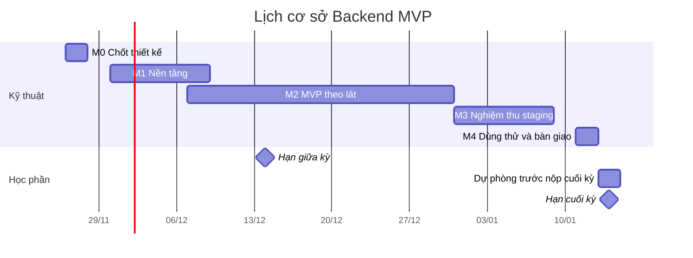

# Lộ trình milestone Backend Nhà hàng Ba Anh Em

**Giai đoạn 5 · Lịch cơ sở đề xuất để duyệt · 25/11/2026**

**Cập nhật phạm vi.** Chủ dự án đưa T29 vào M2 để dùng màn hình quản lý thực đơn hiện có trong MVP. Các mốc và ngày công dưới đây là baseline trước khi chuyển T29. Cần phân lại năng lực ở M2 và M5 trước khi chốt lịch.

Lộ trình giữ các mốc **M0–M5** của WBS và phân bổ 14 bước trong kế hoạch Backend Giai đoạn 4. Với năng lực giả định bên dưới, mục tiêu cơ sở là nghiệm thu nền tảng vào **08/12/2026**, hoàn tất MVP chạy xuyên hệ thống vào **30/12/2026**, nghiệm thu staging vào **08/01/2027** và dùng thử, bàn giao vào **12/01/2027**. Hai hạn học phần là **14/12/2026** và **14/01/2027**. Mốc công khai phụ thuộc quyền phát hành và lịch dùng thử đã duyệt. [WBS và milestone hiện có](../../IMPLEMENTATION_PLAN.md#4-giai-đoạn-milestone-và-thứ-tự-phụ-thuộc) · [Kế hoạch Giai đoạn 4](2026-11-25-backend-implementation.md) · [Mốc đồ án trong BRS](../../BRS-Nha-hang-Ba-Anh-Em.md#12-điều-kiện-đồ-án-và-chuẩn-đầu-ra)

## 1. Giả định ước lượng

- **Lịch làm việc.** Ngày bắt đầu minh họa là 26/11/2026, với điều kiện đã được phép thực hiện. Tính thứ Hai đến thứ Sáu, giả định nhóm không làm ngày 01/01/2027 và có mặt các ngày làm việc còn lại. Các ngày trong nội dung tính cả ngày đầu và cuối. Thời gian chờ ngoài nhóm được ghi theo điều kiện từng mốc.
- **Năng lực cơ sở.** Ba người, mỗi người có 5 giờ tập trung/ngày. Một ngày công trong tài liệu tương ứng 5 giờ. Các vai trò dự kiến gồm người phụ trách lõi Backend/DB, người phụ trách Backend/tích hợp ngoài, và người phụ trách kết nối Frontend/QA có thể hỗ trợ API và staging. Nhà hàng hoặc chủ dự án duyệt chính sách, cung cấp dữ liệu và xác nhận lịch dùng thử.
- **Phạm vi công sức.** 84 ngày công, tương đương 420 giờ từ M0 đến M4. Khoảng ước lượng cộng theo từng mốc là 69–102 ngày công. Ước lượng bao gồm review kỹ thuật, kiểm thử và bằng chứng vận hành ở từng lát. Phần trình bày học phần và phần nâng cao M5 được lập riêng.
- **Phân bổ theo vai trò.** Lõi/DB khoảng 30,5 ngày công, Backend/tích hợp ngoài 29 ngày công và Frontend/QA 24,5 ngày công. Lịch có 33 ngày làm việc đến 12/01 và 35 ngày đến hạn 14/01. Tổng năng lực đến 12/01 là 99 ngày công theo giả định. Phần dư phân bố theo vai trò và thời điểm. Lõi/DB chỉ còn khoảng 2,5 ngày công đến mốc 12/01, cần ưu tiên review chéo các thay đổi đặt chỗ và cọc.
- **Căn cứ ước lượng.** M0 chủ yếu là duyệt và chuẩn hóa đầu vào từ Giai đoạn 1–4. M1 tận dụng repo đã có NestJS, CI và Compose, cần hoàn thiện PostgreSQL 17, phiên, contract và harness. M2 là phần lớn công sức vì có nhiều giao dịch liên miền và phải nối từng màn hình. M3–M4 dùng lại ca nghiệm thu của M2, cộng thêm đo tải, khôi phục, tích hợp thật và dùng thử.
- **Phương thức theo dõi.** P0 là việc chặn MVP hoặc phát hành, P1 là việc vẫn bắt buộc cho nghiệm thu MVP, P2 chỉ thực hiện khi phạm vi riêng được duyệt. Ngày công là khối lượng cộng theo người. Ngày làm việc là thời gian lịch đã xét chồng lấn. Khoảng ước lượng là dải lập kế hoạch, và lịch cơ sở cần cập nhật khi có năng lực thực tế hoặc thời gian chờ mới.

## 2. Lịch cơ sở

Các thanh dùng ngày lịch để thể hiện phần chồng lấn. Số ngày làm việc loại trừ cuối tuần và ngày nghỉ giả định đã nêu. [Cú pháp biểu đồ Gantt Mermaid](https://mermaid.js.org/syntax/gantt.html)

**Giữa kỳ.** M0 và M1 là mục tiêu kỹ thuật. Sau mốc 08/12 có ba ngày làm việc trước ngày nộp, từ 09–11/12, để hoàn thiện bằng chứng và hồ sơ. Trong lịch cơ sở, đội kỹ thuật vẫn làm M2 ở những ngày này. Người phụ trách báo cáo cần phân công trước để tránh dùng trùng giờ lõi Backend.

**Cuối kỳ.** M4 có mục tiêu hoàn tất 12/01, còn 13–14/01 dành cho phát sinh, đóng bằng chứng hoặc nộp. M5 có lịch riêng sau khi duyệt. Điều kiện dùng thử công khai và minh chứng của nhà hàng là một phần của AC-19.

## 3. Milestone và điều kiện nghiệm thu

### M0 · Duyệt phạm vi, hợp đồng và quy tắc để bắt đầu

**Ưu tiên và thứ tự** — T01 → phần còn lại của T03/T04 đều P0. T02 và Frontend hiện có là đầu vào để chốt màn hình, luồng và dữ liệu. Đối chiếu điều kiện từng operation trong OpenAPI, luồng trạng thái, sổ Q, dữ liệu thử và người có quyền duyệt.

**Độ phức tạp và ước lượng** — Trung bình. Cơ sở **5 ngày công**, khoảng 4–7. Lịch **26–27/11**, 2 ngày làm việc. Giả định đã có bản kiến trúc, ERD, OpenAPI, bảng ánh xạ và kế hoạch từ các giai đoạn trước, với người duyệt có thể phản hồi đúng nhánh cần chốt.

**Điều kiện bắt đầu và hoàn thành** — Bắt đầu khi nhóm xác nhận dùng bộ tài liệu Giai đoạn 1–4 và có đầu mối nhà hàng. Hoàn thành khi baseline kỹ thuật và phần quyết định cần cho nền được duyệt. Q còn mở có chủ sở hữu, hạn chốt và task bị ảnh hưởng.

**Checklist nghiệm thu**

- [ ] BRS, OpenAPI dự thảo, DDL và bảng ánh xạ được gắn phiên bản, xác định nhánh triển khai và đầu vào còn thiếu.
- [ ] Các quyết định về tài nguyên, quyền, cọc, mô hình AI và dữ liệu được giao người chốt. Quy tắc ảnh hưởng Frontend có mốc duyệt trước khi chỉnh.
- [ ] Fixture thử có kết quả dự kiến và ký hiệu dữ liệu mẫu. Nhóm có thể bắt đầu phần môi trường đủ đầu vào.

**Rủi ro và xử lý** — Khả năng chốt nghiệp vụ bị kéo dài nếu hỏi cả BRS cùng lúc. Tách nhóm Q theo lát, ghi người chốt và duy trì phần nền độc lập trong lúc chờ.

### M1 · Môi trường, PostgreSQL, contract và xác thực

**Ưu tiên và thứ tự** — T05 P0 kiểm nền repo → T06 P0 migration và T08 P1 công cụ contract/smoke có thể bắt đầu song song → T07 P0 xác thực và quyền sau khi DB và hợp đồng liên quan sẵn sàng. T08 bổ sung kiểm tích hợp phiên khi T07 sẵn sàng.

**Độ phức tạp và ước lượng** — Cao. Cơ sở **15 ngày công**, khoảng 12–18. Lịch **30/11–08/12**, 7 ngày làm việc. Giả định API skeleton, npm workspaces, Jest, Compose và GitHub Actions hiện có có thể tái sử dụng. Cần môi trường PostgreSQL 17 và cấu hình IdP thử. Trong 07–08/12, M1 dùng 1 / 1 / 0,5 ngày công theo ba vai trò, phần còn lại của hai ngày dùng cho lát thực đơn M2.

**Điều kiện bắt đầu và hoàn thành** — Bắt đầu khi M0 đã duyệt phần nền, quyền repo/hạ tầng thử và phạm vi IdP. Hoàn thành khi nhóm tái tạo được môi trường từ checkout sạch, có migration được thử trên PG17, kiểm phiên/quyền và có công cụ sinh hợp đồng chạy được.

**Checklist nghiệm thu**

- [ ] CI cài từ lockfile, lint, format, typecheck, unit và build. Web, API và DB chạy theo hướng dẫn. Nguồn baseline Prototype local được ghi riêng.
- [ ] Migration từ DB trống và nâng bản được thử trên PostgreSQL 17. Có xác nhận `btree_gist` và quyền migration/runtime.
- [ ] Có OpenAPI/type theo lát, kiểm drift và smoke web qua proxy. Phiên khách, phiên nhân sự và từ chối quyền/CSRF có bằng chứng.
- [ ] Có gói minh chứng kỹ thuật để chốt hồ sơ giữa kỳ.

**Rủi ro và xử lý** — PG17 hoặc IdP thử chưa sẵn sàng. Kiểm quyền và kết nối từ đầu, dùng fixture/adapter cho phần kiểm độc lập và đánh dấu chính xác ca còn chờ dịch vụ thật.

### M2 · MVP chạy từ đầu đến cuối

**Ưu tiên và thứ tự** — T09 P1 có đường đọc công khai độc lập sớm. T29 P1 nối quản lý thực đơn khi T07 và T09 sẵn sàng. T10 → T11 → T12 P0 là lõi đặt bàn. Sau đó T13–T15 P0 món và vận hành. T17 P0 cấp cọc có thể chạy sau lõi đặt bàn, còn T18 P0 đối chiếu cần cả nguồn cọc lẫn nghiệp vụ vận hành. T16/T19 P1 lần lượt đọc dữ liệu bếp và báo cáo. T20 → T21 P0 nối Groq và đặt qua chat. T22 P0 là kiểm tổng luồng, gồm AC-20a.

**Độ phức tạp và ước lượng** — Rất cao. Cơ sở **45 ngày công**, khoảng 38–53. Lịch **07–30/12**, 18 ngày làm việc, chồng hai ngày với M1. Ước lượng gồm kiểm thử tranh bàn, gửi lại, cọc trễ, quyền theo lượt và ghép màn hình. Ba vai trò dùng khoảng 17 / 16 / 12 ngày công trong cửa sổ này.

**Nhịp thực hiện đã cân phần giao nhau**

- **07–08/12** — Mở T09 khi migration nền, công cụ hợp đồng/smoke của T08 và dữ liệu menu Q-09 đã sẵn sàng. Phân bổ M2 khoảng 1 / 1 / 1,5 ngày công. Hoàn tất phần còn lại của M1 theo phần năng lực đã giữ.
- **09–15/12** — T10–T12 đưa một lượt từ giao diện có sẵn qua DB và phục hồi kết quả. T20 chuẩn bị tư vấn dựa trên menu song song. Khoảng 5 / 5 / 3 ngày công.
- **16–23/12** — T13, T14 và T15 theo thứ tự món, phân bàn, vận hành. T17 triển khai theo nhánh riêng sau lõi, dự kiến sẵn dữ liệu cọc cho T15 nếu lệnh xác nhận cần. Khoảng 6 / 5 / 4 ngày công.
- **24–28/12** — T16 sau khi có đơn và sự kiện vận hành, T18 sau T15/T17, T21 dùng Booking và chat tư vấn đã có. Cài fixture báo cáo, ghi ca T22 theo lát trước khi chạy tổng. Khoảng 3 / 3 / 2 ngày công.
- **29–30/12** — Hoàn tất T19 với số liệu cọc và kỳ đã duyệt, chạy tổng T22 sau khi đủ nhánh. Cửa sổ này là lượt kiểm tổng cuối, các ca unit/API/E2E từng lát đã được viết và chạy trước. Khoảng 2 / 2 / 1,5 ngày công.

**Điều kiện bắt đầu và hoàn thành** — Lát menu có thể bắt đầu khi đạt đầu vào hẹp của T09. Lệnh ghi đặt chỉ bắt đầu khi phiên, DB, hợp đồng cùng Q-01–03/Q-07/Q-15 đủ điều kiện. Từng lát khác đi theo Q trong kế hoạch Giai đoạn 4. Hoàn thành khi cùng một lượt xuất hiện đúng ở web, chat và vận hành, các trạng thái bàn, món, cọc, báo cáo đối chiếu được và bộ kiểm tổng đạt.

**Checklist nghiệm thu**

- [ ] Có bằng chứng AC-01–AC-16 và AC-18 cho MVP. Đặt bàn, món, cọc, phân bàn, bếp, báo cáo và AI sử dụng đường tích hợp tương ứng.
- [ ] Hai yêu cầu tranh chỗ cuối, thay bố trí thất bại, tiền đến muộn, thao tác lặp và mất phản hồi có test. Trạng thái chỉ thay đổi theo quyền và chính sách đã duyệt.
- [ ] Các lát đã nối vào màn hình/route hiện có. Các khác biệt UI được ghi riêng và chỉ xuất hiện sau phê duyệt.
- [ ] Có tập dữ liệu và dấu vết kỹ thuật đủ để T23–T26 kiểm lại.

**Rủi ro và xử lý** — Lõi/DB dùng trọn năng lực suốt các đợt 09–30/12 nên việc phát sinh ở lệnh ghi có thể đẩy cả release. Làm sớm test tranh bàn/idempotency, dùng người thứ hai review transaction, xác minh nguồn cọc từ M0 và chuyển từng lát vào UI ngay khi có API. Nếu Q-04 hoặc Q-11 chưa chốt thì triển khai phần có thể thử độc lập và giữ trạng thái chờ cho luồng tương ứng.

### M3 · Release candidate được nghiệm thu trên staging

**Ưu tiên và thứ tự** — T23 rà quyền/dữ liệu → T24 đo tải và phục hồi → T25 dựng staging/pipeline → T26 nghiệm thu. Tất cả P0. Có thể chuẩn bị DNS, tài khoản, cấu hình và hồ sơ vận hành sớm. Kết luận release candidate cần kết quả T22 và các gate T23–T26.

**Độ phức tạp và ước lượng** — Cao. Cơ sở **14 ngày công**, khoảng 11–17. Lịch **31/12–08/01**, 6 ngày làm việc với ngày nghỉ giả định 01/01. Giả định staging và tài khoản tích hợp đã được chuẩn bị trước khi chạy checklist, có một vòng đo lại khi phát hiện vấn đề.

**Điều kiện bắt đầu và hoàn thành** — Bắt đầu khi M2 đạt các ca đòi hỏi toàn luồng, Q-14 chốt tải, quyền, dữ liệu thử và mục tiêu phục hồi. Hoàn thành khi một digest trên staging có bằng chứng chất lượng, bảo mật, sao lưu/khôi phục và khả năng tích hợp thật trong phạm vi cho phép.

**Checklist nghiệm thu**

- [ ] Đạt các ca AC-01–AC-18 theo phạm vi áp dụng. AC-17 có số đo và bằng chứng lỗi/khôi phục theo ngưỡng được duyệt.
- [ ] Staging dùng HTTPS, PostgreSQL 17, script migration và readiness chạy được. Kiểm Groq và nguồn đối chiếu VietQR theo dữ liệu/cấu hình đã cấp quyền.
- [ ] Có diễn tập rollback ứng dụng, restore cô lập và quy trình đối chiếu tiền sau restore. AC-19 được diễn tập với runbook và dữ liệu mẫu được duyệt.

**Rủi ro và xử lý** — Không có tài khoản thử thật, DNS/TLS hoặc extension đích. Xác minh các phụ thuộc ngoài từ M0, chuẩn bị staging trước cửa sổ T26 và chuyển mốc nếu thiếu bằng chứng bắt buộc.

### M4 · Phát hành MVP, dùng thử và bàn giao

**Ưu tiên và thứ tự** — T27 P0 phát hành theo digest đã duyệt và dùng thử tại đơn vị → T28 P0 ổn định, bàn giao, ghi kết quả và tồn đọng.

**Độ phức tạp và ước lượng** — Cao do phối hợp bên ngoài. Cơ sở **5 ngày công**, khoảng 4–7. Lịch **11–12/01**, 2 ngày làm việc và giả định nhà hàng xác nhận một phiên dùng thử trong khoảng đó. Dự phòng **13–14/01** cho phát sinh trước hạn nộp. Lịch dùng thử dài hơn hoặc lỗi nghiêm trọng sẽ đổi ngày đóng mốc.

**Điều kiện bắt đầu và hoàn thành** — Bắt đầu sau M3, khi có quyền phát hành, lịch và dữ liệu dùng thử, tài khoản quản trị, backup, đầu mối nhà hàng và runbook. Hoàn thành sau khi phiên dùng thử thực sự diễn ra, kết quả được xác nhận và quy trình bàn giao được thực hiện.

**Checklist nghiệm thu**

- [ ] URL công khai hoạt động và artifact khớp digest staging đã duyệt. Smoke xác nhận các điểm vào của khách và nhân sự.
- [ ] AC-19 có bằng chứng dùng thử cho MVP và chatbot. Kịch bản ghi rõ dữ liệu thật hay thử đã được duyệt và giới hạn minh chứng.
- [ ] Nhà hàng nhận hướng dẫn, phạm vi quyền, cách đối chiếu/trợ giúp và cách báo sự cố. Nhóm lưu biên bản bàn giao và công việc còn lại.

**Rủi ro và xử lý** — Đổi lịch nhà hàng hoặc trục trặc ngay sau phát hành. Chốt phiên dùng thử và đầu mối từ M0, giữ sẵn phương án quay về artifact đã duyệt, dùng ngày dự phòng cho sự cố hoặc hoàn thiện hồ sơ. Nếu chưa có phiên dùng thử, AC-19 vẫn chờ xác nhận.

### M5 · Tùy chọn và mức Tốt nếu được duyệt

**Ưu tiên và thứ tự** — P2. T30–T31 dành cho tra cứu và đổi/hủy nếu được duyệt. T32 đặt tiệc, T33 đánh giá và T34 Tool Calling là ba phần của mức Tốt. T34 cần quyền và contract nghiệp vụ ổn định. T35 kiểm hồi quy MVP và nghiệm thu các phần được chọn.

**Độ phức tạp và ước lượng** — Mức Tốt có dự trù cơ sở **12–18 ngày công trong 7–12 ngày làm việc**, gồm nghiệm thu tương ứng của T35. Cập nhật ước lượng cho T30–T31 khi duyệt phạm vi. Khi chọn cả hai nhóm, cân lại người, dữ liệu và phần hồi quy dùng chung.

**Điều kiện bắt đầu và hoàn thành** — Bắt đầu sau M4 và sau khi phạm vi được duyệt cùng các Q tương ứng, đặc biệt Q-12/Q-13 và quyền của T34. Hoàn thành khi các phần được chọn có bằng chứng, người duyệt xác nhận và hồi quy MVP đạt.

**Checklist nghiệm thu**

- [ ] Phần tùy chọn có AC-20 tương ứng. Nếu mục tiêu là mức Tốt, đủ AC-21a, AC-21b và AC-21c.
- [ ] Các thay đổi đối với màn hình hiện có đã được duyệt. Nghiệp vụ mới tuân cùng cơ chế quyền và kiểm dữ liệu của MVP.
- [ ] Có hồi quy, biên bản T35 và lịch phát hành riêng cho phạm vi đã chọn.

**Rủi ro và xử lý** — M5 lấn phần dự phòng MVP hoặc việc riêng được tính như toàn bộ mức Tốt. Chốt phạm vi, người thực hiện và kỳ vọng nghiệm thu riêng. Nếu mức Tốt trở thành mục tiêu cuối kỳ, tính lại năng lực và lịch chính thức trước khi cam kết.

## 4. Phụ thuộc quyết định và cách giảm làm lại

- **Chuỗi theo dõi sát** — Chốt Q lịch/bàn, danh tính và gửi lại → PostgreSQL/phiên/contract → T10–T12 đặt bàn → T13–T15 điều phối → T18 đối chiếu → T19/T22 → T23–T26 → T27/T28. T17 có thể chạy sớm, nhưng trở thành phụ thuộc của lệnh xác nhận nếu cần dữ liệu cọc. Nhánh T20/T21 cũng có thể trở thành điểm đến muộn nhất của T22 nếu Groq hoặc phạm vi chatbot chậm.
- **Các xác nhận đề xuất theo nhánh** — Chốt dữ liệu menu Q-09 và đường IdP/phiên Q-07/Q-08 trước 04/12. Chốt Q-01–03 và Q-15 phần đặt bàn trước 08/12. Xác nhận dữ liệu được gửi Groq Q-07/Q-11 trước lúc bắt đầu T20. Chốt giá và mốc bếp Q-05 cùng phần cấp QR Q-04 trước 15/12. Chốt Q-06/Q-08, nguồn và thời điểm xác minh Q-04, handoff chat Q-11/Q-15 trước khi đưa T15/T18/T21 vào kiểm liên miền. Chốt công thức Q-10 và điều kiện staging/dùng thử Q-14 trước 23/12 để có thời gian chuẩn bị fixture, quyền và runbook.
- **Nối Frontend theo lát** — Thực đơn trước cho luồng đọc, đặt bàn kế tiếp để xác nhận phiên, quyền, lỗi và cam kết có dữ liệu thật. Sau đó nối món, phân bàn, cọc, bếp và báo cáo theo đầu ra đã kiểm. Chat dùng lại kết quả đặt bàn đã kiểm. Bộ kiểm contract chạy khi thêm operation, và thay đổi nghiệp vụ ảnh hưởng màn hình được duyệt trước khi chỉnh UI.
- **Cập nhật lịch khi có sai lệch** — Nếu cùng phương án chậm thêm 2 ngày làm việc trên chuỗi chi phối, mục tiêu chuyển từ 12/01 sang 14/01. Chậm 3 ngày chuyển sang 15/01 và vượt hạn. Khi tới điểm này phải đánh giá lại nguồn lực, lịch nhà hàng và mốc nộp có thể chứng minh. Scope bắt buộc gồm chatbot và cọc, nên sự cố ở một trong hai là điều kiện cần báo cáo của release.
- **Kiểm giả định nguồn lực** — Nếu ba người chỉ có 4 giờ/ngày, 420 giờ tương đương ít nhất 35 ngày làm việc về tổng năng lực. Với cùng phân vai, riêng lõi/DB cần ít nhất 39 ngày. Nếu hai người làm 5 giờ/ngày, tổng khối lượng cần ít nhất 42 ngày làm việc. Các con số là cận dưới theo giờ, chưa cộng ràng buộc chờ và tích hợp. Khi năng lực thấp hơn cơ sở, cần phân lại phần DB/quyền cho người phù hợp, tăng năng lực hoặc chốt lại lịch.
- **Cập nhật Jira/MS Project khi được yêu cầu** — Dùng mã T hiện có, mốc M0–M5, vai trò được phân công, khối lượng giờ, thời lượng lịch, quan hệ kết thúc–bắt đầu hoặc phần song song, Q bị chặn, ngày cơ sở, ngày dự báo và liên kết bằng chứng. Ghi điểm thay đổi theo ngày để còn đối chiếu kế hoạch và thực tế.

## 5. Checklist nghiệm thu Giai đoạn 5

- [x] Giữ đủ M0–M5 và truy vết sang WBS, 14 bước triển khai và các AC áp dụng.
- [x] Từng milestone có công việc theo thứ tự, ưu tiên, độ phức tạp, ước lượng, giả định, điều kiện bắt đầu/hoàn thành, tiêu chí nghiệm thu và rủi ro.
- [x] Đối chiếu số ngày, giờ, năng lực ba vai trò, phần chồng lấn tháng 12 và hai hạn học phần. Phân biệt lịch cơ sở với các tình huống đổi năng lực hoặc chậm quyết định.
- [x] Ưu tiên tích hợp lên Frontend hiện có qua từng lát và xác định nhánh cần chốt sớm để tránh thay đổi lặp.
- [ ] Chủ dự án xác nhận nguồn lực, thời điểm bắt đầu, phạm vi M5 nếu chọn và cho phép chuyển sang Giai đoạn 6.
